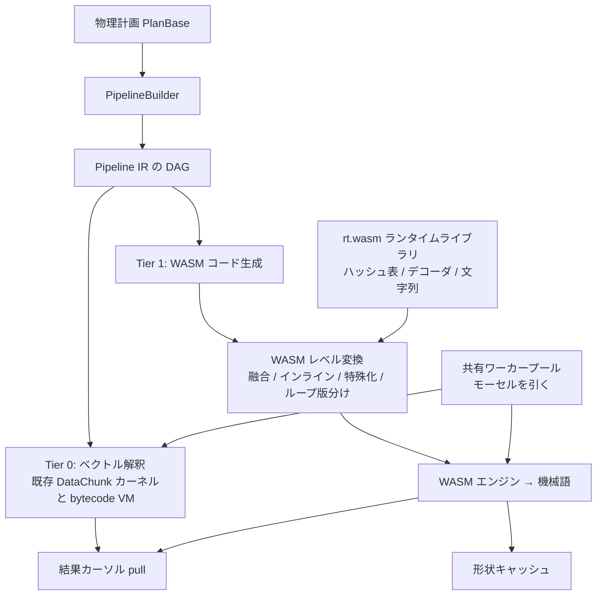
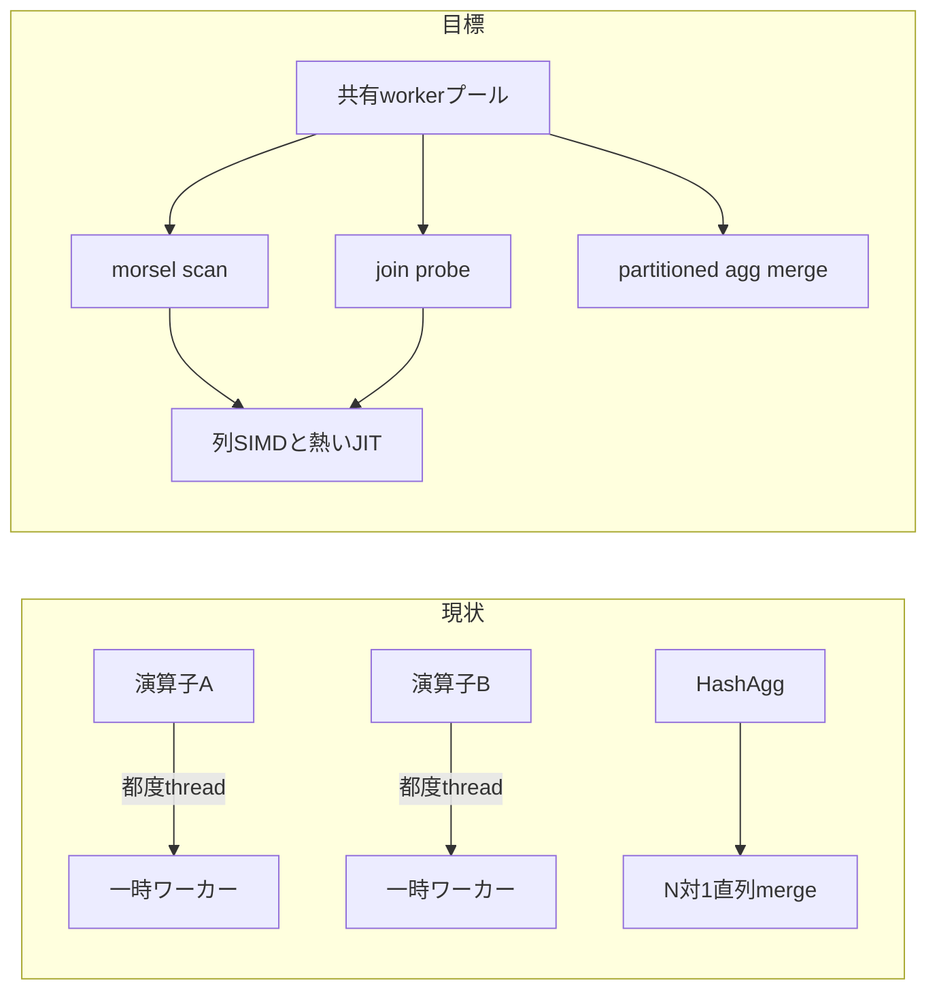

# Executor 全面刷新 — 融合ループを WASM 上で生成する並列実行系

2026-11-13。Executor を「pull 型のバッチ実行（`NextBatch(DataChunk*)` の木）」から、
**パイプライン単位の融合ループを WASM として生成し、モーセル駆動で並列実行する方式**へ
全面的に書き換える。本ファイルがその手順の正本である。

2026-11-12 版（pull 型 `NextBatch` を維持する構造改革）は方針を置き換えた。
測定事実と進捗ログは今後も物差しとして使うため、[付録 A](#付録-a--2026-11-12-版構造改革の診断と進捗) に
そのまま残した。旧フェーズ P0–P6 の行き先は [§6](#6-旧フェーズ-p0p6-の行き先) に書いた。

用語: 本書の「pull 型」は次の 2 点を指す。パイプラインの内側は 1 本の融合ループで、
演算子間の呼び出しは無い。

- ワーカーが共有キューから **モーセルを引く**（morsel-driven）。
- 最上位は今までどおり **結果カーソルを引く**（`SqlEngine` / postgres サーバの契約は不変）。

---

## 実装進捗（2026-11-13、ClickBench 1/10 着手）

- S0の最初の測定を `benchmark/wasm_spike/` に追加。Wasmtime 50.0.1、
  shared memory64、4 GiB超の同一入力、3カーネル、1/2/8 workers、SIMD128対AVX2。
  probe＋集約の8 workersはnative 6.979 ms / WASM 9.985 msで、1.3倍以内のゲートは未達。
  [ADR 0002](docs/adr/0002-wasm-fused-execution.md) に結果・制限・残る検証を書く。
  S0全体、S1〜S10は未完了。生成物は共通C++からのコンパイルで、手書きWATの評価は残る。
- 公式hits_0〜9の実1000万行を新規ロードし、同じ入力のDuckDB・ClickHouseを用意。
  変更前DuckDB比較は43/43一致、tinylamb 10598.984 ms / DuckDB 1546.860 ms、7/43勝利。
  この値はwarmup 1＋3回の診断値で、測定中に別CPU群でビルド・小規模テストを実行している。
- WASMと独立な仕事量削減: TopNが必要なキー・フィルタ列だけをキャッシュし、
  上位候補だけsnapshotを通して復元する。通常scanへのfallbackでは全出力列を検証する。
  全面刷新やDuckDB/ClickHouseへの性能勝利を達成したという意味ではない。
- 最終1000万行・8スレッド・warmup 1＋7回: 両比較で43/43一致。
  Tinylamb 5664.964 / DuckDB 1521.916 ms（5/43勝）、
  Tinylamb 5802.035 / ClickHouse 1042.593 ms（9/43勝）。目標未達。
  `build/benchmarks/clickbench-tenth-20261113/report-final/` に図と全クエリ結果を保存。
  全体ctest 3983件で失敗0・既存skip 3、ASan/UBSan Executor 231件、
  SQL oracle 1024シード、ハーネス18件、layering成功。
- 続く並列プロファイルで、Q33の部分集約後の直列再ハッシュが約1325 msを
  占めると判明。数値キーを先に分配し、担当ごとの集約＋TopNへ変更した。
  複合辞書キーの直列再ハッシュも除去し、辞書述語の準備を並列化した。
  狭い列キャッシュによる整数等値の不在判定を通常scanにも接続した。
  全43クエリ合計は1スレッド11320.884→7618.326 ms、
  8スレッド5585.338→2796.160 ms。変更前は3回、変更後は7回の中央値。
  Q33は8スレッド2132.517→120.769 ms（17.66倍）、Q32は9.71倍。
  変更後の全1/2/4/8スレッドで43/43一致。8スレッドの比較先は
  DuckDB 1521.614 ms（7/43勝）、別実行ではTinylamb 2790.978 /
  ClickHouse 1045.136 ms（11/43勝）。圧勝・全クエリ勝利は未達。
  `build/benchmarks/clickbench-parallel-20261113/report/` にスケーリング・
  全43件の変更前後・perfの根拠、`report-comparison/` に比較先との図を保存。
  Q29の一般的な文字列グループ化は約1.1秒のまま。WASM未統合、S0〜S10の
  完了を意味しない。今回のctestは3987件で失敗0・既存skip 3、
  ASan/UBSanはExecutor 232件＋関連回帰20件、TSanは対象5件、
  SQL oracleは1024シード成功。Python 18件とlayeringも成功。
  コマンド・時間・ログは同ディレクトリの `validation-summary.json` に記録。

- LLVM生成IRへホストCPU対応O3を追加し、IR・機械語の保存と最適化無効時のA/Bを整備。
  個別カーネルはAOTとほぼ同速。filter→projection→sumの別ループは未融合で、
  1000万要素の診断はsplit JIT/native 6.790 ms / fused AOT 0.763 ms。
  この8.90倍は診断用AOTループの差であり、融合SQL JITの実装成果ではない。
- 辞書変換と部分集約の融合、DISTINCTの並列マージ、担当別TopN、派生キーの
  並列評価、統計カウンタのfalse sharing解消を実施。8物理コア・warmup 1＋7回で
  全43件一致、Tinylamb 915.571 / ClickHouse 1043.667 ms（合計1.140倍、16/43勝）。
  直前の完成実装2790.978 msから約3.05倍。全クエリ勝利・圧勝は未達。
  初回の列ストア・辞書頻度・一意性メタデータ構築は測定外、SQL結果キャッシュなし。
  根拠は[計測記録](docs/jit_profile.md)、生データは
  `build/benchmarks/clickbench-jit-20261113/candidate7-clickhouse-8t/`。
  S0〜S10の全面刷新完了を意味しない。

- 追加最適化: 選択的COUNTを担当分配へ切り替え、不要な配列初期化を除去。
  整数辞書にも厳密な頻度・初出位置を保持し、COUNT DISTINCTへ再利用した。
  8コア主測定はTinylamb 742.468 / ClickHouse 1038.330 ms、
  反転再測定は740.689 / 1034.845 ms。ともに約1.40倍で全43件一致。
  個別21/43勝（反転22/43勝）、主測定の速度比幾何平均は1.454倍。
  同じバイナリのDuckDB比較は8コア735.071 / 1501.914 ms、
  1コア3272.270 / 8621.261 msで、いずれも全43件一致。
  生データは `build/benchmarks/clickbench-jit-20261113/candidate9-*/`、
  最終検証は同ディレクトリの `final-validation.json`。SQL全体の融合JIT/WASMは未実装。

  最終検証はctest 3,991件で失敗0・既存skip 3、SQL oracle 1,024反復成功。
  ASan/UBSan 266件、TSan 5件、Python 18件、layeringも成功（2026-11-14 JST）。

## 1. 現状（2026-11-13 にコードを読んだ結果）

| 領域 | 現状 | 刷新での扱い |
|---|---|---|
| 演算子木 | `ExecutorBase::NextBatch(DataChunk*, 1024)` を実装するクラスが 66 個（[`executor/`](executor/)）。`PlanBase::EmitExecutor` の本体は [`executor/relational_factory.cpp`](executor/relational_factory.cpp) | Tier 0（ベクトル解釈）の演算子本体として残し、駆動だけパイプラインスケジューラへ移す |
| 文駆動の経路 | `RelationalExecutor`（[`executor/relational.cpp`](executor/relational.cpp) 7.7k 行、[`detail/build_input.cpp`](executor/detail/build_input.cpp) 7.3k 行、[`detail/typed_stream_aggregate.cpp`](executor/detail/typed_stream_aggregate.cpp) 10.7k 行、[`detail/fused_grouped_join.cpp`](executor/detail/fused_grouped_join.cpp) 7.0k 行）。集約つき文は既定でこちら（`TINYLAMB_GROUPED_ROUTE`）。`ProgramShape` が `mul_one_minus_col0` / `profit_col0..3` のような**手で認識した式の形**ごとに融合ループを持つ | 手書きの融合形はコード生成で置き換え、最後に削除する（S10） |
| 式 | AST が正本、bytecode がバッチ IR。LLVM ORC JIT には Filter / Projection / Sum / MaskedSum / FilterProjectSum / FilterHashProbe / ProjectionChecked / SumChecked の 8 compile entry point がある（[`expression/jit.hpp`](expression/jit.hpp)）。コンパイル約 2.36 ms、昇格は累積 2,000 万行（[`docs/jit_profile.md`](docs/jit_profile.md)） | bytecode → WASM の変換に置き換える。「JIT は bytecode の compiler」という契約は維持 |
| 並列 | 演算子ごとに `RunParallelTasks`（[`common/parallel_work.hpp`](common/parallel_work.hpp)）と行数閾値（[`plan/parallel_thresholds.hpp`](plan/parallel_thresholds.hpp)）。semi / anti / outer / residual つき join は逐次 | クエリ単位の共有プールとパイプライン DAG に置き換える |
| WASM | [`table/fragment/fragment.hpp`](table/fragment/fragment.hpp) に `Runtime { kNative, kWasm }` と `Capabilities` があり、`PaxChunk` は「WASM から無コピーで辿れる」形式として設計済み。ただし**このリポジトリには `.wasm` / `.wat` も CMake の WASM ビルド規則も WASM 実行エンジンも無い**。`Calibrate()` は両方 1.0 の仮値 | エンジンの組み込みとランタイムライブラリのビルドを S0 / S3 で新設。Fragment IR は S8 でパイプラインのスキャン前段として統合 |
| WASM 実行環境 | スパイクで Wasmtime 50.0.1 を使用済み（[`benchmark/wasm_spike/requirements.txt`](benchmark/wasm_spike/requirements.txt) に固定）。ただし、本番 Executor へのランタイム統合や CMake の WASM ビルドルールは未実装 | S0 / S3 で本番用ランタイムを組み込む |

温かい 2 周目の TPC-DS SF=1・8 スレッド合計は 3110–3134 ms、DuckDB は 964 ms（付録 A §1.1）。

### 1.1 この刷新で縮む差と縮まない差

コード生成が削るのは、行オブジェクトの構築、演算子境界でのバッチ受け渡し、
式の解釈、型ごとの分岐である。**仕事量そのものの差は縮まない。**
Q67 の ROLLUP 再スキャン（入力 4.65 倍）、Q72 の結合順序、Q78 の anti 変換、Q23 の CTE 再利用は
計画側・アルゴリズム側の課題で、本刷新と独立に進める（§6）。

---

## 2. 目標アーキテクチャ

**物理計画をパイプラインの DAG に分解し、各パイプラインを「ソース → 演算子列 → シンク」の
1 関数に融合した WASM を生成する。融合・インライン化・特殊化は自前の WASM レベルの
変換で済ませ、実行エンジンには素直なコードを渡す。ワーカーは共有プールからモーセルを
引いてその関数を呼ぶ。生成できない形と短命クエリは、同じパイプライン IR をベクトル単位で
解釈する Tier 0 が受ける。**



### 2.1 例: 1 つのクエリがどう変わるか

```sql
SELECT i_brand_id, SUM(ss_ext_sales_price) AS s
FROM store_sales
JOIN date_dim ON ss_sold_date_sk = d_date_sk
JOIN item     ON ss_item_sk = i_item_sk
WHERE d_year = 2000 AND i_manager_id = 28
GROUP BY i_brand_id
ORDER BY s DESC LIMIT 100;
```

**今**: `Limit ← Sort ← HashAgg ← HashJoin ← HashJoin ← Scan` の各段が 1024 行の
`DataChunk` を受け渡す（または `RelationalExecutor` が手書きの融合形に当てはまるか試す）。

**刷新後**: パイプライン 5 本の DAG になる。`EXPLAIN (PIPELINE)` の出力イメージ:

```text
P1 dop=1  PaxScan(date_dim [d_date_sk,d_year]) → filter d_year=2000 → HashBuild HT1(key=d_date_sk)
P2 dop=1  PaxScan(item [i_item_sk,i_brand_id,i_manager_id]) → filter i_manager_id=28
          → HashBuild HT2(key=i_item_sk, payload=[i_brand_id])
P3 dop=8  PaxScan(store_sales [ss_sold_date_sk,ss_item_sk,ss_ext_sales_price])
          → rf(HT1: zonemap+bloom) → probe HT1(exists) → probe HT2(payload)
          → GroupAgg(keys=[i_brand_id], sum) local-preagg → radix(64)      deps: P1,P2
P4 dop=8  GroupMerge(partition) → TopN(100, s DESC)                        deps: P3
P5 dop=1  TopNSource → Result                                              deps: P4
tier: P1,P2=0 (行数が少なく生成しない)  P3,P4=1 (wasm, cache hit)  P5=0
```

P3 から生成する関数（C 風の擬似コード。実体は WASM）:

```c
// ワーカーがモーセルごとに呼ぶ。戻り値は Status コード。行ごとのホスト呼び出しは無い
int p3_morsel(Ctx* c, Morsel* m) {
  LocalGroups* g = c->local[worker];                 // ワーカー別の前集約表
  for (RowGroup* rg = m->begin; rg != m->end; ++rg) {
    if (rg->zmax[DATE_SK] < c->rf1_min || rg->zmin[DATE_SK] > c->rf1_max) continue;
    // 列の符号化ごとにループを版分けする。下は FOR+bitpack / 非 NULL の版
    for (uint32_t i = 0; i < rg->rows; ++i) {
      int64_t d = rg->for_base[0] + unpack(rg->bits[0], i, rg->width[0]);   // デコードも融合
      if (!bloom_test(c->rf1_bloom, d)) continue;
      if (!ht1_contains(c->ht1, d)) continue;        // 開番地法の探索を展開済み
      int64_t it = rg->for_base[1] + unpack(rg->bits[1], i, rg->width[1]);
      const HT2Entry* e = ht2_find(c->ht2, it);      // 同上
      if (!e) continue;
      Group* grp = groups_find_or_insert(g, e->brand_id);
      grp->sum += load_f64(rg->col[2], i);           // 価格列は当たった行だけ読む
    }
  }
  return OK;
}
```

`ht1_contains` などは呼び出しではなく、`rt.wasm` の関数本体をキー型（INT64・非 NULL・単一キー）で
特殊化してループ内へ展開したものである（S4 の例を参照）。

---

## 3. 先に決めること

S0 のスパイクで実測して決め、[`docs/adr/`](docs/adr/) に `0002-wasm-fused-execution.md` として残す。

### D1. パイプライン内の生成方式

- 案 A: produce / consume（データ中心）。演算子は「1 行を受けて下流のコードを埋め込む」テンプレート。
- 案 B: pull のイテレータを書いて全段インライン化する。直線的な形は同じループになるが、
  1 対多の join（1 行から複数行が出る）で状態機械が要り、生成器が複雑になる。

**推奨は A。** 外側（モーセルの取得と結果カーソル）は pull のまま。

### D2. 線形メモリとデータの置き場（最重要）

生成コードは WASM の線形メモリしか読めない。`PaxChunk` のバイト列・ハッシュ表・前集約表を
コピーなしで読ませる方法を決める。

| 案 | 内容 | 懸念 |
|---|---|---|
| M1 | wasm64（memory64）の共有メモリ 1 枚を、ホストが予約した仮想アドレス範囲に割り当てる。LSTable のチャンクとクエリのアリーナをその範囲から確保する | 4 GiB 超を扱える。ガードページによる境界検査の省略が効かず、明示的な検査が入る |
| M2 | wasm32 の共有メモリ。チャンクをモーセル単位で線形メモリへ写す | コピーが入る。SF=1 でも 4 GiB の上限が近い |
| M3 | 自前で WASM → LLVM IR に変換し、線形メモリ = ホストのアドレス空間として検査なしで実行（生成コードは自作なので信頼する） | エンジンを自作する量が増える。コンパイルが遅い |

**推奨は M1 を第一候補、M3 を対抗として S0 で両方測る。** M2 は採らない。

### D3. WASM 実行エンジン

評価軸: (1) パイプライン 1 本のコンパイル時間、(2) 同じループを `clang -O2` でネイティブに
した場合との速度比、(3) memory64・共有メモリ・SIMD128・ホスト提供メモリへの対応、
(4) macOS arm64 / Linux x86-64 / Windows、(5) コンパイル結果の直列化（キャッシュ）、(6) 依存の大きさ。

| 候補 | 見込み | S0 で確かめること |
|---|---|---|
| Wasmtime（Cranelift、C API） | コンパイルが速い。組み込みが容易 | (2) の速度比、ホスト提供メモリでの M1、3 OS でのビルド |
| WAMR（インタプリタ / fast JIT / LLVM JIT） | 小さい。段階実行を内蔵 | fast JIT の速度、memory64 の成熟度 |
| 自前 WASM → LLVM ORC（既存の LLVM 依存を流用） | 最高速を狙える。M3 が使える | コンパイル時間（既存カーネルで 2.36 ms。パイプライン全体では桁が上がる） |

TPC-DS SF=1 の目標は 99 クエリで 1 秒前後（1 クエリ平均 10 ms）なので、
**コンパイルに 10 ms 単位を払う構成は Tier 1 の主経路にできない。** 遅いが速いコードを出す
エンジンは、採るとしても長時間クエリ用の上位段に限る。

### D4. SIMD の扱い

WASM の SIMD は 128 bit 幅で、AVX2 / AVX-512 は使えない。既存の
[`executor/simd_comparison.cpp`](executor/simd_comparison.cpp) と PAX のネイティブカーネルは
それより広い幅を使っている。次の規則で始め、S0 と S8 の測定で見直す。

- 行ごとの融合ループは WASM で生成する（SIMD128 または スカラー）。
- 行グループ単位の一括処理（ビット展開、辞書フィルタ、ビットマップ演算）で
  ネイティブカーネルが WASM 版より明確に速いものは、**行グループにつき 1 回のホスト呼び出し**
  として残す。行ごとのホスト呼び出しは禁止（§4）。

### D5. Tier 0 の位置づけ

同じ Pipeline IR をベクトル単位で解釈する経路を常に持つ。役割は 3 つ。
コンパイル待ちなしの即時実行（点検索・TPC-C 系・短命クエリ）、生成器が未対応の演算子の受け皿、
Tier 1 の differential oracle。演算子本体は既存の `DataChunk` カーネルと bytecode VM を使う。
**意味論の経路は増やさない**（式は bytecode、Tier 1 は bytecode の compiler）。

### D6. 融合しない箇所（ステージ分割）

融合が既定だが、次は測定で勝つときだけ小さなベクトル（256–1024 行）を挟む。

- L2 に収まらないハッシュ表の probe: キーをためて hash → prefetch → 探索。
- 128 bit SIMD が効く単純フィルタの前段: 選択ベクトルを作ってから後段を融合。
- Tier 0 へ逃がす式（S4）。

---

## 4. 不変条件

1. **意味論**: AST `Expression::Evaluate` が正本、bytecode が IR
   （[`docs/expression_evaluation.md`](docs/expression_evaluation.md)）。WASM 生成は bytecode からだけ行う。
   AND / OR の短絡、三値論理、WHERE 連言の「兄弟が FALSE / NULL ならエラーを抑止」、
   outer / semi / anti の ON は厳格、NaN のグループ同一視、collation を全て保つ。
2. **エラー**: 例外を使わない。生成関数は Status コードを返す。SQL のエラー（0 除算・桁あふれ・
   CAST 失敗）はループ内で検査して戻る。WASM の trap は生成器のバグとして内部エラーの
   `Status` に変換し、クエリだけを失敗させる。
3. **ホスト呼び出しの粒度**: 行ごとの経路からホスト関数を呼ばない。import には
   「モーセルごと / 行グループごと / 冷たい経路」の粒度を宣言し、生成器が行ループ内での
   使用を拒否する。
4. **結果の一致**: どの段階でも `TINYLAMB_EXEC_TIER=0` と `=1` と旧経路で回答が一致する。
   TPC-DS 99/99、`differential_test`、SQL oracle fuzzer を各フェーズの出口で回す。
5. **層**: [`ARCHITECTURE.md`](ARCHITECTURE.md) の DAG を守る。新規コードの置き場:

   | 置き場 | 内容 | 層 |
   |---|---|---|
   | `common/wasm/` | WASM バイナリ書き出し（`ModuleBuilder`）、エンジンの薄いラッパー | common |
   | `expression/wasm_lowering.*` | bytecode → WASM（`jit.cpp` の後継） | expression |
   | `executor/detail/pipeline/` | Pipeline IR、`PipelineBuilder`、EXPLAIN | relational |
   | `executor/codegen/` | 演算子テンプレート、インライナ、特殊化、ループ版分け | executor |
   | `executor/runtime/` | スケジューラ、モーセル、Tier 0 駆動、`rt/`（`rt.wasm` のソース） | executor |

6. **測っていない倍率を成果として書かない**（旧版から継続）。受け入れ条件は同一ハーネスで測る。
7. 切り替えは環境変数で常に戻せる。追加したら
   [`docs/environment_variables.md`](docs/environment_variables.md) に書く。

   | 変数 | 値 | 意味 |
   |---|---|---|
   | `TINYLAMB_EXEC_ENGINE` | `legacy` / `pipeline` | 旧 `EmitExecutor` 木か、パイプライン実行か |
   | `TINYLAMB_EXEC_TIER` | `0` / `1` / `auto` | ベクトル解釈固定 / WASM 固定 / 自動昇格 |
   | `TINYLAMB_WASM_DUMP` | ディレクトリ | 生成した `.wasm` と `.wat` を書き出す |

---

## 5. 手順

各フェーズは「旧経路を壊さずに新経路を足し、出口で回答一致と測定を取る」形にする。
S2 以降はいつでも `TINYLAMB_EXEC_ENGINE=legacy` で元に戻せる状態を保つ。

### S0 — スパイクと決定（本体コードに触れない）

目的: D2 / D3 / D4 を数字で決め、進むか止めるかを判断する。
置き場: `benchmark/wasm_spike/`（`EXCLUDE_FROM_ALL`）。

- [ ] 手書きの `.wat` 3 本を用意する。(a) INT64 列のフィルタ + SUM、(b) §2.1 の P3
      （bloom → probe 2 回 → 前集約）、(c) FOR + bitpack のデコードを融合した (a)
- [ ] 同じループを C++ で書き、`clang -O2`（ネイティブ）を基準にする
- [ ] 候補エンジンごとに、コンパイル時間・実行時間・8 スレッドでの伸びを測る
- [ ] M1（ホスト予約領域を memory64 の共有メモリにする）が候補エンジンで成立するか確かめる。
      `PaxChunk` 1 個を無コピーで読めること
- [ ] SIMD128 版と既存 AVX2 カーネルを行グループ単位で比べ、D4 の線引きを決める
- [ ] macOS arm64 と Linux x86-64 の両方でビルドと測定を取る（Windows はビルド確認まで）
- [ ] ADR `docs/adr/0002-wasm-fused-execution.md` に結果と決定を書く

(a) の `.wat`（memory64。フィルタは分岐にせず `select` で畳む）:

```wat
(func $filter_sum (param $col i64) (param $n i64) (param $lit i64) (result i64)
  (local $i i64) (local $acc i64) (local $v i64)
  (block $done
    (loop $next
      (br_if $done (i64.ge_u (local.get $i) (local.get $n)))
      (local.set $v
        (i64.load (i64.add (local.get $col) (i64.shl (local.get $i) (i64.const 3)))))
      (local.set $acc
        (i64.add (local.get $acc)
                 (select (local.get $v) (i64.const 0)
                         (i64.lt_s (local.get $v) (local.get $lit)))))
      (local.set $i (i64.add (local.get $i) (i64.const 1)))
      (br $next)))
  (local.get $acc))
```

**受け入れ（案。数値は ADR で確定する）**:
(b) の実行時間がネイティブ `clang -O2` の 1.3 倍以内、パイプライン 1 本のコンパイルが 2 ms 以内、
8 スレッドで 2 スレッド比 3 倍以上、の 3 つを満たすエンジンとメモリ方式の組が 1 つ以上ある。
**満たす組が無ければ、ここで止めて方針を見直す**（WASM を IR としてだけ使い機械語は LLVM で出す、
などの縮退案を ADR に書く）。

### S1 — 物差しと二重実行ハーネス

目的: 以後の全フェーズで「同じ答えか」「どこが速くなったか」を機械的に言えるようにする。
着手点: [`benchmark/comparison/tpcds.py`](benchmark/comparison/tpcds.py)、EXPLAIN ANALYZE、
[`executor/detail/explain_format.cpp`](executor/detail/explain_format.cpp)、fuzzer 群。

- [ ] `TINYLAMB_EXEC_ENGINE` / `TINYLAMB_EXEC_TIER` を読む入口を 1 か所に作る（S2 までは `legacy` のみ有効）
- [ ] TPC-DS / TPC-H ハーネスに「2 つの設定で実行して行集合を比べる」モードを足す
      （浮動小数は既存の許容差: 相対 1e-9・絶対 1e-7）
- [ ] `sql_oracle_fuzzer` / `griffin_fuzzer` に、`TINYLAMB_DISABLE_BYTECODE` と同じやり方で
      エンジンと Tier を切り替える軸を足す
- [ ] 壁時計とワーカー累積 CPU を分けて報告する。`planning_ms` の二重計上を直す（旧 P0）
- [ ] パイプライン単位の計測項目を決める: `compile_ms` / `tier` / `cache_hit` / `morsels` /
      `rows_in` / `rows_out` / `wait_ms` / `legacy_source_ms`
- [ ] 現行バイナリの SF=1・2 / 8 スレッドを基準として固定する

**受け入れ**: 旧経路同士（bytecode 有効 / 無効）の比較が 99/99 一致で通り、差分があれば
クエリ番号と最初の不一致行が出る。

### S2 — Pipeline IR と Tier 0 駆動（まだ WASM は出さない）

目的: 実行の骨格を「演算子木を引く」から「パイプライン DAG をスケジューラが回す」へ移す。
ここで並列モデルの刷新（旧 P1）が入る。
着手点: [`plan/plan.hpp`](plan/plan.hpp)、[`executor/relational_factory.cpp`](executor/relational_factory.cpp)、
[`executor/pipeline_breaker.hpp`](executor/pipeline_breaker.hpp)、[`common/parallel_work.cpp`](common/parallel_work.cpp)、
[`executor/query_memory.hpp`](executor/query_memory.hpp)。

- [ ] Pipeline IR を定義する（`executor/detail/pipeline/pipeline_ir.hpp`）。
      `Source`（PaxScan / IndexScan / HashTableScan / SortedRunScan / Values / LegacySource）、
      `Operator`（Filter / Project / Probe / Unnest / RuntimeFilter）、
      `Sink`（HashBuild / GroupAgg / Sort / TopN / Window / Materialize / Insert / Result）、
      パイプライン間の依存、列の型・NULL 可否・collation
- [ ] `PlanBase` に `EmitPipelines(PipelineBuilder&)` を足す。既定実装は
      **その部分木を `EmitExecutor` して `LegacySource` に包む**。これで初日から全計画が動く
- [ ] クエリ単位の共有ワーカープールとモーセルキューを作る。演算子ごとの
      `RunParallelTasks` を新経路では使わない
- [ ] パイプライン DAG のスケジューラ: 依存が済んだものから実行、DOP はパイプラインごと、
      LIMIT 到達・エラー・取り消しで全ワーカーを止める
- [ ] Tier 0 の実行器: モーセル → `DataChunk` → 演算子列 → シンク。演算子本体は既存カーネルを呼ぶ
- [ ] シンクの契約を決める: `Sink(local, chunk)`（ワーカー別）→ `Combine(local → global)` →
      `Finalize()`。メモリ予算とスピルはシンクが `QueryMemory` と話す
- [ ] 最初に IR 化する形: PaxScan → Filter → Project → Result、
      内部 HashJoin（build シンク + probe 演算子）、キーなし集約、HashAgg
- [ ] `EXPLAIN (PIPELINE)` を出す（§2.1 の形）
- [ ] `executor/AGENTS.md`、[`docs/executor/10-execution-model.md`](docs/executor/10-execution-model.md)、
      `ARCHITECTURE.md` を更新する

`EmitPipelines` の例（内部ハッシュ結合。擬似コード）:

```cpp
void HashJoinPlan::EmitPipelines(PipelineBuilder& b) const {
  HashTableId ht = b.NewHashTable(build_keys_, build_payload_);
  PipelineId build = b.Begin();           // build 側は別パイプライン
  build_child_->EmitPipelines(b);         // ソースと演算子列を積む
  b.EndWithSink(HashBuildSink{ht});
  probe_child_->EmitPipelines(b);         // probe 側は今のパイプラインを継続
  b.DependsOn(build);
  b.Add(ProbeOp{ht, probe_keys_, kind_, residual_});
}
```

**受け入れ**: `TINYLAMB_EXEC_ENGINE=pipeline TINYLAMB_EXEC_TIER=0` で ctest 全件と TPC-DS 99/99 一致。
SF=1 合計の 2 → 8 スレッドの伸びが 1.6 倍以上（旧 P1 のゲート）。合計時間が `legacy` より悪化しない。
`legacy_source_ms` の比率をクエリごとに報告できる。

### S2.1 — JOIN の push 化を先に検証する（2026-11-14 の追加監査）

詳細・再測定・DuckDB の optimizer 切り替え実験は
[`docs/jit_profile.md`](docs/jit_profile.md#2026-11-14-join-push-audit) に記録。
未チェックの項目は未実装。既存の融合経路やマイクロベンチを完了扱いにしない。

- [x] 最初の接続として、既存の raw grouped fusion の出力を最大 1024 行の借用バッチで
      数値 HashBuild / LEFT probe 列へ直接渡す経路を実装した。
      `GroupedOutputSink` / `GroupedNumericHash` と `TryPushGroupedCteJoins`。
      単一利用の grouped CTE / derived table、2–4 入力、signed INT64 等価キー、
      数値 payload、限定した全域 WHERE が対象。右側は所有権付き数値 tuple、
      左側は全件保持せずに probe し、WHERE 通過行を既存の finish 処理へ渡す。
      重複の全組み合わせ・NULL 補完・メモリ予約拒否時の旧経路を維持する。
      `EXPLAIN ANALYZE` の `pushed_group_rows` / `pushed_group_joins` で使用を確認できる。
      **バッチはまだ `Value` cells を使い、scan / anti / grouping 入力も既存経路。
      Pipeline IR / scheduler / typed chunk view の完成ではない。**

次の接続点は **大きい側を読み始める前**。一般の
`SharedBuildParallelHashJoin` は両入力を `RowAt` で全件保持してから build 側を選ぶため、
この方式を新経路へ流用しない。Q78 の前半では date 側と returns 側を先に構築し、
fact の scan → date filter/probe → anti probe → group update をつなぐ。
既存の `DeferredLSTableProbe` の scan 内 probe は接続候補だが、
グループごとに fact の代表行を丸ごと保持する処理も同時に外す必要がある。
必要な group key / 出力列だけを所有し、借用 scan バッファの寿命を越えるポインタを残さない。

runtime filter は既に一部の通常 JOIN から scan へ渡せるが、単一 INT64/DATE キーが中心。
Q78 の複合キー Bloom は `ReduceUnmatchedOuterProbes` の別処理で、集約結果の実体化後に働く。
`GroupedNumericHash` の確定キーから scan 用の複合キー Bloom を構築する経路を追加した。
さらに preserved fact のキー列だけを先読みし、右側の scan にも逆向きに伝播する。
対象は単一利用 grouped LEFT-chain の直接 group key。集約・述語が例外を隠さず、
フィルタが group 全体を保つことを実際の immutable scan bounds で証明できる場合のみ。
`transfer_seed_rows` / `transfer_scan_tested` / `transfer_scan_rejected` で先読みと削減を分けて計測。
任意の JOIN グラフを巡回する一般的な predicate transfer planner は未実装。
INNER/SEMI の Bloom 不一致は除外、LEFT は NULL 補完、ANTI は結果へ残すという違いを守る。
複数 nullable 側の domain の和集合で捨てる場合は、全不一致を拒否する WHERE の証明が必要。
GROUP BY より前へ伝播させる場合は group の完全性に加え、捨てる group の SUM overflow 等を
隠さない証明も必要であり、出力段の Bloom をそのまま scan に移すだけでは正しくない。

当初の監査では Q78 は 1 / 8 コアで Tinylamb 387.442 / 208.636 ms、DuckDB 112.522 / 33.650 ms。
こちらは終盤の LEFT JOIN 入力を 492,986 → 14,010 行に減らしても遅い。
DuckDB に CTE を実体化させても大差なく、ANTI JOIN をこちらと同じ向きにすると
むしろ DuckDB が速くなる。この結果から、実体化するデータ表現とパイプラインの境界を変える方針で上の接続を進めた。
WASM 選定・コンパイルキャッシュ完成をこの実験の依存条件にしない。

- [ ] S5 の `HashBuildSink` / `ProbeOp` / `GroupAggSink` の **native Tier 0** を
      S2 へ先行して実装する。`Row` を渡す callback 化だけでは合格にしない。
      worker は 1 モーセルの scan → filter → probe 列 → sink を同じタスクで進める。
      演算子ごとのスレッド・全件キュー・barrier を置かない。
- [ ] `DataChunk` に参照と selection を保持する入力 view を用意する。
      probe 側列は view、build 側の必要列だけ gather し、結果の全行を `Row` 化しない。
      チャンク寿命・文字列所有者・非同期再開時の pin を契約に含める。
      build 側はキー＋必要 payload の固定幅 tuple / 可変長 arena を保持する。
- [ ] `HashBuild` をワーカー別 intake → combine → finalize とし、依存する probe は
      finalize 後に解禁する。大きな finalize は分割並列化し、小さい表のタスク分割費用も測る。
      build 側を選ぶために両入力を先に全件 `Row` 化する現在の方式を持ち込まない。
- [ ] Q78 の 3 本の scan → date probe → anti probe → aggregate と、
      aggregate scan → LEFT probe → LEFT probe → filter → TopN を実経路へ接続する。
      build 側 aggregate scan はそのまま次の HashBuildSink へ送る。
      単一利用 CTE は途中 `Relation` を作らず接続、共有 CTE は所有権付き chunk collection。
      集約完了という意味上必要な barrier は残す。
- [ ] `RelationalExecutor` 内の Q78 全体が旧 `ExecuteQuery` へ戻っていないことを確認する。
      `Plan` の物理実装は `executor/relational_factory.cpp` 側に置き、layering allowlist を増やさない。
- [ ] 1 対多の出力には再開 cursor を持つ。チャンクが満ちたら下流へ渡し、
      同じ probe 行の残りを再開する。入力サイズや fanout に比例する出力 vector を持たない。
- [ ] Q51 は次段階。FULL JOIN の matched 状態を build 行単位で持ち、全 probe 完了後に
      未一致 build 行を source として流す。window は分割・sort が必要な別 sink / source とし、
      JOIN と一緒に無条件で streaming 化できるとは扱わない。
- [ ] `EXPLAIN PIPELINE` に source / operator / sink、build 依存、DOP、
      materialization の理由を表示。ANALYZE では行数、copy/gather bytes、`Row` boxing 数、
      retained bytes、phase wall / task CPU、待ち時間、legacy fallback を別々に報告する。
      WASM の WAT / native assembly 表示は、この IR / module ID に後から結び付ける。

**最初の合格条件:** Q78 の native Tier 0 を 1 / 8 コア・warmup 1＋7 回で旧経路と比較し、
全回答を照合する。対象 pipeline 内の非 spill `Row` boxing は 0、probe 出力の保持量は
worker 数×chunk 容量に制限する（ハッシュ表・集約状態をこの上限から除くが別途計上する）。
集約結果の一括 `Relation` と JOIN 出力全件 vector がなくなったことをカウンタで示す。
速度目標はまず現行約 209 ms の半分以下、次に DuckDB 標準約 34–36 ms を下回ること。
これらは目標であり達成予測ではない。最適化を切り替えた DuckDB 約 24 ms も併記する。
NULL / duplicate / residual / empty build / cancellation / spill / allocation error、
符号・型・collation の意味論、oracle と sanitizer を通し、最後に TPC-DS 99 問を再測定する。

### S3 — WASM 実行基盤

目的: 生成した WASM を安全に並列実行できる土台を、生成器より先に固める。
置き場: `common/wasm/`、`executor/runtime/`。

- [ ] S0 で選んだエンジンを CMake に組み込む（`TINYLAMB_ENABLE_WASM_EXEC`、既定 ON、
      見つからなければ Tier 0 のみで動く）。macOS / Linux / Windows でビルド
- [ ] `ModuleBuilder`: 型・関数・import・メモリ・データ節を書く WASM バイナリ書き出し。
      依存なし。`wat2wasm` の出力と突き合わせる単体テスト
- [ ] メモリ方式（D2）を実装する。クエリのアリーナ、ハッシュ表、`PaxChunk` の置き場を
      線形メモリの中に取る。`QueryMemory` の予算と連動させる
- [ ] ワーカーごとにインスタンス（スタックとグローバル）を持ち、メモリを共有する
- [ ] ホスト import の表を作り、粒度（モーセル / 行グループ / 冷）を型で宣言する。
      初期の一覧: `host_next_morsel`、`host_alloc`、`host_spill_partition`、
      `host_eval_bytecode_batch`（Tier 0 へ逃がす式）、`host_set_error`
- [ ] ランタイムライブラリ `rt.wasm` を作る。C++（フリースタンディング、`-nostdlib`）を
      clang の wasm ターゲットでビルドし、バイナリを本体に埋め込む。初期の中身:
      開番地ハッシュ表（find / insert / contains）、bloom、アリーナ、INT64 / DOUBLE のハッシュ
- [ ] `rt` の各関数にネイティブ版と同じ単体テストを通す（同じソースを両方でビルドする）
- [ ] trap・無限ループ（取り消し）・メモリ超過を `Status` に変換する。取り消しは
      モーセル境界で確認する
- [ ] 生成物の検証器: 行ループ内のホスト呼び出し、未初期化ローカル、範囲外の定数オフセットを拒否

**受け入れ**: S0 の (a)(b) を `ModuleBuilder` から組み立てて S2 のスケジューラ上で 8 並列実行でき、
ネイティブと同じ答えになる。trap とメモリ超過がプロセスを落とさず `Status` で返る。
TSan / ASan ビルドで通る。

### S4 — コード生成 v1: スキャン → フィルタ → 射影 → キーなし集約

目的: 生成器の骨格（テンプレート、インライナ、特殊化、式の変換）を最小の形で通す。
既存の `JitInt64Kernels` をここで置き換える。
着手点: [`expression/bytecode.hpp`](expression/bytecode.hpp)、[`expression/jit.cpp`](expression/jit.cpp)、
[`executor/selection.cpp`](executor/selection.cpp)、[`executor/projection.cpp`](executor/projection.cpp)、
[`executor/aggregation.cpp`](executor/aggregation.cpp)。

- [ ] 演算子テンプレートの枠（D1 の produce / consume）。各 `Operator` / `Sink` が
      「下流の本体を埋め込む」関数を持つ
- [ ] bytecode → WASM（`expression/wasm_lowering`）。対象は INT64 / DOUBLE / DATE / BOOL の
      `kLoadColumn` `kLoadConstant` `kBinary*` `kUnary*` `kJump*` `kPop` `kExtractDatePart`。
      NULL は「値 + 有効ビット」の 2 本で運ぶ
- [ ] 桁あふれ・0 除算の検査をループ内に出す。WHERE 連言のエラー抑止は「エラー保留フラグ」で実装する
      （兄弟が行を落とせば保留を捨て、最後まで残れば `host_set_error` して戻る）
- [ ] **WASM レベルのインライナ**: `rt.wasm` の関数本体を呼び出し側へ写す
      （引数 → ローカル、`return` → `br`、ローカル番号の付け替え）
- [ ] **特殊化**: 定数引数（キー幅、NULL 可否、表のマスク）を畳み、到達しない腕を落とす
- [ ] **ループの版分け**: 行グループに NULL が無い版 / ある版、選択率が極端な版 / 中間の版を
      生成し、行グループの統計で選ぶ
- [ ] 生成できない式（VARCHAR 関数、collation つき比較、JSON、UDF など）は
      **ステージ分割して Tier 0 に逃がす**（下の例）。パイプライン全体を諦めない
- [ ] 形状キャッシュ: キーは「Pipeline IR の正規形 + 列の型 / NULL 可否 / 符号化の版 +
      リテラルを引数に追い出した式」。リテラルは `Ctx` 経由で渡し、値が変わっても再コンパイルしない
- [ ] `differential_test` に Tier 1 を足す（AST / bytecode / WASM の 3 者一致）。
      `JitInt64Kernels` の利用箇所を置き換える（削除は S10）

インライン化と特殊化の例。`rt.wasm` の汎用関数:

```c
// rt/hash_table.cc — 汎用。キー幅も NULL 可否も実行時引数
Entry* rt_ht_find(const HT* t, const uint8_t* key, uint32_t key_bytes, uint64_t hash);
```

を、キーが INT64・非 NULL・単一列と分かっている probe では次の形に展開する
（`key_bytes == 8` を畳み、`memcmp` が `i64.eq` になり、呼び出しが消える）:

```c
uint64_t h = (uint64_t)k * 0x9e3779b97f4a7c15ull;
uint32_t s = h >> t_shift;                       // t_shift, t_slots は Ctx から 1 回だけ読む
for (;;) {
  int64_t sk = t_slots[s].key;
  if (sk == k)     { e = &t_slots[s]; break; }
  if (sk == EMPTY) { e = 0; break; }
  s = (s + 1) & t_mask;
}
```

Tier 0 へ逃がす例。`WHERE ss_quantity > 10 AND REGEXP_CONTAINS(c_email, r'...')` は
パイプラインを 2 段に割る:

```text
stage 1 (wasm) : scan → ss_quantity > 10 → 生き残った行の (行番号, c_email) を 1024 行ためる
host (行グループごと・1024 行ごとの呼び出し) : bytecode VM が REGEXP_CONTAINS を評価し選択ベクトルを返す
stage 2 (wasm) : 選択ベクトルを回して後段（probe → 集約）を融合ループで続ける
```

**受け入れ**: TPC-H Q1 / Q6 と、TPC-DS のうちキーなし集約とスキャン主体の形が Tier 1 で動き回答一致。
同じクエリで Tier 0 比の壁時計を記録する。Tier 1 のコンパイル時間が S0 の受け入れ値以内。
式の 3 者一致テストが通る。

### S5 — ハッシュ結合とグループ集約

目的: TPC-DS の時間の大半を占める「スキャン → 複数 probe → 集約」を 1 本の融合ループにする。
旧 P2（並列統合）をシンクの設計として実装する。
着手点: [`executor/hash_join.cpp`](executor/hash_join.cpp)、[`executor/parallel_hash_join.cpp`](executor/parallel_hash_join.cpp)、
[`executor/grouped_aggregate.cpp`](executor/grouped_aggregate.cpp)、[`executor/parallel_aggregation.cpp`](executor/parallel_aggregation.cpp)、
[`executor/detail/aggregate_accumulator.cpp`](executor/detail/aggregate_accumulator.cpp)、
[`common/runtime_filter.hpp`](common/runtime_filter.hpp)。

- [ ] `HashBuildSink`: ワーカー別に行をためる → 行数確定後に 1 回で表を確保 → 並列に挿入。
      キーとペイロードは固定幅の行形式（可変長は別アリーナへの参照）
- [ ] `ProbeOp` の生成: inner / left outer / semi / anti / null-aware anti / 残余条件つき。
      1 対多は内側ループとして生成する。現状逐次の種類もここで並列になる
- [ ] build 完了時に min / max と bloom を公開し、probe 側パイプラインのソースが
      行グループの読み飛ばしと行単位の検査に使う（`RuntimeFilterGroup` を流用）
- [ ] `GroupAggSink`: ワーカー別の前集約表 → 表が閾値を超えたらキーのハッシュ上位ビットで
      分割して吐き出す → **分割ごとに並列統合**。barrier N:1 にしない
      （付録 A §0.3 のマイクロベンチ結論）
- [ ] 集約状態の配置を生成時に決める（SUM / COUNT / MIN / MAX / AVG は固定幅で行内、
      DISTINCT・順序依存・`CanMerge()` が偽のものは Tier 0 のシンクへ）
- [ ] VARCHAR キー: 辞書符号化列は符号のまま比較、それ以外は (ハッシュ, 長さ, 参照) で運び
      一致時だけ `rt` のバイト比較を呼ぶ。collation つきは Tier 0
- [ ] メモリ予算超過時のスピルは分割単位でホストに渡す（冷たい経路）
- [ ] D6 のステージ分割（大きな表の probe で prefetch）を入れ、表の大きさで版を選ぶ

グループ集約の更新部分の生成例（キー INT64 1 本、`SUM(double)` と `COUNT(*)`）:

```c
Group* grp = groups_find_or_insert(local, key);   // 展開済み。新規なら {key, 0.0, 0} で初期化
grp->sum   += v;        // v が NULL 可の列なら「有効ビットが立つ行だけ」の版を生成
grp->count += 1;
```

**受け入れ**: TPC-DS 99 本のうち、実行時間の合計で 80% 以上が Tier 1 のパイプラインで走る
（`legacy_source_ms` と Tier 0 の時間で測る）。回答 99/99 一致。semi / anti を含む回帰と oracle が通る。
高カーディナリティの集約マイクロで分割統合が barrier より速いことを Executor 経路で再現。

### S6 — ソート・TopN・ウィンドウ・DISTINCT・集合演算

目的: 融合できない演算子を「シンク + ソース」として載せ、生成するのは比較器とキー符号化に絞る。
着手点: [`executor/sort.cpp`](executor/sort.cpp)、[`executor/topn.cpp`](executor/topn.cpp)、
[`executor/window.cpp`](executor/window.cpp)、[`executor/detail/window_eval.cpp`](executor/detail/window_eval.cpp)、
[`executor/set_operation.cpp`](executor/set_operation.cpp)、[`executor/distinct.cpp`](executor/distinct.cpp)。

- [ ] `SortSink`: ワーカー別に正規化キー（memcomparable）+ 行参照をためる → 並列ソート → マージ。
      キー符号化を生成し、ソート本体は `rt`（またはホストの既存 pdqsort）
- [ ] `TopNSink`: ワーカー別ヒープ。しきい値より悪い行をループ内で先に落とす
- [ ] `WindowSink` → 分割・整列 → `WindowSource`。フレーム集約の内側ループを生成する。
      スピルつきの形は Tier 0 のまま
- [ ] DISTINCT は `GroupAggSink`（集約なし）へ、UNION ALL は複数パイプラインが同じシンクへ、
      INTERSECT / EXCEPT は semi / anti の probe へ落とす
- [ ] ROLLUP / CUBE / GROUPING SETS: 最細粒度の状態から上位を combine する
      （旧 P2。Q67 の入力行数を減らす。コード生成と独立に Tier 0 で先行してよい）

**受け入れ**: TPC-DS の支配クエリ（Q67 / Q23 / Q72 / Q78 / Q51 / Q4 / Q14）が端から端まで
パイプライン実行で動き回答一致。Q67 の `aggregate_input_rows` が状態再利用後の値になる。

### S7 — 残りの演算子と OLTP 経路

目的: 全計画を Pipeline IR に載せ、`LegacySource` をゼロにする。
全てを生成する必要は無い。Tier 0 の演算子として IR に載せれば足りるものを区別する。

| 演算子 | 方針 |
|---|---|
| IndexScan / IndexOnlyScan / BitmapScan / MultiIndexCoveringScan / SkipScanDistinct | Tier 0 のソース。出力以降は融合可 |
| LookupJoin / ZigzagJoin / BandJoin / MergeJoin | Tier 0 の演算子で開始。LookupJoin は probe と同じ枠で生成を検討 |
| Insert / Update / Delete / 外部キー検査 | Tier 0 のシンク（行位置を運ぶ契約を IR に持つ） |
| RecursiveCte / Apply（相関）/ Unnest / TableSample | Tier 0。相関は非相関化できた分だけ通常の join へ |
| 点検索・小さな範囲検索 | 行数見積もりが閾値未満なら Tier 0 固定で、コンパイルを起こさない |

- [ ] 上の表を 1 行ずつ IR 化し、`LegacySource` の使用箇所を数えるテストを 0 にする
- [ ] `RelationalExecutor` の文駆動経路（`TINYLAMB_GROUPED_ROUTE` の既定）を
      Cascades → Pipeline IR に寄せる。サブクエリ実行時（[`detail/subquery_runtime.cpp`](executor/detail/subquery_runtime.cpp)）は
      パイプラインの依存として表す
- [ ] TPC-C と点検索のレイテンシが `legacy` より悪化しないことを確認する

**受け入れ**: ctest 全件・TPC-H・TPC-DS・TPC-C が `TINYLAMB_EXEC_ENGINE=pipeline` で通る。
`LegacySource` が 0。OLTP ベンチの p50 / p99 が悪化しない。

### S8 — ストレージ符号化との融合

目的: 「デコードして列ベクトルを作ってから処理」をやめ、符号化されたまま融合ループに入れる。
着手点: [`table/pax_chunk/`](table/pax_chunk/)、[`table/fragment/fragment.hpp`](table/fragment/fragment.hpp)、
[`table/lstable_bridge.hpp`](table/lstable_bridge.hpp)、[`executor/detail/scan_filter.cpp`](executor/detail/scan_filter.cpp)。

- [ ] `PaxScan` ソースを符号化ごとに版分けする: PLAIN、FOR + bitpack、辞書、RLE、定数。
      行グループごとに版を選ぶ
- [ ] 辞書列の述語は辞書側で 1 回評価してビット集合にし、ループ内は符号の検査だけにする
- [ ] RLE 列はランごとに処理する（ラン長 × 値で集約を更新、フィルタはランごと 1 回）
- [ ] 遅延実体化: フィルタと probe で生き残った行だけペイロード列を読む
- [ ] **Fragment IR との統合**: パイプラインのスキャン前段（連言フィルタ・射影・単純集約）を
      `Fragment` として渡し、`Estimate` / `Quote` の費用とメタデータ回答（ゾーンマップ、フッタ集計）を
      使う。残った連言を生成ループが受ける。`Runtime::kWasm` の capability は
      `rt.wasm` に実在するカーネルから機械的に作り、`Calibrate()` の仮値 1.0 を実測に置き換える
- [ ] PAX デコーダの WASM 版を `rt` に入れる（現在このリポジトリに実体が無い）。
      ネイティブ版との一致をフォーマットの全方式で検査する
- [ ] D4 の線引きを実測で確定する（行グループ単位のネイティブ一括カーネルを残す範囲）

**受け入れ**: スキャン主体のクエリで「列ベクトルへの展開」がプロファイルの上位から消える。
ネイティブ / WASM のデコード一致テストが全符号化方式で通る。

### S9 — 段階実行とキャッシュ

目的: 短いクエリでコンパイル待ちが見えないようにする。

- [ ] `auto`: パイプラインを Tier 0 で始め、裏でコンパイルし、**モーセル境界で** Tier 1 に切り替える。
      シンクの状態は両 Tier で同じ配置にする（S2 のシンク契約がこれを満たすこと）
- [ ] 昇格判定: 見積もり行数 × 1 行あたりの差 > コンパイル費。係数は S1 の計測から求める。
      旧 JIT の「累積 2,000 万行」は廃止
- [ ] 形状キャッシュをプロセス全体で共有し、容量上限と追い出しを入れる
      （旧 JIT キャッシュの「破棄しない」前提を引き継がない。macOS の静的破棄順の問題に注意）
- [ ] プリペアド文・`ParameterSlot` の再束縛で再コンパイルが起きないことをテストする
- [ ] エンジンが対応していればコンパイル結果をディスクに保存する（任意）

**受け入れ**: TPC-DS SF=0.1（短命クエリ主体）の合計が Tier 0 固定より悪化しない。
SF=1 の 2 周目でコンパイルが 0 回（全てキャッシュ命中）。

### S10 — 旧経路の撤去と文書

- [ ] `TINYLAMB_EXEC_ENGINE` の既定を `pipeline` にし、1 リリース分 `legacy` を残してから削除する
- [ ] 手書きの融合形を削除する: `fused_grouped_join` の `ProgramShape` 群、
      `typed_stream_aggregate` の形別ループ、`stream_grouped_join`、`build_input` の専用経路。
      対応する `TINYLAMB_DISABLE_*` の A/B ハッチも消す
- [ ] `expression/jit.{hpp,cpp}` と LLVM 依存を削除する（D3 で LLVM を採った場合は用途を限定して残す）
- [ ] `ExecutorBase` を結果カーソルと Tier 0 演算子の内部インターフェースに縮める。
      `PlanBase::EmitExecutor` を削除し `EmitPipelines` だけにする（V4 の負債も同時に消える）
- [ ] `plan/parallel_thresholds.hpp` を DOP 決定の 1 か所に置き換える
- [ ] 文書を更新する: `docs/expression_evaluation.md`（「JIT」節を WASM に）、`docs/jit_profile.md`、
      `docs/executor/*`、`ARCHITECTURE.md`、各層の `AGENTS.md`、`docs/environment_variables.md`
- [ ] 生成器が `rt` 以外のホスト関数を行ループで呼ばないことを CI の検査にする

**受け入れ**: TPC-DS SF=1・8 スレッドを DuckDB / ClickHouse と同条件で再比較し、99/99 一致。
DuckDB 比を記録する（刻みは旧版と同じ: まず 3 倍以内、次に 2 倍以内。未達なら差分の内訳を REPORT に残す）。
`check_layering.py` が通り、許容辺が増えていない。

---

## 6. 旧フェーズ P0–P6 の行き先

| 旧 | 内容 | 行き先 |
|---|---|---|
| P0 観測 | 壁時計と CPU の分離、計測の信頼性 | S1 |
| P1 並列実行モデル | 共有プール、semi / anti / outer の並列 | S2（プールとスケジューラ）、S5（probe の種類） |
| P2 集約構造 | 分割並列統合、スピル、`CanMerge()` | S5。**ROLLUP の状態再利用は独立に先行可**（S6 に項目あり） |
| P3 結合・途中削減 | 結合順序、anti 変換、CTE 再利用 | **計画側の課題として本刷新と並行で継続**。動的フィルタの scan 貫通は S5 / S8 |
| P4 ベクトル実行契約 | `DataChunk` のみ、選択ベクトル貫通 | Tier 0 の契約として S2 |
| P5 SIMD / JIT | カーネル拡張、昇格閾値 | S4–S9 に置き換え。SIMD の線引きは D4 |
| P6 検証 | 再比較ゲート | 各フェーズの受け入れと S10 |

---

## 7. やらないこと・リスク

- 66 個の演算子を一度に書き換えること。`LegacySource` と Tier 0 で常に全計画が動く状態を保つ。
- S0 の受け入れを満たさないまま S3 以降へ進むこと。
- 式の意味論を生成器の中に書くこと（必ず bytecode を経由する）。
- 行ごとのホスト呼び出しで不足を埋めること。
- ClickHouse の Resize 8→1 → 直列 Rollup の模倣（旧版から継続）。

| リスク | 兆候 | 手当て |
|---|---|---|
| SIMD128 の幅でスキャンが旧 AVX2 経路より遅くなる | S0 (c)、S8 の測定 | D4: 行グループ単位のネイティブ一括カーネルを残す |
| memory64 の境界検査がループを遅くする | S0 (b) | M3（信頼モード）へ切り替え、またはエンジン変更 |
| コンパイル時間が短命クエリを遅くする | S9 の SF=0.1 | Tier 0 始動、形状キャッシュ、閾値未満は生成しない |
| 生成器のバグで誤答 | 二重実行の不一致 | S1 のハーネスと fuzzer の Tier 軸、`TINYLAMB_WASM_DUMP` |
| 手書き融合形より遅い形が出る | 付録 A §1.1 の個別最適化（Q14 / Q51 / Q67 / Q72）との比較 | 形ごとに A/B を取り、勝つまで旧経路を消さない |
| 例外撤廃（`exc_shim`）と作業が衝突する | `expression_eval` / `fused_grouped_join` の同時変更 | 例外撤廃を S4 の前に式まわりだけ終える |

---

## 8. 推奨順

```
S0 スパイク（止めるかの判断）
 └→ S1 物差し ─→ S2 Pipeline IR + Tier 0 + 共有プール      ← ここで並列の伸びを先に回収
                   ├→ S3 WASM 基盤 ─→ S4 生成 v1 ─→ S5 結合・集約 ─→ S6 ─→ S8
                   └→ S7 残り演算子の IR 化（Tier 0。S3 以降と並行）
                                              S9 段階実行（S5 の後ならいつでも）
                                              S10 撤去（S7 と S8 の受け入れ後）
並行で継続: 旧 P3（結合順序・anti 変換・CTE 再利用）、ROLLUP 状態再利用、例外撤廃
```

S2 は WASM を一切含まないが、スケジューラとシンク契約という土台であり、
ここを先に通すと S3 以降の失敗が「生成器の問題」に限定できる。

---

## 付録 A — 2026-11-12 版「構造改革」の診断と進捗

以下は 2026-11-12 版の本文である（見出しを 1 段下げた以外は変更なし）。目標アーキテクチャ（§1）と
フェーズ別 TODO（§2 以降）は本書の §2–§8 が置き換えた。測定値と進捗ログは引き続き有効。

### （旧題）Executor 構造改革 — TPC-DS SF=1 多コア差を埋める

2026-11-12。細かい定数いじりの前に、JIT / SIMD / マルチコアを活かし切る
実行系の構造を直す。旧ルート `TODO.md`（製品比較チェックリスト等）は git
履歴と [`BenchmarkHistory.md`](BenchmarkHistory.md) /
[`docs/`](docs/) レポートに残る（旧 `docs/todo.md` / `docs/executor_todo.md` は削除・本ファイルと [`ooca-v2.md`](ooca-v2.md) に統合済み）。**本ファイルが構造改革・パイプライン化計画の正本。**

> **2026-11-17 補足**: パイプライン低下と OOC シンク群（[`executor/pipeline_lowering.hpp`](executor/pipeline_lowering.hpp)、[`query/grouped_pipeline_lowering.hpp`](query/grouped_pipeline_lowering.hpp)、[`executor/detail/pipeline/`](executor/detail/pipeline/)）が実装され、現在の `SqlEngine` は既定でパイプライン経路（`TINYLAMB_EXEC_ENGINE != legacy`）を実行する。下表の S2/P3/P4 の一部項目および S3 以降の WASM 関連チェックリストは策定時（2026-11-13〜14）の作業分割・目標履歴として保持している。

意味論の契約は変えない: AST `Expression::Evaluate` が正本、bytecode が
バッチ IR、JIT はその compiler
（[`docs/expression_evaluation.md`](docs/expression_evaluation.md)）。
第4の解釈経路は作らない。

---

### 0. 診断サマリ（根拠）

#### 0.1 測定事実

出典: [`benchmark/comparison/README-tpcds.md`](benchmark/comparison/README-tpcds.md)、
[`build/benchmarks/tpcds-scaling-final-20261111/REPORT.md`](build/benchmarks/tpcds-scaling-final-20261111/REPORT.md)。
SF 0.1 / SF 1 × 2・8・16 物理コア、99 クエリ中央値合計、全 12 実行で 3 製品とも
99/99 回答一致。

| SF | コア | Tinylamb ms | ClickHouse ms | DuckDB ms |
|---|---:|---:|---:|---:|
| 0.1 | 2 | 460–465 | 1,271–1,289 | 437–445 |
| 0.1 | 8 | 403–408 | 1,105–1,111 | 390–391 |
| 1 | 2 | 7,716–7,796 | 6,875–6,887 | 1,848–1,875 |
| 1 | **8** | **6,314–6,346** | **3,570–3,596** | **964–969** |
| 1 | 16 | 7,368–7,394 | 3,963–3,974 | 1,063–1,070 |

- SF=1・8コア: Tinylamb は DuckDB の約 **6.55 倍**、ClickHouse の約 **1.77 倍**。
- 2→8コア加速: Tinylamb **約 1.23 倍**、他 2 製品 **約 1.9 倍**。
  コアを増やしても伸びないのは構造問題。
- 16コアは 3 製品とも 8コアより遅い（NUMA/L3 跨ぎ）。本改革の第一ゲートは
  **8コアでの加速と DuckDB 差の縮小**。

SF=1・8コアで Tinylamb が時間を要した上位（両順序中央値の平均）:

| Q | Tiny ms | CH ms | Duck ms | Tiny/Duck |
|---|---:|---:|---:|---:|
| Q67 | 1,088 | 214 | 56 | ~19.6× |
| Q23 | 773 | 115 | 34 | ~22.7× |
| Q72 | 454 | 514 | 18 | ~25.6× |
| Q78 | 380 | 75 | 36 | ~10.5× |
| Q4  | 316 | 135 | 26 | ~12.0× |
| Q51 | 270 | 53 | 51 | ~5.3× |
| Q39 | 249 | 28 | 9 | ~26.8× |
| Q75 | 246 | 65 | 17 | ~14.1× |
| Q47 | 235 | 105 | 21 | ~11.4× |
| Q14 | 219 | 180 | 30 | ~7.3× |

#### 0.2 計画監査で分かった彼我の差

出典: [`build/benchmarks/tpcds-plan-audit-20261111/REPORT.md`](build/benchmarks/tpcds-plan-audit-20261111/REPORT.md)。

1. **Q67 ROLLUP**: DuckDB は最細 540,754 行 → 群を作り
   `EXPORT_STATE` / `combine_aggr` で上位集約を再利用（9 段の入力合計
   ~1,045,790）。Tinylamb は `aggregate_input_rows=4,866,786`（540,754×9）。
   仕事量に約 4.65 倍の差。最終群数は同じ 505,037。
2. **ClickHouse を一律の模範にしない**: Q67 の 8 スレッド計画は
   `AggregatingTransform ×8 → Resize 8→1 → RollupTransform` で直列統合段が
   大きい。単純 N:1 はボトルネックを作り得る。
3. **Q72 結合順序**: DuckDB は日付・属性で先に絞り、動的フィルタで
   inventory の row group を削減。Tinylamb は
   `HeuristicJoinOrder=syntactic (outer/using joins present)` で
   catalog_sales×inventory を先に置き、`join_ms` ~281 ms。
4. **Q78**: DuckDB は返品除外を `RIGHT_ANTI`、Tinylamb は `join_ms` ~265 ms。
   anti 変換と hash build/probe 並列が候補。
5. **Q39**: 分散・標準偏差の誤並列統合を `CanMerge()` で止め、現状は直列。
   統計状態の正しい並列統合契約が必要。
6. **Q23**: DuckDB は materialized CTE 再利用。Tinylamb の `join_ms` ~571 ms が
   次の観測対象（重複実行断定はまだしない）。

#### 0.3 集約マイクロベンチの結論（Executor 未配線）

出典: [`benchmark/comparison/README-spsc-aggregation.md`](benchmark/comparison/README-spsc-aggregation.md)。

高カーディナリティ（800万行・~100万群・8コア）中央値:

| 方式 | ms | 相対 |
|---|---:|---|
| barrier N:1（部分集約→直列統合） | 99.9 | 1.00× |
| SPSC N:1（生産と統合の重なり） | 80.5 | 1.24× |
| **partitioned merge（並列統合）** | **38.6** | **2.59×** |

多数コア向けの主経路は **キー分割した並列統合**。N:1 のパイプライン化は
少数コアやバッファ有界化の補助に留める。この結論はまだ本番 Executor に入っていない。

#### 0.4 現行実装の構造制約

| 領域 | 現状 | 帰結 |
|---|---|---|
| 並列 | 演算子内 `RunParallelTasks` + 行数閾値（[`plan/parallel_thresholds.hpp`](plan/parallel_thresholds.hpp)）。semi/anti/outer/residual join は逐次。共有プール・Exchange DOP なし | 2→8 が 1.23× に留まる |
| 集約 | 部分表 → 直列寄り merge；ROLLUP は grouping-set 展開で再スキャン相当 | Q67 仕事量 4.65× |
| JIT | INT64 比較 / 線形投影 / SUM のみ、昇格 ~2000万行（[`docs/jit_profile.md`](docs/jit_profile.md)）。並列 agg は JIT 非対応 | SF=1 ではほぼ効かない |
| SIMD | 比較カーネル中心（[`executor/simd_comparison.hpp`](executor/simd_comparison.hpp)） | hash / 加算 / CAST はスカラー寄り |
| バッチ契約 | `DataChunk` と行経路が併存 | カーネル横断最適化が難しい |
| 結合削減 | `PreferDynamicFilter` / semi-reduction はあるが、scan 貫通と anti 並列が薄い | Q72/Q78 |



---

### 1. 目標アーキテクチャ（一文）

**pull-based `NextBatch(DataChunk*)` は維持したまま、クエリ全体の共有 worker
プール上で morsel タスクを回し、集約は local partial → radix/hash partition →
並列 merge（+ spill）、式は列ベクトル SIMD を既定・bytecode を一般・JIT を
熱い形状だけ、スキャンは PAX/zone-map + 必要列 decode + selection vector に
揃える。**

ClickHouse の N:1 Resize→Rollup は模倣しない。参照は DuckDB の
radix 並列集約・ROLLUP 状態再利用・動的フィルタ。

---

### 1.1 進捗（2026-11-12）

現行バイナリで SF=1・8 スレッド・同一プロセスの 2 周目（LSTable 構築済み）を測った。
99 クエリの合計は **3722.8 ms**（回答は Q67 の保存結果と一致、全件エラー 0）。
DuckDB の 964 ms にはまだ約 3.9 倍届かない。孤立した初回クエリは store_sales
などの LSTable 構築で約 0.8 秒乗る。公式比較の warmup 後中央値（合計 6.3 秒）
よりは短いが、勝利条件は未達。

同じ 8 クエリの 2 スレッド比は 1.05〜1.42 倍（合計 1.27 倍）。コアを増やしても
伸びない。温かい実行で大きいもの: Q23 349 ms、Q51 267 ms、Q67 245 ms、
Q78 240 ms、Q14 237 ms、Q4 190 ms。Q67 の内訳は集約約 146 ms、計画約 44 ms、
window 約 33 ms、scan 約 18 ms。Q51 は join 約 89 ms と window 約 55 ms。
Q23 は scan 約 128 ms と join 約 144 ms。VARCHAR ハッシュを 8 バイト単位にした効果は測定誤差の範囲だった。
入力順 SUM の統合を単一走査に変える変更、遅延ファクト走査の対象を
1〜6 列の次元へ広げる変更、整数 PARTITION BY の並列構築は、いずれも
複数クエリの結果が変わったため戻した。回答が一致した温かい合計は 3722.8 ms のままである。
複数集約の融合プローブはグループ配列をワーカーごとに分けて最後に足す。
同一比較の許容差（相対 1e-9・絶対 1e-7）で全99件が一致し、合計は
3712.5 ms で誤差の範囲だった。
数値の SUM/AVG（列または2列の積）と COUNT、MIN/MAX だけの融合では、
1列の結合キーもファクトより先に読み、ファクトは LSTable の列のまま
最後の融合プローブまで遅延させる。途中の見積もりのために行へ戻さない。
グループ ID が事前に付いているときは、行を作らずに列の値をワーカー別の
部分和へ足す。遅延プローブの単独 SUM(double) は入力順ログを使わないので、
共有配列のロックではなくワーカー別部分和にする。
この状態の温かい2周目は **3503.6 ms**（基準 3722.8 ms）。Q23 は 349 ms から
150 ms。回答は同じ許容差で 99/99 一致。目標の 964 ms にはまだ約 3.6 倍届かない。
Q51 の 288 万行は遅延プローブだが、GROUP BY がファクト列と次元列の
分割キーで、グループ ID が事前割当ではない。列から packed key を作って
SUM すると、グループに `has_key_hash` を載せない限りワーカー部分和が
統合されず合計がずれる。ハッシュを載せて統合すると回答は一致するが、
群が 49.9 万あるため壁時計は 248 ms のままだった。その経路は外した。
COUNT(*) と集約なしの存在確認は、遅延プローブで行を作らずグループの
出現だけを足す。温かい合計は 3513 ms で、3503.6 ms との差は測定のばらつき
の範囲である。Q4 の SUM は 4 項の DOUBLE 式で、グループは顧客行と
年の組である。列からその式を評価しても、顧客文字列のハッシュは
キャッシュ済みで、時間は 186 ms のままだったため外した。
温かい内訳の大きいところ: Q67 の ROLLUP 集約が project_ms 137 ms、
Q78 の結合 142 ms、Q51 の結合 106 ms と window 配置 39 ms、
Q14 の scan 73 ms。Q67 の 540,754 行・9 段を分けると、引数評価 36 ms、
最細グループ構築 23 ms、粗い段の再ハッシュ 60 ms、行の再加算 2 ms、
出力 22 ms。粗い段は文字列比較が本体で、プレフィックスハッシュの再利用は
比較が残るため 245 ms が 253 ms に遅くなり戻した。
粗い段を最細グループから独立に並列構築すると、Q67 は孤立実行で
245 ms から 217 ms、全件実行では 238 ms から 226 ms。回答は許容差内。
この状態の温かい合計は 3531.9 ms（3513 ms との差はばらつきの範囲）。
ウィンドウ配置の型証明を行の再走査から 1 パスにまとめても、Q51 の
layout は約 40 ms のまま（本体は分割とソート）だった。
遅延プローブの dense 整数キーは、ブロックの min/max がそのキー範囲の外なら
読まない（バイアス 0 の内部結合だけ）。温かい合計は **3470.9 ms**、
回答は許容差内。964 ms にはまだ約 3.6 倍。
`COALESCE(数値式, 0)` / `IFNULL` はバイトコードではなく DOUBLE 式として
評価する。Q67 の引数評価は約 36 ms から 16 ms、クエリは 220 ms から
200 ms。
メモリ上のハッシュ結合は、出力行ベクタを入力側の行数ぶん先に確保する。
Q51 の join は孤立実行で 109 ms から 87 ms。
GROUP BY のない AVG/SUM/COUNT が UNION ALL の上にあるときは、各枝で
部分合計と件数を出してから足す。Q14 は 228 ms から 134 ms。
温かい全件は **3365.5 ms**。回答は許容差内。964 ms にはまだ約 3.5 倍。
グループキーが残っていない数値の合計は、吸収済みの実行時フィルタで
生き残ったファクト列を行に戻さず 1 グループへ足す。失敗したときは
今までどおり行へ戻す。Q14 は全件実行で 134 ms から約 30 ms 台、
温かい全件は **3304.9 ms**。回答は許容差内。964 ms にはまだ約 3.4 倍。
グループキーも集約引数も列そのものの raw 集約は、結合行のスクラッチへ
全セルをコピーしない。温かい全件は **3281.6 ms**。回答は許容差内。
`RANK() OVER (PARTITION BY 列 ORDER BY 合計 DESC) <= K` の入力が
ROLLUP のときは、境界の同点を残して上位グループだけ出力する。
Q67 は 191 ms から 154 ms。温かい全件は **3244.1 ms**。回答は許容差内。
`CASE WHEN a IS NOT NULL THEN a ELSE b` は列のコピーだけで済ませる。
Q51 の射影は 44 ms から 13 ms、クエリは 265 ms から 226 ms。
温かい全件は **3227.6 ms**。回答は許容差内。
LEFT JOIN のあと `IS NULL` だけで右表を落とすときは、NULL 埋めの列を
作らない。温かい全件は **3188.3 ms**。回答は許容差内。
ウィンドウ列は入力行へ並列に足し、行の作り直しをしない。
Q51 は 220 ms から 209 ms。温かい全件は **3152.9 ms**。回答は許容差内。
整数の PARTITION BY が狭い値域なら配列で分ける。Q51 の分割は
10 ms から 6 ms。全件合計は誤差の範囲。
100 万行を超える数値ファクトは、左の結合キーのビット集合で列ストアを
並列に探して、一致した行だけを作る。先頭の表は今までどおり読み、
合わなければ従来の結合に戻す。Q72 は 105 ms から 63 ms。
温かい全件は 3110.1 ms と 3134.1 ms（遅い方を記録）。回答は許容差内。
964 ms にはまだ約 3.3 倍。

EXPLAIN ANALYZE に `execute_ms` / `boundary_ms` / `build_input_ms` /
`window_ms` / `window_layout_ms` / `window_input_rows` / `rank_bounds` /
`deferred_materialize_ms` を足した。`build_input_ms` は入れ子呼び出しの合計で、
壁時計より大きくなり得る。

### 2. フェーズ別 TODO

ゲートの数値は「未検証の予言」ではなく、**実装後に同一比較ハーネスで測る
受け入れ条件**。途中の見積もり倍率は本ファイルに書かない。

#### P0 — 観測基盤（改革の物差し）

着手点: EXPLAIN ANALYZE / runtime カウンタ、`planning_ms` の定義見直し
（現状は BuildInput 込みで scan/join と二重計上しうる — 計画監査レポート §計測制約）。

- [ ] wall clock とワーカー累積 CPU を分離して報告する（DuckDB 累積時間と混同しない）
- [ ] 演算子ごとの wait / 実行 / 行数 / `aggregate_input_rows` /
      relation_spills / parallel efficiency を支配クエリ（Q67/23/72/78/39）で信頼できる形にする
- [ ] Tinylamb EXPLAIN が実際の実行木（hash vs NL 等）と食い違わないよう、
      heuristic estimate と runtime 実測を明示分離する
- [ ] TPC-DS SF=1・2/8 コアの「改革前ベースライン」を
      `build/benchmarks/tpcds-scaling-final-20261111/` として固定参照する
      （再測定は各フェーズ完了時）

**受け入れ**: 支配 5 クエリについて、差の主因を「仕事量 / 並列待機 /
直列区間 / 式評価」のいずれかに切り分けられる。

#### P1 — 並列実行モデル（マルチコアを活かす土台）

着手点: [`common/parallel_work.hpp`](common/parallel_work.hpp)、
[`plan/parallel_thresholds.hpp`](plan/parallel_thresholds.hpp)、
[`executor/relational_factory.cpp`](executor/relational_factory.cpp)、
[`executor/parallel_scan.cpp`](executor/parallel_scan.cpp)、
[`executor/parallel_hash_join.cpp`](executor/parallel_hash_join.cpp)、
[`executor/parallel_aggregation.cpp`](executor/parallel_aggregation.cpp)。

- [ ] クエリ単位の **共有 worker プール**（演算子ごとの都度 thread 起動をやめる）
- [ ] 同一予算の下で scan / hash-join probe / hash-agg が morsel を奪い合わずに進む
      （pipeline 内並列と交換並列の役割を文書化し、単一ノードでは thread 間 Exchange で足りる範囲を決める）
- [ ] semi / anti / null-aware anti / residual 付き inner の並列経路を設計・実装
      （現状は閾値超過でも逐次 — `parallel_thresholds.hpp` コメント通り）
- [ ] outer 系 join の並列化方針（build 共有 + probe 分割、または partitioned build）を決め、
      少なくとも TPC-DS 支配クエリに効く形を 1 本入れる
- [ ] 行数固定閾値だけに頼らず、観測した縮約率・morsel 数・待ち時間から DOP を決める
      （16コア劣化は NUMA 意識の配置まで必須にしないが、8コア内での過分割は抑える）

**受け入れ**: TPC-DS SF=1 合計の 2→8コア加速が **≥ 1.6×**（現状 ~1.23×）。
回答 99/99 一致。semi/anti を含む回帰と oracle が通る。

#### P2 — 集約構造（仕事量と並列統合）

着手点: [`executor/grouped_aggregate.cpp`](executor/grouped_aggregate.cpp)、
[`executor/parallel_aggregation.cpp`](executor/parallel_aggregation.cpp)、
[`executor/detail/`](executor/detail/) 集約ヘルパ、
grouping-set rewrite（`RewriteGroupingSetBranch` 周辺）、
独立試作 [`benchmark/spsc_aggregation_benchmark.cpp`](benchmark/spsc_aggregation_benchmark.cpp)。

- [ ] **partitioned（radix/hash）並列 merge** を本番 HashAgg 経路へ配線する
      （barrier N:1 / SPSC N:1 は補助。マイクロベンチ結論を Executor に移す）
- [ ] ローカル表サイズ上限・flush・spill をメモリ予算と接続する
      （DuckDB external aggregation 相当の契約。未検証倍率は書かない）
- [ ] **ROLLUP / CUBE / GROUPING SETS の状態再利用**
      （最細粒度の部分状態から上位 grouping を combine。Q67 の
      `aggregate_input_rows` を再スキャン相当から大きく減らす）
- [ ] 浮動小数 SUM・NULL・オーバーフロー・RANK/LIMIT 同率への意味を固定し、
      differential / TPC-DS 回答一致で担保する
- [ ] `AggregateAccumulator::CanMerge()` を count/mean/M2 等へ広げ、
      Q39 系統計集約を **正しい並列統合**で再有効化する
- [ ] DISTINCT / 順序依存 / FILTER 付き集約は merge 契約が無い限り並列拒否を維持
      （誤統合を再び入れない）

**受け入れ**: Q67 の `aggregate_input_rows`（または同等メトリクス）が計画監査時の
4.8M から、状態再利用後に DuckDB 側オーダー（~1M 前後）へ近づくこと。
Q39 が並列でも回答一致。高カーディナリティ micro で partitioned merge が
barrier より速いことを Executor 経路でも再現。

#### P3 — 結合・途中削減（仕事を作らない）

着手点: [`plan/product_plan.cpp`](plan/product_plan.cpp)、
implementation rules の dynamic filter / semi-reduction、
[`executor/hash_join.cpp`](executor/hash_join.cpp)、
[`executor/parallel_hash_join.cpp`](executor/parallel_hash_join.cpp)、
scan 側 runtime filter 受け口。

- [ ] outer / USING / 相関があっても、**安全な内側 inner 部分の並べ替え**を行う
      （Q72: 選別の強い次元・日付を先に。意味保存のゲートをテストで固定）
- [ ] `PreferDynamicFilter` を **scan / zone-map まで貫通**させる
      （build 完了後の min/max・IN リスト・bloom を probe 側スキャンが消費）
- [ ] LEFT JOIN + IS NULL を安全な anti join へ落とす適用範囲を広げ、並列 hash anti と接続（Q78）
- [ ] CTE / 部分集約結果の再利用をプロファイルで確認し、重複実行があれば materialize 方針を決める（Q23）
- [ ] late materialization / 必要列だけの decode を支配クエリの fact スキャンで常時効かせる

**受け入れ**: Q72/Q78/Q23 の runtime `join_ms` と読取行数が改革前ベースラインから
明確に減る（回答一致必須）。ClickHouse より遅いケース（例: Q72）を「広げてから絞る」
計画に退行させない。

#### P4 — ベクトル実行契約（カーネルが乗れる形）

着手点: [`executor/data_chunk.hpp`](executor/data_chunk.hpp)、
[`executor/selection_vector.hpp`](executor/selection_vector.hpp)、
[`executor/executor_base.hpp`](executor/executor_base.hpp)（「全 operator の DataChunk 入出力」方針）。

- [ ] 演算子内部は **DataChunk のみ**；`Next(Row*)` は外側 sink アダプタに限定
      （[`executor/AGENTS.md`](executor/AGENTS.md) の方針を負債箇所まで完遂）
- [ ] selection vector / validity を filter→project→join payload で貫通させ、
      中間の密行化を必要な pipeline breaker だけに限る
- [ ] PAX decode は参照列だけ；辞書・RLE があればカーネル側で直接消費する道を残す
- [ ] pipeline breaker（hash build / sort / materialize）を明示し、
      それ以外はバッチをコピーしない

**受け入れ**: 支配クエリの実行プロファイルで「行オブジェクト構築」が上位コストから落ちる。
`data_chunk_test` / differential / 既存 executor 回帰が通る。

#### P5 — SIMD / JIT（熱経路の機械語）

着手点: [`executor/simd_comparison.hpp`](executor/simd_comparison.hpp)、
[`expression/jit*`](expression/)、[`executor/selection.cpp`](executor/selection.cpp)、
projection / aggregation の fast path、[`docs/jit_profile.md`](docs/jit_profile.md)。

- [ ] SIMD を比較以外の hot kernel へ拡張する（候補: 整数 hash、加算/SUM、
      NULL 付き選択、単純 CAST）。AST 正本→bytecode→カーネルの順を守る
- [ ] JIT 対象形状を bytecode パターン単位で増やす（複合比較、DATE、
      列対列、短絡しない単純 AND 連結など — 短絡意味は AST と一致必須）
- [ ] 昇格閾値を再校正する（現状 ~2000万行は SF=1 でほぼ不発）。
      静的ヒューリスティックまたは軽量プロファイルで、コンパイル費を回収できる形だけ昇格
- [ ] **並列経路でも** 同じ SIMD/JIT カーネルを共有する
      （逐次 Aggregation だけ JIT SUM、並列は非対応、という分裂を解消）
- [ ] NULL 含有バッチ・エラー吸収・volatile はフォールバックを維持し、
      `differential_test` で三経路一致を固定する

**受け入れ**: SF=1 支配クエリで JIT/SIMD 発火がプロファイルに現れ、
bytecode のみとの A/B で壁時計が改善する。意味論 regress ゼロ。

#### P6 — 検証・ゲート

- [ ] TPC-DS SF=1・8コアを DuckDB / ClickHouse と同条件で再比較
      （[`benchmark/comparison/tpcds.py`](benchmark/comparison/tpcds.py) /
      three 系ハーネス）。99/99 一致
- [ ] 合計中央値の DuckDB 比を改革前 6.55× から縮小したことを記録
      （目標の刻み: まず **≤ 3×**、その後 **≤ 2×**。未達でも差分内訳を REPORT に残す）
- [ ] 2→8コア加速 ≥ 1.6× を再確認
- [ ] `ctest` 該当 suite、`differential_test`、SQL oracle（長め）、
      `python3 scripts/check_layering.py`
- [ ] 変更層の `AGENTS.md` / 本 TODO の該当項目を `[x]` 化し、
      測定 REPORT へのリンクを追記

---

### 3. やらないこと（この改革の非目標）

- ClickHouse の **Resize 8→1 → 直列 Rollup** をそのまま真似ること
- SF=10 測定や細かい `parallel_thresholds` 定数いじりを、P1–P3 より先にやること
- 意味論の第4経路（AST/bytecode/JIT 以外）を増やすこと
- 「未測定の見込み倍率」を成果として宣言すること
- ルートをまたぐレイヤリング違反の増やす実装（下位に置けるものは下位へ）

---

### 4. 推奨作業順

```
P0 観測 → P2 集約仕事量削減（ROLLUP再利用）と並行して P1 共有プール
       → P3 結合削減（Q72/Q78）
       → P4 DataChunk 完遂（P5 の前提を固める）
       → P5 SIMD/JIT 拡大
       → P6 再比較ゲート
```

P2 の ROLLUP 再利用は並列モデルが不完全でも単スレッド仕事量を減らすので、
P1 と並列に着手してよい。P5 は P4 なしでも部分可能だが、カーネル横断の回収は
P4 後の方が大きい。

---

### 5. 参照

- 測定: [`benchmark/comparison/README-tpcds.md`](benchmark/comparison/README-tpcds.md)、
  [`build/benchmarks/tpcds-scaling-final-20261111/REPORT.md`](build/benchmarks/tpcds-scaling-final-20261111/REPORT.md)
- 計画差: [`build/benchmarks/tpcds-plan-audit-20261111/REPORT.md`](build/benchmarks/tpcds-plan-audit-20261111/REPORT.md)
- 集約試作: [`benchmark/comparison/README-spsc-aggregation.md`](benchmark/comparison/README-spsc-aggregation.md)
- 式: [`docs/expression_evaluation.md`](docs/expression_evaluation.md)、
  [`docs/jit_profile.md`](docs/jit_profile.md)
- 実行器: [`executor/AGENTS.md`](executor/AGENTS.md)、
  [`docs/executor/00-index.md`](docs/executor/00-index.md)
- 全体層: [`ARCHITECTURE.md`](ARCHITECTURE.md)、[`AGENTS.md`](AGENTS.md)
