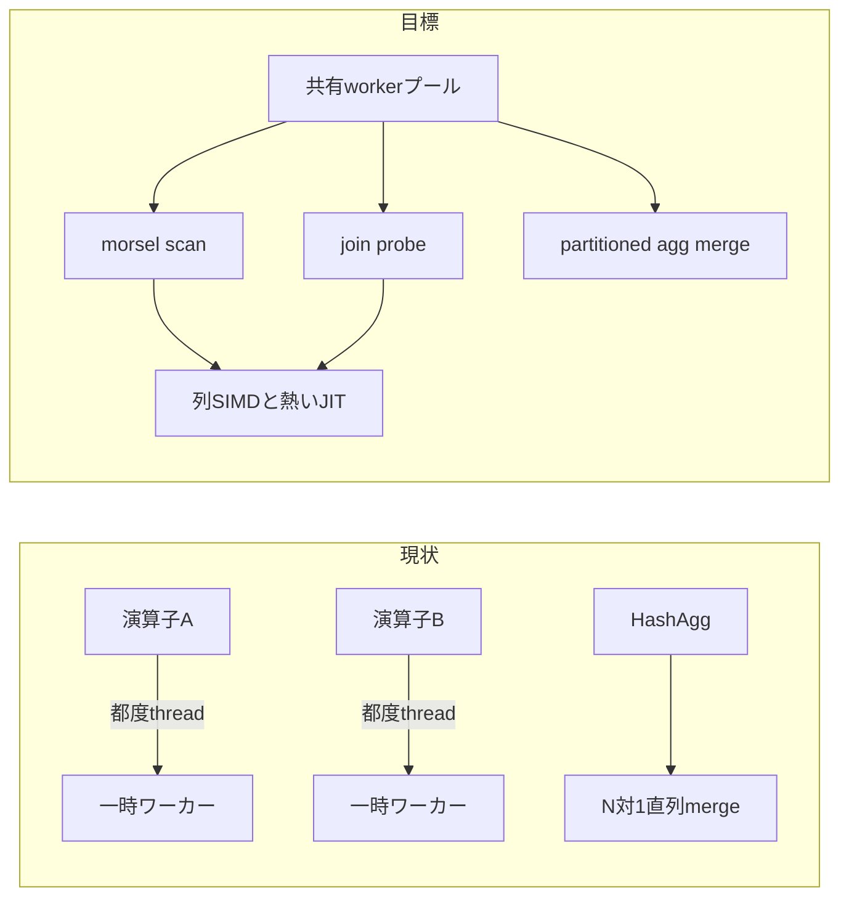

# Executor 構造改革 — TPC-DS SF=1 多コア差を埋める

2026-11-12。細かい定数いじりの前に、JIT / SIMD / マルチコアを活かし切る
実行系の構造を直す。旧ルート `TODO.md`（製品比較チェックリスト等）は git
履歴と [`BenchmarkHistory.md`](BenchmarkHistory.md) /
[`docs/`](docs/) レポートに残る。細部の演算子欠落リストは引き続き
[`docs/executor_todo.md`](docs/executor_todo.md) /
[`docs/todo.md`](docs/todo.md)。**本ファイルが「今やる構造改革」の正本。**

意味論の契約は変えない: AST `Expression::Evaluate` が正本、bytecode が
バッチ IR、JIT はその compiler
（[`docs/expression_evaluation.md`](docs/expression_evaluation.md)）。
第4の解釈経路は作らない。

---

## 0. 診断サマリ（根拠）

### 0.1 測定事実

出典: [`benchmark/comparison/README-tpcds.md`](benchmark/comparison/README-tpcds.md)、
[`build/benchmarks/tpcds-scaling-final-20261111/REPORT.md`](build/benchmarks/tpcds-scaling-final-20261111/REPORT.md)。
SF 0.1 / SF 1 × 2・8・16 物理コア、99 クエリ中央値合計、全 12 実行で 3 製品とも
99/99 回答一致。

| SF | コア | Tinylamb ms | ClickHouse ms | DuckDB ms |
|---|---:|---:|---:|---:|
| 0.1 | 2 | 460–465 | 1,271–1,289 | 437–445 |
| 0.1 | 8 | 403–408 | 1,105–1,111 | 390–391 |
| 1 | 2 | 7,716–7,796 | 6,875–6,887 | 1,848–1,875 |
| 1 | **8** | **6,314–6,346** | **3,570–3,596** | **964–969** |
| 1 | 16 | 7,368–7,394 | 3,963–3,974 | 1,063–1,070 |

- SF=1・8コア: Tinylamb は DuckDB の約 **6.55 倍**、ClickHouse の約 **1.77 倍**。
- 2→8コア加速: Tinylamb **約 1.23 倍**、他 2 製品 **約 1.9 倍**。
  コアを増やしても伸びないのは構造問題。
- 16コアは 3 製品とも 8コアより遅い（NUMA/L3 跨ぎ）。本改革の第一ゲートは
  **8コアでの加速と DuckDB 差の縮小**。

SF=1・8コアで Tinylamb が時間を要した上位（両順序中央値の平均）:

| Q | Tiny ms | CH ms | Duck ms | Tiny/Duck |
|---|---:|---:|---:|---:|
| Q67 | 1,088 | 214 | 56 | ~19.6× |
| Q23 | 773 | 115 | 34 | ~22.7× |
| Q72 | 454 | 514 | 18 | ~25.6× |
| Q78 | 380 | 75 | 36 | ~10.5× |
| Q4  | 316 | 135 | 26 | ~12.0× |
| Q51 | 270 | 53 | 51 | ~5.3× |
| Q39 | 249 | 28 | 9 | ~26.8× |
| Q75 | 246 | 65 | 17 | ~14.1× |
| Q47 | 235 | 105 | 21 | ~11.4× |
| Q14 | 219 | 180 | 30 | ~7.3× |

### 0.2 計画監査で分かった彼我の差

出典: [`build/benchmarks/tpcds-plan-audit-20261111/REPORT.md`](build/benchmarks/tpcds-plan-audit-20261111/REPORT.md)。

1. **Q67 ROLLUP**: DuckDB は最細 540,754 行 → 群を作り
   `EXPORT_STATE` / `combine_aggr` で上位集約を再利用（9 段の入力合計
   ~1,045,790）。Tinylamb は `aggregate_input_rows=4,866,786`（540,754×9）。
   仕事量に約 4.65 倍の差。最終群数は同じ 505,037。
2. **ClickHouse を一律の模範にしない**: Q67 の 8 スレッド計画は
   `AggregatingTransform ×8 → Resize 8→1 → RollupTransform` で直列統合段が
   大きい。単純 N:1 はボトルネックを作り得る。
3. **Q72 結合順序**: DuckDB は日付・属性で先に絞り、動的フィルタで
   inventory の row group を削減。Tinylamb は
   `HeuristicJoinOrder=syntactic (outer/using joins present)` で
   catalog_sales×inventory を先に置き、`join_ms` ~281 ms。
4. **Q78**: DuckDB は返品除外を `RIGHT_ANTI`、Tinylamb は `join_ms` ~265 ms。
   anti 変換と hash build/probe 並列が候補。
5. **Q39**: 分散・標準偏差の誤並列統合を `CanMerge()` で止め、現状は直列。
   統計状態の正しい並列統合契約が必要。
6. **Q23**: DuckDB は materialized CTE 再利用。Tinylamb の `join_ms` ~571 ms が
   次の観測対象（重複実行断定はまだしない）。

### 0.3 集約マイクロベンチの結論（Executor 未配線）

出典: [`benchmark/comparison/README-spsc-aggregation.md`](benchmark/comparison/README-spsc-aggregation.md)。

高カーディナリティ（800万行・~100万群・8コア）中央値:

| 方式 | ms | 相対 |
|---|---:|---|
| barrier N:1（部分集約→直列統合） | 99.9 | 1.00× |
| SPSC N:1（生産と統合の重なり） | 80.5 | 1.24× |
| **partitioned merge（並列統合）** | **38.6** | **2.59×** |

多数コア向けの主経路は **キー分割した並列統合**。N:1 のパイプライン化は
少数コアやバッファ有界化の補助に留める。この結論はまだ本番 Executor に入っていない。

### 0.4 現行実装の構造制約

| 領域 | 現状 | 帰結 |
|---|---|---|
| 並列 | 演算子内 `RunParallelTasks` + 行数閾値（[`plan/parallel_thresholds.hpp`](plan/parallel_thresholds.hpp)）。semi/anti/outer/residual join は逐次。共有プール・Exchange DOP なし | 2→8 が 1.23× に留まる |
| 集約 | 部分表 → 直列寄り merge；ROLLUP は grouping-set 展開で再スキャン相当 | Q67 仕事量 4.65× |
| JIT | INT64 比較 / 線形投影 / SUM のみ、昇格 ~2000万行（[`docs/jit_profile.md`](docs/jit_profile.md)）。並列 agg は JIT 非対応 | SF=1 ではほぼ効かない |
| SIMD | 比較カーネル中心（[`executor/simd_comparison.hpp`](executor/simd_comparison.hpp)） | hash / 加算 / CAST はスカラー寄り |
| バッチ契約 | `DataChunk` と行経路が併存（[`docs/executor_todo.md`](docs/executor_todo.md) P3） | カーネル横断最適化が難しい |
| 結合削減 | `PreferDynamicFilter` / semi-reduction はあるが、scan 貫通と anti 並列が薄い | Q72/Q78 |



---

## 1. 目標アーキテクチャ（一文）

**pull-based `NextBatch(DataChunk*)` は維持したまま、クエリ全体の共有 worker
プール上で morsel タスクを回し、集約は local partial → radix/hash partition →
並列 merge（+ spill）、式は列ベクトル SIMD を既定・bytecode を一般・JIT を
熱い形状だけ、スキャンは PAX/zone-map + 必要列 decode + selection vector に
揃える。**

ClickHouse の N:1 Resize→Rollup は模倣しない。参照は DuckDB の
radix 並列集約・ROLLUP 状態再利用・動的フィルタ。

---

## 1.1 進捗（2026-11-12）

現行バイナリで SF=1・8 スレッド・同一プロセスの 2 周目（LSTable 構築済み）を測った。
99 クエリの合計は **3722.8 ms**（回答は Q67 の保存結果と一致、全件エラー 0）。
DuckDB の 964 ms にはまだ約 3.9 倍届かない。孤立した初回クエリは store_sales
などの LSTable 構築で約 0.8 秒乗る。公式比較の warmup 後中央値（合計 6.3 秒）
よりは短いが、勝利条件は未達。

同じ 8 クエリの 2 スレッド比は 1.05〜1.42 倍（合計 1.27 倍）。コアを増やしても
伸びない。温かい実行で大きいもの: Q23 349 ms、Q51 267 ms、Q67 245 ms、
Q78 240 ms、Q14 237 ms、Q4 190 ms。Q67 の内訳は集約約 146 ms、計画約 44 ms、
window 約 33 ms、scan 約 18 ms。Q51 は join 約 89 ms と window 約 55 ms。
Q23 は scan 約 128 ms と join 約 144 ms。VARCHAR ハッシュを 8 バイト単位にした効果は測定誤差の範囲だった。
入力順 SUM の統合を単一走査に変える変更、遅延ファクト走査の対象を
1〜6 列の次元へ広げる変更、整数 PARTITION BY の並列構築は、いずれも
複数クエリの結果が変わったため戻した。回答が一致した温かい合計は 3722.8 ms のままである。
複数集約の融合プローブはグループ配列をワーカーごとに分けて最後に足す。
同一比較の許容差（相対 1e-9・絶対 1e-7）で全99件が一致し、合計は
3712.5 ms で誤差の範囲だった。
数値の SUM/AVG（列または2列の積）と COUNT、MIN/MAX だけの融合では、
1列の結合キーもファクトより先に読み、ファクトは LSTable の列のまま
最後の融合プローブまで遅延させる。途中の見積もりのために行へ戻さない。
グループ ID が事前に付いているときは、行を作らずに列の値をワーカー別の
部分和へ足す。遅延プローブの単独 SUM(double) は入力順ログを使わないので、
共有配列のロックではなくワーカー別部分和にする。
この状態の温かい2周目は **3503.6 ms**（基準 3722.8 ms）。Q23 は 349 ms から
150 ms。回答は同じ許容差で 99/99 一致。目標の 964 ms にはまだ約 3.6 倍届かない。
Q51 の 288 万行は遅延プローブだが、GROUP BY がファクト列と次元列の
分割キーで、グループ ID が事前割当ではない。列から packed key を作って
SUM すると、グループに `has_key_hash` を載せない限りワーカー部分和が
統合されず合計がずれる。ハッシュを載せて統合すると回答は一致するが、
群が 49.9 万あるため壁時計は 248 ms のままだった。その経路は外した。
COUNT(*) と集約なしの存在確認は、遅延プローブで行を作らずグループの
出現だけを足す。温かい合計は 3513 ms で、3503.6 ms との差は測定のばらつき
の範囲である。Q4 の SUM は 4 項の DOUBLE 式で、グループは顧客行と
年の組である。列からその式を評価しても、顧客文字列のハッシュは
キャッシュ済みで、時間は 186 ms のままだったため外した。
温かい内訳の大きいところ: Q67 の ROLLUP 集約が project_ms 137 ms、
Q78 の結合 142 ms、Q51 の結合 106 ms と window 配置 39 ms、
Q14 の scan 73 ms。Q67 の 540,754 行・9 段を分けると、引数評価 36 ms、
最細グループ構築 23 ms、粗い段の再ハッシュ 60 ms、行の再加算 2 ms、
出力 22 ms。粗い段は文字列比較が本体で、プレフィックスハッシュの再利用は
比較が残るため 245 ms が 253 ms に遅くなり戻した。
粗い段を最細グループから独立に並列構築すると、Q67 は孤立実行で
245 ms から 217 ms、全件実行では 238 ms から 226 ms。回答は許容差内。
この状態の温かい合計は 3531.9 ms（3513 ms との差はばらつきの範囲）。
ウィンドウ配置の型証明を行の再走査から 1 パスにまとめても、Q51 の
layout は約 40 ms のまま（本体は分割とソート）だった。
遅延プローブの dense 整数キーは、ブロックの min/max がそのキー範囲の外なら
読まない（バイアス 0 の内部結合だけ）。温かい合計は **3470.9 ms**、
回答は許容差内。964 ms にはまだ約 3.6 倍。
`COALESCE(数値式, 0)` / `IFNULL` はバイトコードではなく DOUBLE 式として
評価する。Q67 の引数評価は約 36 ms から 16 ms、クエリは 220 ms から
200 ms。
メモリ上のハッシュ結合は、出力行ベクタを入力側の行数ぶん先に確保する。
Q51 の join は孤立実行で 109 ms から 87 ms。
GROUP BY のない AVG/SUM/COUNT が UNION ALL の上にあるときは、各枝で
部分合計と件数を出してから足す。Q14 は 228 ms から 134 ms。
温かい全件は **3365.5 ms**。回答は許容差内。964 ms にはまだ約 3.5 倍。
グループキーが残っていない数値の合計は、吸収済みの実行時フィルタで
生き残ったファクト列を行に戻さず 1 グループへ足す。失敗したときは
今までどおり行へ戻す。Q14 は全件実行で 134 ms から約 30 ms 台、
温かい全件は **3304.9 ms**。回答は許容差内。964 ms にはまだ約 3.4 倍。
グループキーも集約引数も列そのものの raw 集約は、結合行のスクラッチへ
全セルをコピーしない。温かい全件は **3281.6 ms**。回答は許容差内。
`RANK() OVER (PARTITION BY 列 ORDER BY 合計 DESC) <= K` の入力が
ROLLUP のときは、境界の同点を残して上位グループだけ出力する。
Q67 は 191 ms から 154 ms。温かい全件は **3244.1 ms**。回答は許容差内。
`CASE WHEN a IS NOT NULL THEN a ELSE b` は列のコピーだけで済ませる。
Q51 の射影は 44 ms から 13 ms、クエリは 265 ms から 226 ms。
温かい全件は **3227.6 ms**。回答は許容差内。
LEFT JOIN のあと `IS NULL` だけで右表を落とすときは、NULL 埋めの列を
作らない。温かい全件は **3188.3 ms**。回答は許容差内。
ウィンドウ列は入力行へ並列に足し、行の作り直しをしない。
Q51 は 220 ms から 209 ms。温かい全件は **3152.9 ms**。回答は許容差内。
整数の PARTITION BY が狭い値域なら配列で分ける。Q51 の分割は
10 ms から 6 ms。全件合計は誤差の範囲。
100 万行を超える数値ファクトは、左の結合キーのビット集合で列ストアを
並列に探して、一致した行だけを作る。先頭の表は今までどおり読み、
合わなければ従来の結合に戻す。Q72 は 105 ms から 63 ms。
温かい全件は 3110.1 ms と 3134.1 ms（遅い方を記録）。回答は許容差内。
964 ms にはまだ約 3.3 倍。

EXPLAIN ANALYZE に `execute_ms` / `boundary_ms` / `build_input_ms` /
`window_ms` / `window_layout_ms` / `window_input_rows` / `rank_bounds` /
`deferred_materialize_ms` を足した。`build_input_ms` は入れ子呼び出しの合計で、
壁時計より大きくなり得る。

## 2. フェーズ別 TODO

ゲートの数値は「未検証の予言」ではなく、**実装後に同一比較ハーネスで測る
受け入れ条件**。途中の見積もり倍率は本ファイルに書かない。

### P0 — 観測基盤（改革の物差し）

着手点: EXPLAIN ANALYZE / runtime カウンタ、`planning_ms` の定義見直し
（現状は BuildInput 込みで scan/join と二重計上しうる — 計画監査レポート §計測制約）。

- [ ] wall clock とワーカー累積 CPU を分離して報告する（DuckDB 累積時間と混同しない）
- [ ] 演算子ごとの wait / 実行 / 行数 / `aggregate_input_rows` /
      relation_spills / parallel efficiency を支配クエリ（Q67/23/72/78/39）で信頼できる形にする
- [ ] Tinylamb EXPLAIN が実際の実行木（hash vs NL 等）と食い違わないよう、
      heuristic estimate と runtime 実測を明示分離する
- [ ] TPC-DS SF=1・2/8 コアの「改革前ベースライン」を
      `build/benchmarks/tpcds-scaling-final-20261111/` として固定参照する
      （再測定は各フェーズ完了時）

**受け入れ**: 支配 5 クエリについて、差の主因を「仕事量 / 並列待機 /
直列区間 / 式評価」のいずれかに切り分けられる。

### P1 — 並列実行モデル（マルチコアを活かす土台）

着手点: [`common/parallel_work.hpp`](common/parallel_work.hpp)、
[`plan/parallel_thresholds.hpp`](plan/parallel_thresholds.hpp)、
[`executor/relational_factory.cpp`](executor/relational_factory.cpp)、
[`executor/parallel_scan.cpp`](executor/parallel_scan.cpp)、
[`executor/parallel_hash_join.cpp`](executor/parallel_hash_join.cpp)、
[`executor/parallel_aggregation.cpp`](executor/parallel_aggregation.cpp)、
[`docs/executor_todo.md`](docs/executor_todo.md) P3（morsel DOP / Exchange）。

- [ ] クエリ単位の **共有 worker プール**（演算子ごとの都度 thread 起動をやめる）
- [ ] 同一予算の下で scan / hash-join probe / hash-agg が morsel を奪い合わずに進む
      （pipeline 内並列と交換並列の役割を文書化し、単一ノードでは thread 間 Exchange で足りる範囲を決める）
- [ ] semi / anti / null-aware anti / residual 付き inner の並列経路を設計・実装
      （現状は閾値超過でも逐次 — `parallel_thresholds.hpp` コメント通り）
- [ ] outer 系 join の並列化方針（build 共有 + probe 分割、または partitioned build）を決め、
      少なくとも TPC-DS 支配クエリに効く形を 1 本入れる
- [ ] 行数固定閾値だけに頼らず、観測した縮約率・morsel 数・待ち時間から DOP を決める
      （16コア劣化は NUMA 意識の配置まで必須にしないが、8コア内での過分割は抑える）

**受け入れ**: TPC-DS SF=1 合計の 2→8コア加速が **≥ 1.6×**（現状 ~1.23×）。
回答 99/99 一致。semi/anti を含む回帰と oracle が通る。

### P2 — 集約構造（仕事量と並列統合）

着手点: [`executor/grouped_aggregate.cpp`](executor/grouped_aggregate.cpp)、
[`executor/parallel_aggregation.cpp`](executor/parallel_aggregation.cpp)、
[`executor/detail/`](executor/detail/) 集約ヘルパ、
grouping-set rewrite（`RewriteGroupingSetBranch` 周辺）、
独立試作 [`benchmark/spsc_aggregation_benchmark.cpp`](benchmark/spsc_aggregation_benchmark.cpp)。

- [ ] **partitioned（radix/hash）並列 merge** を本番 HashAgg 経路へ配線する
      （barrier N:1 / SPSC N:1 は補助。マイクロベンチ結論を Executor に移す）
- [ ] ローカル表サイズ上限・flush・spill をメモリ予算と接続する
      （DuckDB external aggregation 相当の契約。未検証倍率は書かない）
- [ ] **ROLLUP / CUBE / GROUPING SETS の状態再利用**
      （最細粒度の部分状態から上位 grouping を combine。Q67 の
      `aggregate_input_rows` を再スキャン相当から大きく減らす）
- [ ] 浮動小数 SUM・NULL・オーバーフロー・RANK/LIMIT 同率への意味を固定し、
      differential / TPC-DS 回答一致で担保する
- [ ] `AggregateAccumulator::CanMerge()` を count/mean/M2 等へ広げ、
      Q39 系統計集約を **正しい並列統合**で再有効化する
- [ ] DISTINCT / 順序依存 / FILTER 付き集約は merge 契約が無い限り並列拒否を維持
      （誤統合を再び入れない）

**受け入れ**: Q67 の `aggregate_input_rows`（または同等メトリクス）が計画監査時の
4.8M から、状態再利用後に DuckDB 側オーダー（~1M 前後）へ近づくこと。
Q39 が並列でも回答一致。高カーディナリティ micro で partitioned merge が
barrier より速いことを Executor 経路でも再現。

### P3 — 結合・途中削減（仕事を作らない）

着手点: [`plan/product_plan.cpp`](plan/product_plan.cpp)、
implementation rules の dynamic filter / semi-reduction、
[`executor/hash_join.cpp`](executor/hash_join.cpp)、
[`executor/parallel_hash_join.cpp`](executor/parallel_hash_join.cpp)、
scan 側 runtime filter 受け口。

- [ ] outer / USING / 相関があっても、**安全な内側 inner 部分の並べ替え**を行う
      （Q72: 選別の強い次元・日付を先に。意味保存のゲートをテストで固定）
- [ ] `PreferDynamicFilter` を **scan / zone-map まで貫通**させる
      （build 完了後の min/max・IN リスト・bloom を probe 側スキャンが消費）
- [ ] LEFT JOIN + IS NULL を安全な anti join へ落とす適用範囲を広げ、並列 hash anti と接続（Q78）
- [ ] CTE / 部分集約結果の再利用をプロファイルで確認し、重複実行があれば materialize 方針を決める（Q23）
- [ ] late materialization / 必要列だけの decode を支配クエリの fact スキャンで常時効かせる

**受け入れ**: Q72/Q78/Q23 の runtime `join_ms` と読取行数が改革前ベースラインから
明確に減る（回答一致必須）。ClickHouse より遅いケース（例: Q72）を「広げてから絞る」
計画に退行させない。

### P4 — ベクトル実行契約（カーネルが乗れる形）

着手点: [`executor/data_chunk.hpp`](executor/data_chunk.hpp)、
[`executor/selection_vector.hpp`](executor/selection_vector.hpp)、
[`executor/executor_base.hpp`](executor/executor_base.hpp)、
[`docs/todo.md`](docs/todo.md)「全 operator の DataChunk 入出力」。

- [ ] 演算子内部は **DataChunk のみ**；`Next(Row*)` は外側 sink アダプタに限定
      （[`executor/AGENTS.md`](executor/AGENTS.md) の方針を負債箇所まで完遂）
- [ ] selection vector / validity を filter→project→join payload で貫通させ、
      中間の密行化を必要な pipeline breaker だけに限る
- [ ] PAX decode は参照列だけ；辞書・RLE があればカーネル側で直接消費する道を残す
- [ ] pipeline breaker（hash build / sort / materialize）を明示し、
      それ以外はバッチをコピーしない

**受け入れ**: 支配クエリの実行プロファイルで「行オブジェクト構築」が上位コストから落ちる。
`data_chunk_test` / differential / 既存 executor 回帰が通る。

### P5 — SIMD / JIT（熱経路の機械語）

着手点: [`executor/simd_comparison.hpp`](executor/simd_comparison.hpp)、
[`expression/jit*`](expression/)、[`executor/selection.cpp`](executor/selection.cpp)、
projection / aggregation の fast path、[`docs/jit_profile.md`](docs/jit_profile.md)。

- [ ] SIMD を比較以外の hot kernel へ拡張する（候補: 整数 hash、加算/SUM、
      NULL 付き選択、単純 CAST）。AST 正本→bytecode→カーネルの順を守る
- [ ] JIT 対象形状を bytecode パターン単位で増やす（複合比較、DATE、
      列対列、短絡しない単純 AND 連結など — 短絡意味は AST と一致必須）
- [ ] 昇格閾値を再校正する（現状 ~2000万行は SF=1 でほぼ不発）。
      静的ヒューリスティックまたは軽量プロファイルで、コンパイル費を回収できる形だけ昇格
- [ ] **並列経路でも** 同じ SIMD/JIT カーネルを共有する
      （逐次 Aggregation だけ JIT SUM、並列は非対応、という分裂を解消）
- [ ] NULL 含有バッチ・エラー吸収・volatile はフォールバックを維持し、
      `differential_test` で三経路一致を固定する

**受け入れ**: SF=1 支配クエリで JIT/SIMD 発火がプロファイルに現れ、
bytecode のみとの A/B で壁時計が改善する。意味論 regress ゼロ。

### P6 — 検証・ゲート

- [ ] TPC-DS SF=1・8コアを DuckDB / ClickHouse と同条件で再比較
      （[`benchmark/comparison/tpcds.py`](benchmark/comparison/tpcds.py) /
      three 系ハーネス）。99/99 一致
- [ ] 合計中央値の DuckDB 比を改革前 6.55× から縮小したことを記録
      （目標の刻み: まず **≤ 3×**、その後 **≤ 2×**。未達でも差分内訳を REPORT に残す）
- [ ] 2→8コア加速 ≥ 1.6× を再確認
- [ ] `ctest` 該当 suite、`differential_test`、SQL oracle（長め）、
      `python3 scripts/check_layering.py`
- [ ] 変更層の `AGENTS.md` / 本 TODO の該当項目を `[x]` 化し、
      測定 REPORT へのリンクを追記

---

## 3. やらないこと（この改革の非目標）

- ClickHouse の **Resize 8→1 → 直列 Rollup** をそのまま真似ること
- SF=10 測定や細かい `parallel_thresholds` 定数いじりを、P1–P3 より先にやること
- 意味論の第4経路（AST/bytecode/JIT 以外）を増やすこと
- 「未測定の見込み倍率」を成果として宣言すること
- ルートをまたぐレイヤリング違反の増やす実装（下位に置けるものは下位へ）

---

## 4. 推奨作業順

```
P0 観測 → P2 集約仕事量削減（ROLLUP再利用）と並行して P1 共有プール
       → P3 結合削減（Q72/Q78）
       → P4 DataChunk 完遂（P5 の前提を固める）
       → P5 SIMD/JIT 拡大
       → P6 再比較ゲート
```

P2 の ROLLUP 再利用は並列モデルが不完全でも単スレッド仕事量を減らすので、
P1 と並列に着手してよい。P5 は P4 なしでも部分可能だが、カーネル横断の回収は
P4 後の方が大きい。

---

## 5. 参照

- 測定: [`benchmark/comparison/README-tpcds.md`](benchmark/comparison/README-tpcds.md)、
  [`build/benchmarks/tpcds-scaling-final-20261111/REPORT.md`](build/benchmarks/tpcds-scaling-final-20261111/REPORT.md)
- 計画差: [`build/benchmarks/tpcds-plan-audit-20261111/REPORT.md`](build/benchmarks/tpcds-plan-audit-20261111/REPORT.md)
- 集約試作: [`benchmark/comparison/README-spsc-aggregation.md`](benchmark/comparison/README-spsc-aggregation.md)
- 式: [`docs/expression_evaluation.md`](docs/expression_evaluation.md)、
  [`docs/jit_profile.md`](docs/jit_profile.md)
- 実行器: [`executor/AGENTS.md`](executor/AGENTS.md)、
  [`docs/executor_todo.md`](docs/executor_todo.md)
- 全体層: [`ARCHITECTURE.md`](ARCHITECTURE.md)、[`AGENTS.md`](AGENTS.md)
