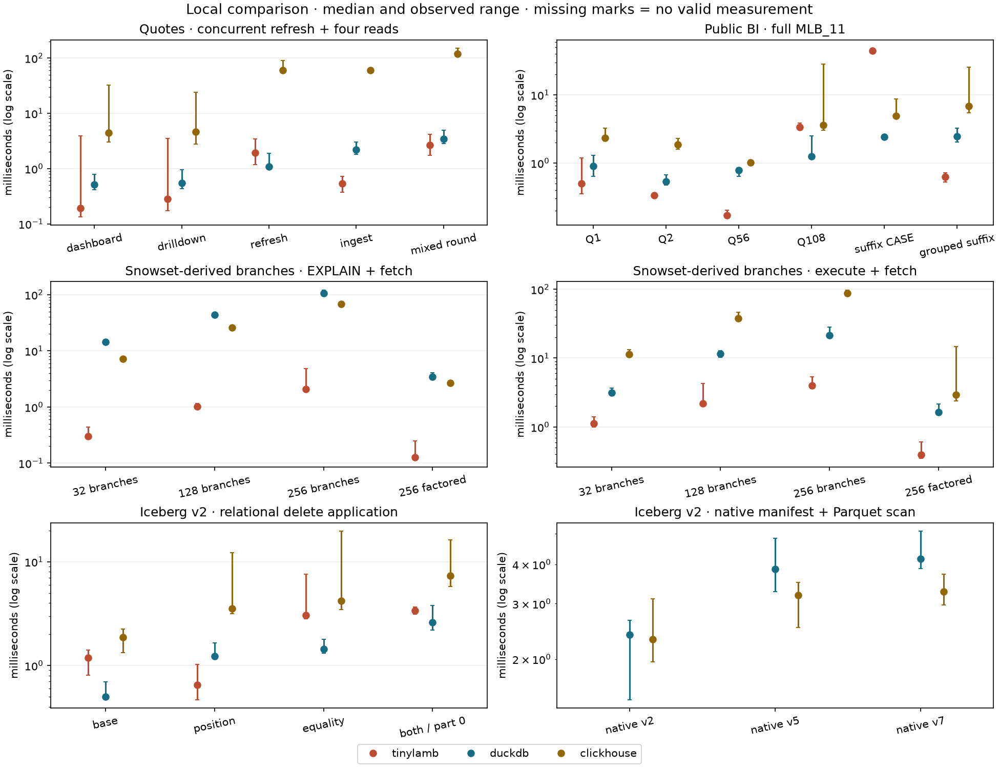
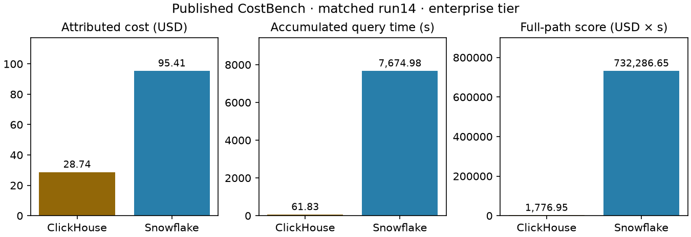

# CostBench・PBench・Iceberg・Public BI の比較

2026-11-24 JST に tinylamb、DuckDB 2.0.0、ClickHouse 26.10.2.103 を同一ホストで測定した。75 系列の所要時間と SQL を保存した。ローカル SELECT の全試行は、合成データの参照計算、MLB 実データの Python 集計、または Iceberg の公開スナップショットの期待値と一致した。EXPLAIN では計画の返却を検査した。[測定値と SQL](measurements.json)・[再現用ランナー](../../cloud_bi_bench.py)・[測定から登録した Lean 命題 42 件](../../../../lean/issues/research/cloud-bi.md)



[JOB・STATS-CEB・H2O・LDBC-SNB・BigBench の既存比較](../../README-analytics.md)と同じエンジンアダプターを使う。

## 同じ結果を返す SQL の比較

単位はミリ秒。ウォームアップ 1 回の後、各 SQL を 7 回実行した中央値。各組とも元の SQL と書き換えた SQL を同じ入力で実行した。

| 入力と SQL | tinylamb | DuckDB | ClickHouse |
| --- | ---: | ---: | ---: |
| MLB 186,593 行に文字列の接尾辞 CASE を適用 | 44.376 | 2.413 | 4.917 |
| 先に (league, position) の 144 組を集約してから同じ CASE を適用 | **0.624** | 2.448 | 6.840 |
| Snowset 派生の 256 分岐を UNION ALL して集約 | 3.983 | 21.425 | 87.416 |
| 同じ分岐をキー別の多重度に畳んで集約 | **0.395** | **1.635** | **2.946** |

MLB の書き換えは最終 32 群すべての件数を保存した。tinylamb では約 71 倍、DuckDB ではほぼ同じ、ClickHouse では追加の集約によって遅くなった。この形の書き換えを選ぶ際には文字列処理のコストと細かいキーの種類数が効く。256 分岐はどちらの SQL も 7,332 を返した。分岐ごとのスキャンを省く効果は 3 エンジンで観測された。いずれも同じエンジンに明示的に別の SQL を与えた比較で、実装済み自動書き換えの効果は未測定。

## 4 系統で測ったもの

- **CostBench** は合成気配値を 1 ライター・4 リーダーで処理するローカル派生負荷。128 行を事前投入し、12 ラウンドで毎回 128 行を確定する。直後にそのバッチの 16 銘柄を DB で集約し、クライアント経由で集計表に追記する。並行する 2 読者が確定済みプレフィックスの集計表を、2 読者が明細を読む。毎回の読み取りと最終集計表の全 208 行を検査した。tinylamb の中央値は取り込み 0.541 ms、集計公開 1.929 ms、並行ラウンド全体 2.647 ms。バリア解放から全処理完了までを分母にすると 47,644 行/秒。ラウンド間の次回準備時間は除外される。クラウドの固定到着率、独立した読み取り計算資源、バックグラウンドの再クラスタリング費用はこのローカル測定の対象外。下図には公式のクラウド測定値を使用した。[CostBench の計測契約](https://github.com/ClickHouse/CostBench/tree/0e9bbfecc3eb4073c9aa50bf2555470daaafebc6/full-path-realtime/quotes)
- **Snowflake BI / PBench** は公開 Snowset の 5 分バケットから join の比率を読み、決定的に結合付き分岐を選んだ派生 SQL。256 行の fact と 16 行の dimension を固定し、8 本ずつ部分集約を挟んで、32・128・256 分岐に拡張した。ソース SQL のスキャン、結合、WHERE、SUM、二項 UNION ALL を個別に数えると 134・532・1,066 演算。ベンダーの物理計画ノード数は別の尺度である。実行＋全件受信に加え、EXPLAIN＋計画の全件受信も測定した。tinylamb の 256 分岐の EXPLAIN は初回 10.524 ms、繰り返し中央値 2.066 ms。計画の文字列化・転送・キャッシュが含まれる。PBench のワークロード合成器や Snowflake サービスの再生スコアは計測していない。[PBench](https://github.com/ruc-datalab/PBench/tree/312440f012e46dfcf75ee305c9d28ab8d26912f7)・[使用トレース](https://github.com/ruc-datalab/PBench/blob/312440f012e46dfcf75ee305c9d28ab8d26912f7/src/Workloads/Snowset/workload1h-5m-30s_1.csv)
- **Iceberg Merge-on-Read** の共通 SQL は 96 ファイル・4,608 行の 1 partition spec をモデル化した。ファイル ID と物理位置、データ・削除の sequence number、partition/global scope、NULL を照合し、残った行の件数と ID の和を検査した。削除なし 4,608 行、position 適用 4,320 行、equality 適用 4,104 行、両方を適用した partition 0 は 616 行。さらに DuckDB と ClickHouse は同じ実物の Avro マニフェストと Parquet を直接読み、削除適用前の v2 で ID 1,2,3,4、v5 で 4、追記と再削除後の v7 で 4,5 を照合した。ネイティブ測定は小さな equality-delete fixture を開く負荷を含む。tinylamb の測定範囲は共通 SQL。[Iceberg v2 の削除適用規則](https://iceberg.apache.org/spec/#scan-planning)・[ネイティブ fixture の期待結果](https://github.com/duckdb/duckdb-iceberg/blob/9463c2f6bf643c235dbfd39428948a7f4ae9bcae/test/sql/local/equality_deletes.test)
- **Public BI** は CWI の MLB_11 全 186,593 行から関係する 7 列をロードした。Q1・Q2 はリーグ・守備位置の軸を列挙し、Q56 は重複した GROUP BY 年キーを持つ。Q108 はリーグ、守備位置、年で 509 行を選び、4 打撃指標の MAX/MIN を返す。公開 SQL の識別子を簡略化し、年は整数、3 桁の小数は 1,000 倍した整数係数で扱った。図の suffix CASE の 2 問はこの実データに追加した比較クエリ。[公開 SQL](https://github.com/cwida/public_bi_benchmark/tree/cf9909083bf9ed185cd7f5121a2881e1fea0e7a9/benchmark/MLB/queries)・[スキーマ](https://github.com/cwida/public_bi_benchmark/blob/cf9909083bf9ed185cd7f5121a2881e1fea0e7a9/benchmark/MLB/tables/MLB_11.table.sql)・[配布データ](https://event.cwi.nl/da/PublicBIbenchmark/MLB/MLB_11.csv.bz2)

## 公開 CostBench のクラウド費用

下図はベンチマーク提唱元が公開した Enterprise tier の run14 を、固定リビジョンの集計 JSON から描画した。取り込み・維持・対象クエリの合計帰属費用は ClickHouse が $28.74、Snowflake が $95.41。公式の full-path score はこの費用に累積クエリ秒数を掛けたもの。Snowflake の帰属費用には run14 の warehouse 換算規則が適用されている。[run14 の費用・計算式・帰属条件](https://github.com/ClickHouse/CostBench/blob/0e9bbfecc3eb4073c9aa50bf2555470daaafebc6/full-path-realtime/quotes/snowflake/results/t2/charts/run14/full_path_cost_performance_clickhouse_vs_snowflake_summary.json)



## 再現

Ryzen 9 9950X3D、Linux、Python 3.14.4。tinylamb はローカル TCP Simple Query、DuckDB は組み込み API、ClickHouse はローカル HTTP。DuckDB・ClickHouse のクエリスレッドと tinylamb の read workers は 2。データロードは計時外で、追加の ANALYZE、CPU 固定、キャッシュの強制破棄は行っていない。エンジンは順番に専用の一時 DB で起動した。エンジン間の絶対値には接続方式や計画表示形式の差も含まれる。グラフは中央値と最小～最大。混在負荷は 12 ラウンド、読み取り種別ごとに 24 サンプルであり、他のパネルは各 7 サンプル。バイナリ SHA-256、開始時の作業ツリー HEAD、バージョン、入力ハッシュを JSON に保存した。

リポジトリルートから、実行可能な tinylamb_server と ClickHouse のローカルバイナリを指定する。初回は公開 fixture と DuckDB の Iceberg 拡張の取得にネットワークを使う。

```bash
python -m pip install duckdb==2.0.0 psycopg2-binary==2.9.13 matplotlib==3.11.2
python -c 'import duckdb; duckdb.connect().execute("INSTALL iceberg")'
python benchmark/comparison/cloud_bi_bench.py \
  --server build-tpcds-release/tinylamb_server \
  --clickhouse-binary build/benchmarks/clickhouse-bin/clickhouse-common-static-26.10.2.103/usr/bin/clickhouse \
  --threads 2 --repeats 7 --output benchmark/comparison/results/cloud-bi-new
```

保存済みの JSON から図だけ再生成するには次を使う。

```bash
python benchmark/comparison/cloud_bi_bench.py --plot-only --output benchmark/comparison/reports/cloud-bi
```
