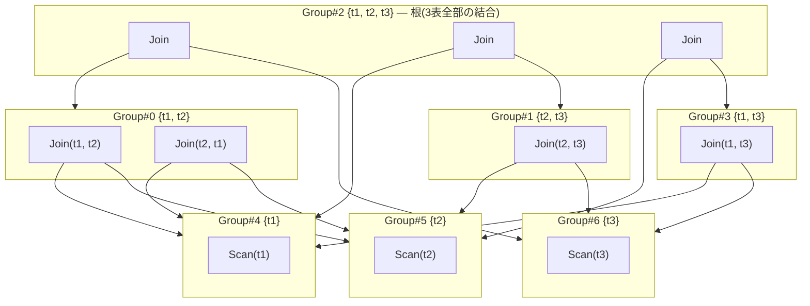
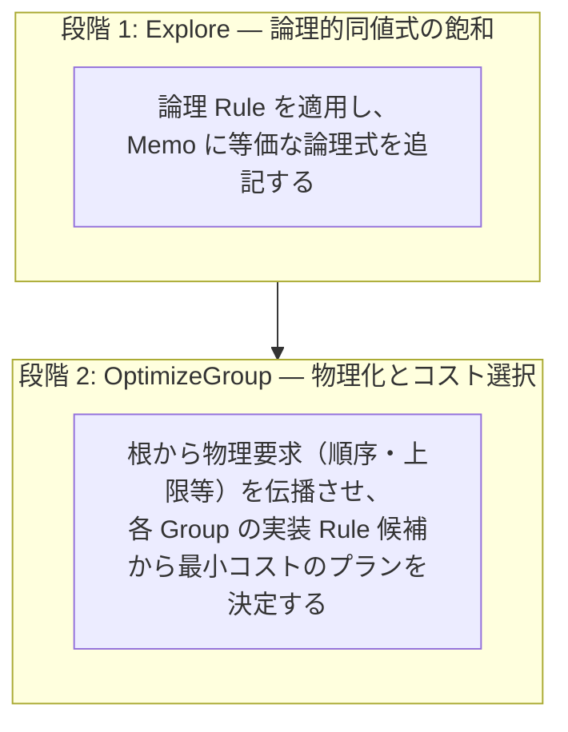

# 第1章 Cascades オプティマイザの全体像

- 状態: draft / 執筆基準リビジョン: `3880673` (2026-09-12)

tinylamb のオプティマイザは、SQL から物理実行計画を作るまでに、
論理式の変換と物理演算子の選択を行います。この章では、個々のデータ構造や
Rule を読む前に必要となる、最適化処理全体の流れを説明します。

## 1-1. オプティマイザの役割 — 手順の探索

RDBMS が `SELECT` 文を受け取った時点では、取得する行の条件だけが決まっており、
行を集める手順は決まっていません。この手順を決めるのがオプティマイザです。

たとえば、次のクエリを考えます。

```sql
SELECT o.order_id, c.name
FROM orders AS o JOIN customers AS c ON o.customer_id = c.id
WHERE c.region = 'APAC';
```

結果行の集合は一意に定まりますが、行を集める手順には複数の選択肢があります。

- `orders` を走査してから `customers` と突き合わせるか、その逆の順序にするか。
- 突き合わせの方式として、ハッシュ表を構築する手法（HashJoin）、両者を整列させて併合する手法（MergeJoin）、あるいは一方の行ごとに他方を走査・探索する手法（NestedLoop / IndexJoin）のどれを採用するか。
- `c.region = 'APAC'` というフィルタ条件を、結合処理の前に `customers` の読み込み段階で適用するか、結合の後に適用するか。
- `customers` の `region` 列にインデックスがあるとき、インデックス経由で走査するか、テーブル全体を順次走査するか。

どの手順を選んでも結果は同じですが、所要時間はデータ量やインデックスの有無で
大きく変わります。オプティマイザは、同じ結果を返す候補のうち、推定コストが
最も小さい計画を選びます。

実行手順の候補数は、テーブルが増えると急増します。結合を二分木で表すと、
木の形状と葉の順列だけでも、3 テーブルで 12 通り、4 テーブルで 120 通り、
5 テーブルで 1680 通りになります。さらに、各結合のアルゴリズムと、
インデックス走査や全表走査などのアクセスパスも選ぶ必要があります。

すべての候補を独立した木として列挙する方法では、この組み合わせを扱えません。
Cascades は、同値な部分構造を共有して探索空間を小さく保ちます。tinylamb も
この方式を採用しています。

## 1-2. Cascades の基本構造 — Group による同値式の共有

Cascades は、探索空間の増大を次の 2 つの機構によって抑制します。

1. **同値な式の集約（Group）**: 「`t1` と `t2` の結合」のように、同じ関係を出力する表現を Group（グループ）単位で管理します。Group は等価な式のリストを保持し、各式の子ノードは個別の式ではなく別の Group を参照します。
2. **要求に応じた物理化**: 論理 Rule は、Group に新しい等価式を登録します。HashJoin や IndexScan などの物理演算子は、必要なソート順や上限件数が決まった後で割り当て、コストを計算します。同じ Group と物理要求の組は一度だけ評価し、結果を再利用します。

3 テーブル `t1`, `t2`, `t3` の結合を例にとると、Memo の構造は次のように表現されます。



この図から、次の 2 つの性質が分かります。

- `Join(t1, t2)` と `Join(t2, t1)` は**同じ Group#0 に含まれます**。どちらも「t1 と t2 の結合」を表すため、別の Group を作らず、等価な選択肢として管理します。
- `(t1 ⋈ t2)` を子に持つ式と `(t2 ⋈ t3)` を子に持つ式は、**Group#5 {t2} などの葉 Group を共有します**。各プラン木を独立に保持する場合と違い、`Scan(t2)` を重複して保存する必要がありません。

図中の Group 番号は説明の便宜上の表記です。tinylamb では、Group の同一性を「含まれる関係の集合と識別タグ」の組で判定し、各 Group が自身に閉じたスキャン述語を保持します。この Memo 構造の実装詳細は第 20 章で解説します。

## 1-3. クエリ処理パイプラインにおける位置づけ

tinylamb は、次のパイプラインでクエリを実行します。アーキテクチャ全体は、
リポジトリ直下の `ARCHITECTURE.md` を参照してください。


本書が対象とするのは中央の `Optimizer::Optimize` です。ヘッダ `plan/optimizer.hpp` における宣言は次のとおりです。

```cpp
class Optimizer {
 public:
  explicit Optimizer() = default;

  static StatusOr<Plan> Optimize(const QueryData& query,
                                 TransactionContext& ctx);
  static StatusOr<Plan> Optimize(const QueryData& query,
                                 TransactionContext& ctx,
                                 const OptimizerOptions& options);
  // ...(省略: OptimizeRelational)...
};
```

入力は、構文解析済みの `QueryData` と、カタログや統計情報へのアクセスを
提供する `TransactionContext` です。出力は、物理プラン木を包む
`StatusOr<Plan>` です。最適化に失敗した場合も C++ 例外は使わず、
エラーステータスを返します。呼び出し側は、そのステータスを見て代替経路へ
切り替えます。

## 1-4. 3 層の Rule セット — 最適化ルールの値渡し

tinylamb の最適化処理では、独立した 3 種類の Rule セットを使います。

| 層 | 定義場所 | 本数 | 役割 |
|---|---|---|---|
| 式書き換え `ExpressionRuleSet` | `expression/rewrite.cpp` の `ExpressionRuleSet::Default()` | 74 回の `Add`（重複登録 1 件を除き実効 73 種） | スカラー式の正規化および定数畳み込み（例: `1 + 2` を `3` に変換、`NOT (a AND b)` の展開） |
| 論理同値 `cascades::RuleSet` | `plan/cascades.cpp` の `RuleSet::Default()` | 有効 116（無効化コメント 1 件を除く） | Memo に結果が等価となる別の論理表現を追加（結合順序の交換、述語の押し込みなど） |
| 物理 `cascades::ImplementationRuleSet` | `plan/implementation_rules.cpp` の `DefaultImplementationRules()` | 52 | 論理式を具体的な物理演算子（HashJoin や IndexScan など）へ変換し、コスト評価対象とする |

論理 Rule の典型例である結合順序の交換（`join_commutativity`）の登録コードを以下に示します（`plan/cascades.cpp` の `RuleSet::Default()`）。

```cpp
built.Add(Rule(
    "join_commutativity", Join(Any("left"), Any("right")),
    [](const Bindings&, Memo& memo, GroupId group,
       const LogicalExpression& expression) {
      memo.AddExpression(group, memo.NewJoin(expression.children[1],
                                             expression.children[0]));
    },
    LogicalOperator::kJoin));
```

この登録コードは、次の要素で構成されます。DSL とパターンの構文は第 30 章で
説明します。

- 第 2 引数の `Join(Any("left"), Any("right"))` は**パターン**の宣言です。2 つの子を持つ任意の `kJoin` 式に一致し、それぞれに `left` と `right` という名前を付けます。
- ラムダ式の本体が**適用時の動作**です。一致した式の左右の子グループを入れ替えた新たな Join 式を生成し、`memo.AddExpression` によって**同一グループへ追記**します。既存の式を上書き・削除しない（追記のみ）点が Cascades の不変条件です。
- この適用により、前節の図における `Group#0` の内部に `Join(t1, t2)` と `Join(t2, t1)` の双方が併存する状態が作られます。

物理 Rule は、論理式 `kJoin` に対して HashJoin、MergeJoin、NestedLoopJoin、
IndexJoin などの候補を `PlanAlternative` として列挙します。後段のコストモデルが
候補を比較します（第 40 章）。

Rule は大域的な登録簿に置かず、`OptimizerOptions` の値として渡します
（`plan/optimizer.hpp` の `OptimizerOptions`）。

```cpp
struct OptimizerOptions {
  cascades::RuleSet relational_rules;
  ExpressionRuleSet expression_rules;
  std::vector<cascades::ImplementationRule> extra_implementation_rules;
  std::unordered_set<std::string> disabled_implementation_rules;
  // ...(省略: access_method / dump_memo / search_step_budget などの診断・予算フィールド)...

  [[nodiscard]] static const OptimizerOptions& Default() {
    static const OptimizerOptions options = [] {
      OptimizerOptions built;
      built.relational_rules = cascades::RuleSet::Default();
      built.expression_rules = ExpressionRuleSet::Default();
      return built;
    }();
    return options;
  }
};
```

`Default()` は 3 層の標準 Rule セットを構築して返します。呼び出し元はこのオプション構造体を複製した上で、特定の Rule を識別名によって除外できます。

```cpp
tinylamb::OptimizerOptions options = tinylamb::OptimizerOptions::Default();
options.relational_rules.Remove("join_commutativity");      // 論理 Rule を除外
options.expression_rules.Remove("de_morgan");               // 式書き換え Rule を除外
options.disabled_implementation_rules.insert("index_join"); // 物理 Rule を無効化
```

この設計により、特定の Rule だけを除外して、生成される計画や結果を比較できます。
また、出力値を計算する文脈では不適切な推論 Rule を除く、といった文脈別の
制御にも同じ仕組みを使います。

## 1-5. 最適化の前半処理 — 式の正規化から Memo の初期構築まで

`Optimizer::Optimize`（`plan/optimizer.cpp`）が Memo を構築するまでの処理は、
次の 5 段階です。

**1. スカラー式の正規化**: SELECT 句や ORDER BY 句に含まれる式を `ExpressionRuleSet` によって正規化します。この段階で、評価文脈に応じた安全性の制限が適用されます。

```cpp
  // Value contexts (select items, ORDER BY keys) must not gain inferred
  // predicates: `x IS NOT NULL AND ...` changes a NULL projection/sort key
  // into FALSE.  The inference rule is only sound in a filter context, so
  // it is stripped for these rewrites (WHERE keeps the full rule set).
  ExpressionRuleSet value_context_rules = options.expression_rules;
  value_context_rules.Remove("inner_join_not_null_inference");
  const ExpressionRewriter value_rewriter(value_context_rules);
```

射影リストやソートキーに `inner_join_not_null_inference`（非 NULL 推論）を
適用すると、元の値が NULL のときに `x IS NOT NULL AND ...` は FALSE となり、
出力値が変わります。この推論は WHERE 句のようなフィルタ文脈では安全ですが、
値をそのまま返す文脈では安全ではありません。そこで、文脈ごとに Rule セットを
複製し、不適切な Rule だけを除いています。

**2. クエリレベルの冗長結合削除**: FROM 句に 2 以上のテーブルが含まれる場合、不要な結合を事前に検出して除去します。内側結合に対する `TryEliminateUnusedJoins` や、外部結合に対する `TryEliminateUnusedOuterJoin` がこれに該当します。これらは Memo による全探索の前に実行される構造単純化です。

`TryEliminateUnusedJoins` は、射影句や ORDER BY 句から一切参照されず、かつ一意キーによる等値結合で 1 行のみが対応することが証明できるテーブル（参照整合性または実データスキャンによる包含証明が成立する次元テーブル）を除去します。証明が成立しない場合は安全側に倒してテーブルを保持します。一方、`TryEliminateUnusedOuterJoin` は LEFT / RIGHT 外部結合の NULL 供給側テーブルを対象とします。保存側テーブルの行数は外部結合によって減少しないため、内側結合のような包含証明を必要とせず、一意キー条件のみで安全に除去できます。

**3. カタログ情報と統計情報の注入**: `RuleContext` に、クエリが参照する各テーブルのスキーマ情報（`Table`）と統計情報（`TableStatistics`）を渡します。これらは後の物理 Rule において演算子ごとの推定コストを算出する入力となります。

**4. Memo の初期構築**: WHERE 句の述語を連言（AND で結ばれた個別の述語単位、conjuncts）へと分解し、`memo.Build(from, conjuncts)` を呼び出して Memo の骨格を生成します。

```cpp
  cascades::Memo memo;
  cascades::GroupId search_root = cascades::kInvalidGroup;
  if (!is_outer) {
    search_root = memo.Build(query.from_, conjuncts);
  } else {
    // ...(省略: outer join の場合は、inner join を含む既定のグループ構築
    // (`TryBuild`)はスキャンフィルタの再利用のためだけに行い、outer join 自体は
    // タグ付きの別グループ(derived group)に置く。inner と outer を Group
    // レベルで分離する)...
  }
```

`conjuncts` は、各述語が参照するテーブルの情報を保持します。`Build`
（`TryBuild` の非例外ラッパー）は各テーブルのスキャングループを作り、
単一テーブルの述語をスキャンフィルタに、複数テーブルを参照する述語を
それらのテーブルを初めてまとめる結合に配置します。

外部結合を別のグループに置くのは、「1 つのグループは 1 つの意味だけを
持つ」という D1 の規律を守るためです。第 20 章で、このグループ構造を
詳しく説明します。

**5. 論理演算子の積み上げ**: Memo の上に、SELECT 文の構造を
論理演算子として積み上げます。WHERE が残っていれば `kSelection`、集約が
あれば `kAggregation`（なければ `kProjection`）、`DISTINCT` なら `kDistinct`、
ORDER BY + LIMIT がそろえば `kTopN`、ORDER BY だけなら `kSort`、LIMIT だけなら
`kLimit` を、それぞれ派生グループ（derived group）として根の上に追加し、
`search_root` を差し替えていきます。射影の部分は次のようなコードです
（`plan/optimizer.cpp` の `Optimizer::Optimize`）。

```cpp
  } else {
    const cascades::GroupId projection =
        memo.EnsureDerivedGroup(query.from_, "projection");
    memo.AddExpression(projection,
                       cascades::LogicalExpression{
                           .operation = cascades::LogicalOperator::kProjection,
                           .children = {search_root},
                           .table = "",
                           .predicate = std::nullopt,
                           .target_list = projection_items});
    search_root = projection;
  }
```

`EnsureDerivedGroup` の第 2 引数に渡す `"projection"` は、派生グループを
識別するタグです。同じ関係集合を参照していても、射影の前後では出力スキーマと
行の意味が異なるため、別の Group として管理します。

以上の処理により、根の Group から葉のスキャン Group までを `GroupId` で
結んだ初期 Memo が構築されます。

## 1-6. 探索エンジン — Explore と OptimizeGroup

構築された Memo は、探索エンジン（`SearchEngine`）に渡されて最適化されます（`plan/optimizer.cpp` の `Optimizer::Optimize`）。

```cpp
  cascades::SearchEngine search(std::move(memo), options.relational_rules);
  search.SetStepBudget(options.search_step_budget);
  std::optional<cascades::BestPlan> best = search.Optimize(
      search_root, properties, *implementation_rules, rule_context);
  if (!best) {
    return Status::kNotImplemented;
  }
```

`SearchEngine::Optimize` の処理は 2 つの段階に分かれています（`plan/cascades.cpp`）。

```cpp
std::optional<BestPlan> SearchEngine::Optimize(
    GroupId root, const PhysicalProperties& properties,
    const Implement& implement, const RuleContext& context) {
  Explore(root);
  return OptimizeGroup(root, properties, implement, context);
}
```

- **論理的同値式の飽和（Explore）**: 論理 Rule を可能な限り適用し、Memo 内に等価な論理式を追加し続ける。探索回数には上限が設けられており、ステップ予算（`search_step_budget`）を使い切った場合は探索を打ち切り、その時点までに登録された式の中で最適化を継続します。
- **要求駆動の物理化とコスト選択（OptimizeGroup）**: 要求された物理特性（ソート順、上限行数、アクセス手法など）を満たす最良の物理プランを、根グループから再帰的に決定します。各グループにおいて実装 Rule が物理候補（`PlanAlternative`）を生成し、子グループへ下位の要求を伝播させる。同一の「 Group と物理要求」の組み合わせに対する探索結果はキャッシュされ、既に判明している最小コストを上回る探索枝は打ち切られます。



この 2 段階の構成により、論理式の変形と物理コストの算出が明確に分離されます。また、結合対象テーブル数が 16 を超えるような極端なケースでは、全列挙を停止して貪欲法による順序決定（`greedy_join_order_fallback`）へ切り替えるなど、探索コスト自体の肥大化を防止するガードが組み込まれています。

なお、オプティマイザがサポート外の構文や演算子を検知して `Status::kNotImplemented` を返した場合、システムは Memo 探索を伴わない簡易な実行計画生成へ切り替えて処理を継続します。

## 1-7. 最適化における正しさの保証

オプティマイザの変更において不可欠な不変条件は、「**出力される行の多重集合（multiset）と順序保証を変更しない**」ことです。処理速度が向上しても、取得される行が欠落したり NULL の評価結果が変わったりすれば、それは誤った変換です。tinylamb では、この正しさを維持するために以下の設計規律を設けています。

- **事前条件ゲートの設置**: 各論理 Rule は、同値性を証明するための事前条件（guard）を持ちます。条件を満たさない場合は変形しません。
- **不完全な規則の無効化**: 事前条件の安全性が完全に証明できない規則は、コード上で無効化され、反例を示すテストケースとともに管理されます。たとえば LIMIT を結合の下層へ押し込む規則（`push_down_limit_through_join`）は、左側の各行が右側と 1 行以上マッチすることを保証できない限り結果行を不当に減らすため、現在は無効化されています。
- **文脈に応じた規則の除外**: 前述の `inner_join_not_null_inference` のように、フィルタ条件としては安全であっても射影値の算出としては不安全な規則は、処理文脈に応じて適用対象から除外されます。
- **差分テストとファジングによる検証**: 網羅的なオラクル走行器（`plan/rule_fuzzer.cpp`）やランダムクエリを用いたファザー（`sql_oracle_fuzzer_libfuzzer`）を実行し、最適化の前後で結果が一致することを継続的に検証しています。

特に注意を要するのは、単一テーブルのスキャングループです。tinylamb ではスキャン述語が Group 内で集約されるため、単一テーブルに対するフィルタの変形は、後段で再評価されない唯一の評価点となります。したがって、単一テーブルのフィルタ変更はコストの最適化ではなく結果の正しさに直結します。各 Rule の解説においても、この安全条件の根拠を重点的に記述します。

## 1-8. 表記上の約束と本書の構成

本書で用いる図表・コード表記の規則は以下のとおりです。

- **Group の表記**: `Group#2 {t1, t2, t3}` のように、識別番号と含まれるリレーション集合を併記します。番号は説明のための仮番です。派生グループは `Group#n {…} (tag: projection)` のようにタグを付与して区別します。
- **プラン構造の図示**: Mermaid によるグラフ描画を用います。`subgraph` が Group を、内部のノードが論理式または物理プランの演算子を表します。
- **コード引用**: 原則として実装ファイルからの抜粋をそのまま掲載します。本質的でない処理の省略は `// ...(省略)...` と明記します。理解の補助として単純化した擬似コードを示す場合は、その旨を付記します。
- **コード位置の指定**: 行番号の陳腐化を避けるため、原則として `plan/cascades.cpp` の `RuleSet::Default()` のようにファイルパスとシンボル名で特定します。

次章以降の基礎編の構成は以下のとおりです。

- 第 20 章: Memo / Group / `LogicalExpression` のデータ構造。関係集合とタグによる同一性判定、スキャン述語の管理、探索上限と縮退動作。
- 第 30 章: `Pattern` DSL と `Bindings`。規則の適用パターンを宣言する DSL とマッチングの仕組み。
- 第 40 章: `SearchEngine`。ワークリストによる飽和探索、物理要求駆動の再帰探索、コストモデルと枝刈り。
- 第 50 章: `PhysicalProperties`。ソート順や LIMIT の要求と、それを満たすための物理演算子の強制（enforcement）。
- 第 60 章: Rule の追加と安全基準。事前条件ゲート（D5）の設計と無効化の規律。
- 第 70 章: 式書き換えフレームワークと基本規則。

次章では、本章で触れた Memo の概念がどのような C++ データ構造として実装されているかを順に確認します。
