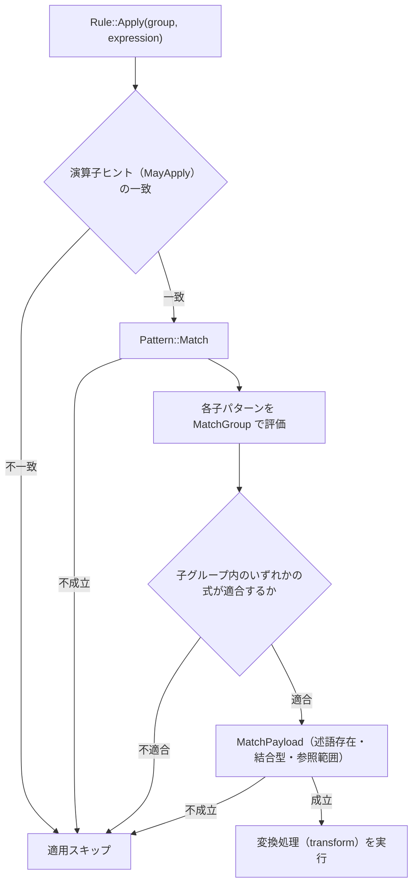

# 第30章 Pattern DSL と Bindings — Rule の「条件」を宣言する

- 状態: draft / 執筆基準リビジョン: `3880673` (2026-09-12)

論理 Rule は、`Pattern` で候補を絞り込み、`Bindings` で変換処理に必要な
Group を受け取ります。この章では `plan/cascades.hpp` の `Pattern`、
`PayloadConstraint`、`Bindings` と、`plan/cascades.cpp` の照合処理を
説明します。

## 30-1. 規則における適用条件と変換処理の分離

論理 Rule は `Rule(name, pattern, transform, target)` という 4 つの要素で定義されます（第 1 章 1-4 節）。**パターン（pattern）** は式に対する適用条件を静的に宣言し、**変換関数（transform）** は条件を満たしたときの Memo への追加操作を記述します。適用条件と変換動作を分けることで、次の利点が得られます。

- 各規則が要求する前提条件がパターン構造として明示され、コードレビューや静的解析による検査が容易になります。
- 探索エンジンは個々の規則の内部変換ロジックに依存せず、パターンの合致判定のみに基づいて規則のディスパッチを行える。

パターンが宣言する条件は、次の 4 要素で構成されます。

1. **演算子型**: 対象とする論理演算子（`kJoin`、`kSelection` 等）。
2. **子の構造**: 許容される子パターンの個数および各子の形状。
3. **キャプチャ**: 適合した子グループ（または親グループ）を変換関数へ受け渡すための識別名。
4. **ペイロード制約**: 述語の存在や、述語が参照するテーブルの範囲（特定の子グループ内に閉起していること）に関する制約。

これらの条件を表すクラスが `Pattern` です（`plan/cascades.hpp`）。

```cpp
class Pattern {
 public:
  static Pattern Any(std::string capture = {});
  static Pattern Op(LogicalOperator operation, std::vector<Pattern> children,
                    std::string capture = {});
  static Pattern Op(LogicalOperator operation, std::vector<Pattern> children,
                    std::string capture, PayloadConstraint payload);

  [[nodiscard]] bool Match(const Memo& memo, GroupId group,
                           const LogicalExpression& expression,
                           Bindings* bindings) const;

 private:
  [[nodiscard]] bool MatchGroup(const Memo& memo, GroupId group,
                                Bindings* bindings) const;
  [[nodiscard]] bool MatchPayload(const Memo& memo,
                                  const LogicalExpression& expression,
                                  const Bindings& bindings) const;
  std::optional<LogicalOperator> operation_;
  std::vector<Pattern> children_;
  std::string capture_;
  PayloadConstraint payload_;
};
```

キャプチャされた Group を保持する型が `Bindings` です（`plan/cascades.hpp`）。

```cpp
using Bindings = std::unordered_map<std::string, GroupId>;
```

キャプチャの対象が式ではなく `GroupId` に限定されている点は重要です。Cascades における規則の適用は既存の式を直接書き換えるのではなく、既存のグループへ新たな等価式を追加する操作であるため、変換処理に必要な引数は常に部分式が属する子グループの識別子（`GroupId`）のみとなります。

## 30-2. パターン記述 DSL

`Pattern` を簡潔に構築できるように、`cascades::dsl` 名前空間には生成関数群があります（`plan/cascades.hpp`）。これらは主に次の 3 種類です。

| 形式 | 代表例 | 判定内容 |
|---|---|---|
| 任意（ワイルドカード） | `Any("left")` | 演算子を問わず適合し、対象グループを `"left"` として束縛 |
| 演算子指定 | `Scan("scan")`, `Join(l, r)` | 指定された `LogicalOperator` および子パターン列に適合 |
| ペイロード制約付き | `LeftOuterJoin(l, r)`, `SelectionWithin(0, child)` | 演算子に加え、述語が子 Group 内に閉じていることや結合型の制約を課す |

代表例として、`Join` とペイロード制約を伴う関数の実装を示します（`plan/cascades.hpp` の `namespace dsl`）。

```cpp
inline Pattern Join(Pattern left = Any(), Pattern right = Any(),
                    std::string capture = {}) {
  std::vector<Pattern> children;
  children.push_back(std::move(left));
  children.push_back(std::move(right));
  return Pattern::Op(LogicalOperator::kJoin, std::move(children),
                     std::move(capture));
}

inline Pattern LeftOuterJoin(Pattern left = Any(), Pattern right = Any(),
                             std::string capture = {}) {
  PayloadConstraint payload;
  payload.outer_join_type = 0;  // 0 = LEFT
  return Pattern::Op(LogicalOperator::kOuterJoin,
                     {std::move(left), std::move(right)}, std::move(capture),
                     payload);
}

inline Pattern SelectionWithin(size_t predicate_within_child,
                               Pattern child = Any(),
                               std::string capture = {}) {
  PayloadConstraint payload;
  payload.requires_predicate = true;
  payload.predicate_within_child = predicate_within_child;
  return Pattern::Op(LogicalOperator::kSelection, {std::move(child)},
                     std::move(capture), payload);
}
```

`LeftOuterJoin` のように結合型の検証をパターン層に持たせることで、変換ラムダの内部で個別に結合型を再検査する重複を排除し、不適切な結合型に対する誤適用を未然に防止しています。

## 30-3. パターン照合の評価手順

照合処理は `Match`、`MatchGroup`、`MatchPayload` の 3 段階で再帰的に進みます。最上位のエントリポイントは `Pattern::Match` です（`plan/cascades.cpp`）。

```cpp
bool Pattern::Match(
    const Memo& memo, GroupId group,
    const LogicalExpression& expression, Bindings* bindings) const {
  if (operation_ && expression.operation != *operation_) {
    return false;
  }
  if (!children_.empty() && children_.size() != expression.children.size()) {
    return false;
  }
  Bindings local = *bindings;
  if (!capture_.empty()) {
    auto [iter, inserted] = local.emplace(capture_, group);
    if (!inserted && iter->second != group) {
      return false;
    }
  }
  for (size_t i = 0; i < children_.size(); ++i) {
    if (!children_[i].MatchGroup(memo, expression.children[i], &local)) {
      return false;
    }
  }
  if (!MatchPayload(memo, expression, local)) {
    return false;
  }
  *bindings = std::move(local);
  return true;
}
```

`Match` は渡された単一の論理式 `expression` に対し、以下の順序で判定を行います。

1. **演算子の一致判定**: パターンに演算子が指定されている場合、式の演算子と完全一致するかを検証します。
2. **子ノード数の比較**: 子パターン列が明示されている場合は、子の要素数が一致するかを確認します（未指定の場合は任意の個数に適合します）。
3. **キャプチャの登録と同一性検証**: パターンにキャプチャ名が存在する場合、現在の `group` を束縛します。既に同名のキャプチャが存在し、かつ異なる `GroupId` を指していた場合は照合失敗とします。同一の変数名を複数回用いることで、左右の子が同一グループであることを要求する制約を表現できます。
4. **子グループへの再帰判定**: 各子ノードに対して `MatchGroup` を呼び出す。
5. **ペイロード制約の検証**: `MatchPayload` を評価します。

照合途中で失敗した際に呼び出し元の束縛情報を汚染しないよう、ローカルコピー `local` に対して操作を行い、すべての条件を満たした場合にのみ元の `bindings` を上書きします。

子 Group を照合する `MatchGroup` は以下のとおりです（`plan/cascades.cpp`）。

```cpp
bool Pattern::MatchGroup(
    const Memo& memo, GroupId group,
    Bindings* bindings) const {
  if (!capture_.empty()) {
    auto [iter, inserted] = bindings->emplace(capture_, group);
    if (!inserted && iter->second != group) {
      return false;
    }
  }
  if (!operation_) {
    return true;
  }
  return std::ranges::any_of(
      memo.Get(group).expressions,
      [&](const LogicalExpression& expression) {
        Bindings local = *bindings;
        if (Match(memo, group, expression, &local)) {
          *bindings = std::move(local);
          return true;
        }
        return false;
      });
}
```

この処理では、子 Group 内にある**いずれか 1 つの等価式**がパターンに合えば、Group 全体がマッチしたと判定します（`std::ranges::any_of`）。Group は等価な式の集合なので、対象の形を持つ代替案が一つでもあれば、探索エンジンはその候補を選んで Rule を適用できます。

ペイロード制約の構造体と判定処理は以下のとおりです（`plan/cascades.hpp`, `plan/cascades.cpp`）。

```cpp
struct PayloadConstraint {
  bool requires_predicate{false};
  std::optional<size_t> predicate_within_child;
  std::optional<uint8_t> outer_join_type;
};

bool Pattern::MatchPayload(const Memo& memo,
                           const LogicalExpression& expression,
                           [[maybe_unused]] const Bindings& bindings) const {
  if (payload_.requires_predicate && !expression.predicate) {
    return false;
  }
  if (payload_.outer_join_type.has_value()) {
    if (expression.operation != LogicalOperator::kOuterJoin ||
        expression.join_type != *payload_.outer_join_type) {
      return false;
    }
  }
  if (!payload_.predicate_within_child) {
    return true;
  }
  const size_t child_index = *payload_.predicate_within_child;
  if (!expression.predicate || child_index >= expression.children.size()) {
    return false;
  }
  const Group& child = memo.Get(expression.children[child_index]);
  return std::ranges::all_of((*expression.predicate)->TouchedColumns(),
                             [&child](const ColumnName& column) {
                               return !column.schema.empty() &&
                                      std::ranges::find(child.relations,
                                                        column.schema) !=
                                          child.relations.end();
                             });
}
```

`predicate_within_child` は、述語が参照するすべての列が、指定した子 Group の関係集合だけに属することを要求します。テーブル修飾のない列名（`col` など）は所属関係を一意に証明できないため、照合不一致とします。所属先を証明できない述語を押し下げ、クエリ結果が変わることを防ぐためです。



## 30-4. 適用例 — `push_selection_into_scan`

述語をスキャン Group へ押し下げる Rule `push_selection_into_scan` の宣言を例に示します（`plan/cascades.cpp` の `RuleSet::Default()`）。

```cpp
    built.Add(Rule(
        "push_selection_into_scan", SelectionWithin(0, Scan("scan")),
        [](const Bindings& bindings, Memo& memo, GroupId,
           const LogicalExpression& expression) {
          memo.MergeScanFilter(bindings.at("scan"), *expression.predicate);
        },
        LogicalOperator::kSelection));
```

- パターン部 `SelectionWithin(0, Scan("scan"))` は、0 番目の子グループが単一テーブルのスキャンであり、かつ選択述語がそのテーブルのみを参照している場合に適合します。
- 変換本体はキャプチャされたスキャングループに対し、`memo.MergeScanFilter` を用いて述語を合併するのみです。
- 述語がスキャン対象の表だけを参照していることは、パターン定義側で検査します。そのため、変換関数内で同じ条件を再判定する必要はありません。

## 30-5. `Rule::Apply` — 規則の実行と Memo 成長の判定

探索エンジンから各 Rule を呼び出す共通処理が `Rule::Apply` です（`plan/cascades.cpp`）。

```cpp
bool Rule::Apply(Memo& memo, GroupId group,
                 const LogicalExpression& expression) const {
  if (!MayApply(expression.operation)) {
    return false;
  }
  Bindings bindings;
  if (!pattern_.Match(memo, group, expression, &bindings)) {
    return false;
  }
  const size_t before_groups = memo.GroupCount();
  const size_t before_expressions = memo.ExpressionCount(group);
  transform_(bindings, memo, group, expression);
  return memo.GroupCount() != before_groups ||
         memo.ExpressionCount(group) != before_expressions;
}
```

- `MayApply` による演算子フィルタ: パターン全体の評価に先立ち、対象式の演算子が規則の事前ヒント（`target`）と一致するかを判定し、無駄なマッチング処理を回避します。
- 戻り値の責務: 戻り値の真偽値は「規則の適用によって Memo に新たなグループまたは式が追加されたか」を表します。変換関数が早期リターンした場合や重複によって追加が棄却された場合を呼び出し側で検知できます。

`Rule::Apply` の戻り値により、探索エンジンは Memo が実際に増えた場合だけ
後続の探索を進められます。第 40 章では、この Rule 適用を繰り返す
`SearchEngine` とコスト選択を説明します。
