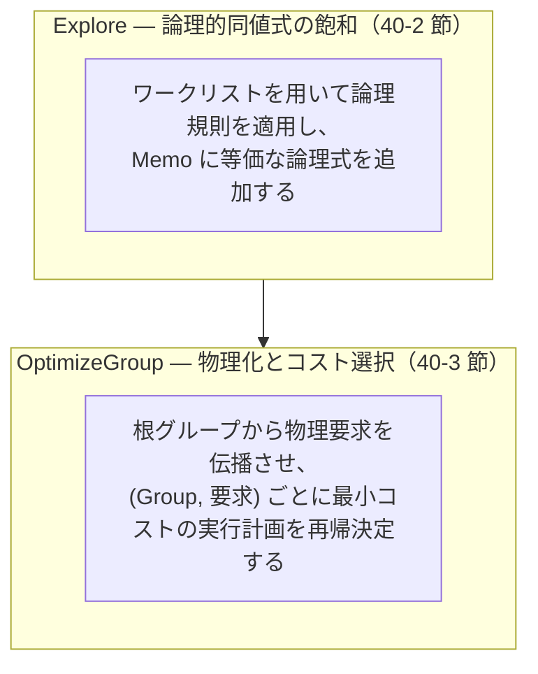

# 第40章 SearchEngine — 探索・コスト・枝刈り・縮退

- 状態: draft / 執筆基準リビジョン: `3880673` (2026-09-12)

`SearchEngine` は、`Explore` で論理 Rule を適用し、`OptimizeGroup` で
最小コストの物理計画を選びます。この章では `plan/cascades.cpp` の実装に
沿って、二つの処理と探索の打ち切り条件を説明します。

## 40-1. 探索エンジンの 2 段階処理

`SearchEngine::Optimize` は、以下の 2 段階で構成されます。



第 1 段階の `Explore` が探索空間（等価式の候補群）を生成し、第 2 段階の `OptimizeGroup` がその中から具体的な物理実行計画を導出します。

## 40-2. `Explore` — ワークリストによる規則の飽和適用

`SearchEngine::Explore` の処理本体は以下のとおりです（`plan/cascades.cpp`）。

```cpp
void SearchEngine::Explore(GroupId root) {
  best_.clear();
  next_expression_.clear();
  steps_ = 0;
  budget_exhausted_ = false;
  std::deque<GroupId> queue;
  std::unordered_set<GroupId> queued;
  const std::function<void(GroupId)> enqueue = [&](GroupId group) {
    if (group == kInvalidGroup) {
      return;
    }
    if (queued.insert(group).second) {
      queue.push_back(group);
    }
  };
  enqueue(root);
  size_t steps = 0;
  constexpr size_t kMaxExploreSteps = 20000;
  while (!queue.empty() && steps < kMaxExploreSteps) {
    ++steps;
    const GroupId group = queue.front();
    queue.pop_front();
    ExploreGroup(group, enqueue);
    for (GroupId touched : memo_.DrainTouchedGroups()) {
      enqueue(touched);
    }
  }
}
```

この処理は幅優先探索（BFS）型のワークリストとして動作します。

- **重複キューイングの抑止**: `queued` 集合を用いて、同じ Group がキューへ重複して追加されるのを防ぎます。Memo は既存の式を変更せず、新しい式だけを追記します。
- **派生更新の追跡**: `Memo::AddExpression` は式が追加されたグループを `touched_groups_` に記録します。`ExploreGroup` の完了ごとに `DrainTouchedGroups()` でこれらを回収してキューへ再投入することで、新しく生成された式に対する規則適用を順次進める。
- **探索回数の安全上限**: 論理規則の適用予算（`search_step_budget`）とは別に、ループ自体の安全弁として `kMaxExploreSteps = 20000` の上限が設けられています。

各グループの探索処理は `ExploreGroup` が担います（`plan/cascades.cpp`）。

```cpp
void SearchEngine::ExploreGroup(GroupId group,
                                const std::function<void(GroupId)>& enqueue) {
  size_t& next = next_expression_[group];
  while (next < memo_.Get(group).expressions.size()) {
    const LogicalExpression expression = memo_.Get(group).expressions[next];
    ++next;
    for (const Rule& rule : rules_->Rules()) {
      if (!rule.MayApply(expression.operation)) {
        continue;
      }
      if (step_budget_ != 0 && steps_ >= step_budget_) {
        budget_exhausted_ = true;
        return;
      }
      ++steps_;
      try {
        if (rule.Apply(memo_, group, expression)) {
          applied_rules_.insert(rule.Name());
        }
      } catch (const std::invalid_argument&) {
        continue;
      }
    }
    for (GroupId child : expression.children) {
      enqueue(child);
    }
  }
}
```

Group ごとに、次に読む式の位置 `next`（`next_expression_[group]`）を
記録します。式が追加された後に同じ Group を再び処理しても、探索は未評価の式から
再開するため、既知の式を読み直しません。

## 40-3. `OptimizeGroup` — メモ化再帰と分枝限定法

第 2 段階の `OptimizeGroup` は、指定された物理要求を満たす最良の物理プランを再帰的に決定します（`plan/cascades.cpp`）。

```cpp
std::optional<BestPlan>
SearchEngine::OptimizeGroup(
    GroupId group, const PhysicalProperties& properties,
    const Implement& implement, const RuleContext& context) {
  const std::string cache_key = std::to_string(group) + '/' + properties.Key();
  if (const auto found = best_.find(cache_key); found != best_.end()) {
    return found->second;
  }

  const bool needs_ordering = !properties.ordering.empty() &&
                              context.query != nullptr &&
                              !context.query->order_expressions_.empty();
  std::optional<BestPlan> best;
  const Group& memo_group = memo_.Get(group);
  for (size_t index = 0; index < memo_group.expressions.size(); ++index) {
    const LogicalExpression& expression = memo_group.expressions[index];
    const std::vector<PhysicalProperties> child_properties =
        RequiredChildProperties(expression, properties);
    if (child_properties.size() != expression.children.size()) {
      continue;
    }
    std::vector<BestPlan> children;
    double child_cost = 0;
    double child_rows = 0;
    bool valid = true;
    for (size_t child = 0; child < expression.children.size(); ++child) {
      std::optional<BestPlan> child_plan =
          OptimizeGroup(expression.children[child], child_properties[child],
                        implement, context);
      if (!child_plan) {
        valid = false;
        break;
      }
      child_cost += child_plan->cost;
      child_rows += child_plan->estimated_rows;
      children.push_back(std::move(*child_plan));
    }
    if (!valid) {
      continue;
    }

    if (best && child_cost >= best->cost) {
      continue;
    }

    for (PlanAlternative alternative :
         implement(group, memo_, expression, children, properties, context)) {
      if (!alternative.plan) {
        continue;
      }
      double cost = child_cost + alternative.local_cost;
      if (needs_ordering &&
          !alternative.plan->IsOrderedBy(context.query->order_expressions_,
                                         context.query->order_ascending_,
                                         context.query->order_nulls_first_)) {
        const double rows = std::max(alternative.estimated_rows, child_rows);
        cost += rows * std::log2(std::max(2.0, rows));
      }
      if (!best || cost < best->cost) {
        best = BestPlan{.plan = std::move(alternative.plan),
                        .cost = cost,
                        .estimated_rows = alternative.estimated_rows,
                        .group = group,
                        .expression_index = index};
      }
    }
  }
  best_.emplace(cache_key, best);
  return best;
}
```

この処理における設計上の重要事項は以下のとおりです。

1. **(Group, 物理要求) を単位とするメモ化**: キャッシュキーはグループ番号と物理要求キーの組（`group/properties.Key()`）で構成されます。同じ関係集合であっても、ソート順を要求する場合と要求しない場合とで異なる最適解が導出・保持されます。
2. **分枝限定法（Branch-and-Bound）による枝刈り**: 各候補の総コストは「子ノードの累積コスト ＋ 自ノードの局所コスト（＋ 整列ペナルティ）」です。局所コストとペナルティは非負なので、`child_cost` だけで暫定最小値 `best->cost` 以上なら、その候補は最小値を更新できません。この時点で後続の物理化を打ち切ります。
3. **物理要求のコスト評価（D6 規律）**: 要求された整列順序を自然に出力できない物理計画に対しては、後段で必要となるソート処理の推定コスト $N \log_2 N$ をペナルティとして加算します。これにより、インデックス走査によって整列順を無償で提供する計画と、全表走査にソート演算子を追加する計画とを、同一のコスト基準で比較できます。
4. **失敗結果のキャッシュ**: 要求を満たす実行計画が存在しない場合、`std::nullopt` がキャッシュされます。同一の (Group, 物理要求) に対する不要な再帰探索を防ぎます。

## 40-4. 物理演算子の局所コスト算出例

実装 Rule が算出する局所コスト（`local_cost`）の例として、2 種類の結合方式を示します（`plan/implementation_rules.cpp` の `JoinAlternatives`）。

**クロス積のコストモデル**:
```cpp
const double local_cost = (l_rows * r_rows) + l_rows + r_rows;
```
左右の行数の積（出力行数）に、両入力の読み込み行数を加算した単純なモデルです。

**ハッシュ結合のコストモデル**:
```cpp
double local_cost = l_rows + r_rows;
const double build_bytes = r_rows * kHashJoinRowBytesEstimate;
if (mode == HashJoinMode::kInMemory &&
    PreferHybridHashJoin(static_cast<size_t>(build_bytes))) {
  local_cost += r_rows * 3;
}
```
両入力の走査行数を基本コストとします。build 側の推定メモリ使用量がメモリ予算を超える場合は、インメモリ結合にペナルティを加え、ディスクスピルを前提とするハイブリッド結合を優先します。

## 40-5. 探索の打ち切りと縮退動作

大規模クエリにおける探索コストの肥大化を抑止するため、tinylamb は以下の縮退（degradation）機構を備えています。

1. **グループ内の式数上限（`expression_cap_`）**: グループ内の論理式が 4096 件（既定値）に達した時点で新規式の追加を停止し、`degraded_` フラグを立てる（第 20 章 20-7 節）。
2. **規則適用ステップ予算（`search_step_budget`）**: 論理規則の適用回数が指定値に達した時点で探索を打ち切り、その時点までに発見された最良プランを返します。
3. **探索ループ上限（`kMaxExploreSteps`）**: ワークリストのループ回数を最大 20,000 回に制限します。

これらの縮退機構は探索範囲を狭めるため、最良の計画を見逃す可能性はありますが、
クエリ結果は変えません。

いずれの上限に達しても、既に登録された式の意味は変わりません。探索範囲を
狭めて計画の最適性を譲るだけで、クエリ結果の正しさは保たれます。第 50 章では、
`OptimizeGroup` が受け渡す `PhysicalProperties` と、親から子への要求変換を
説明します。
