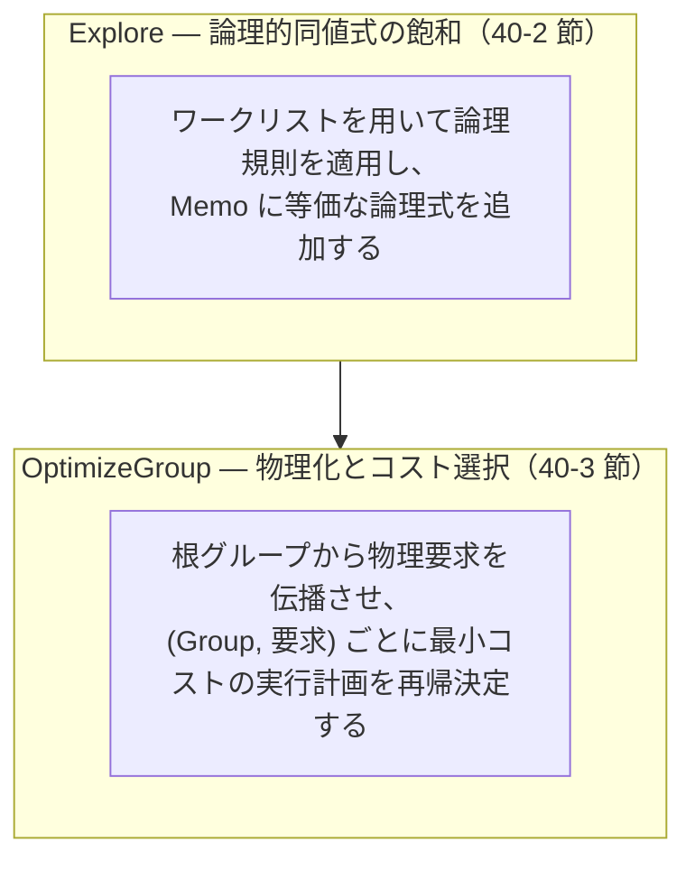

# 第40章 SearchEngine — 探索・コスト・枝刈り・縮退

- 状態: draft / 執筆基準リビジョン: `3880673` (2026-09-12)

`SearchEngine` は、`Explore` で論理 Rule を適用し、`OptimizeGroup` で
最小コストの物理計画を選びます。この章では `plan/cascades.cpp` の実装に
沿って、二つの処理と探索の打ち切り条件を説明します。

## 40-1. 探索エンジンの 2 段階処理

`SearchEngine::Optimize` は、以下の 2 段階で構成されます。



第 1 段階の `Explore` が探索空間（等価式の候補群）を生成し、第 2 段階の `OptimizeGroup` がその中から具体的な物理実行計画を導出します。

## 40-2. 子の変化を親に伝える探索

2026-10-02 更新（`9ce7837` 上の作業ツリー）。対応シンボルは
`plan/cascades.cpp` の `SearchEngine::Explore` / `ExploreGroup` です。

次は簡略化した疑似コードです。実装引用ではありません。

```text
reachable children を先に、parent を後に queue へ入れる
while queue が空でなく予算が残る:
    group の未処理 expression に rule を適用する
    touched group を queue へ戻す
    touched group に依存する既処理 parent の cursor を 0 に戻して enqueue
```

自分に新しい式が追加された Group は続きから処理します。一方、子が変わった親は
既存の式も再照合します。Selection(Projection(X)) のようなパターンは、親の式自体が
増えなくても、子に Projection が追加された時点で新しく成立するからです。
以前の「既知の式は読み直さない」方式ではこの機会を落としていました。
scan filter の変更も touched 通知を発行します。式数、探索ステップ、worklist 回数の
上限を維持し、循環する同値変換が無制限に探索を延ばすことを防ぎます。

## 40-3. コストと順序の要求

`OptimizeGroup` は `(GroupId, PhysicalProperties::Key())` をキャッシュキーとします。
処理中のキー集合も持ち、自分の未確定 winner を要求する循環候補は辞退します。

候補の実コストは子の実コストと local_cost の和です。順序が不足する候補には
選択用スコアとして sort 罰則を加えますが、その罰則を `BestPlan::cost` に入れません。
親が実際に sort を追加するとき、まだ存在しない sort を二重計上しないためです。
枝刈りは子のコストが incumbent の選択スコアを超えるときに行います。

Aggregation と Sort は、通常の子の要求に加え、キー順を指定した子も比較します。
これにより若干高い ordered scan と stream aggregate の組み合わせも候補になります。
Empty は子のスキーマだけを利用するので子の実行コストは 0 として扱います。

統計の入口は `ColumnStats::EstimateJoinMatches` と
`TableStatistics::EstimateDistinctRows` です。前者は MCV / NULL / NDV と範囲、
後者は NULL を含む NDV の指数バックオフを使用します。統計による推定は意味論的な
空集合・一意性の証明に使いません。詳細は [監査](../../optimizer_rule_audit.md) を参照してください。

## 40-4. 物理演算子の局所コスト算出例

実装 Rule が算出する局所コスト（`local_cost`）の例として、2 種類の結合方式を示します（`plan/implementation_rules.cpp` の `JoinAlternatives`）。

**クロス積のコストモデル**:
```cpp
const double local_cost = (l_rows * r_rows) + l_rows + r_rows;
```
左右の行数の積（出力行数）に、両入力の読み込み行数を加算した単純なモデルです。

**ハッシュ結合のコストモデル**:
```cpp
double local_cost = l_rows + r_rows;
const double build_bytes = r_rows * kHashJoinRowBytesEstimate;
if (mode == HashJoinMode::kInMemory &&
    PreferHybridHashJoin(static_cast<size_t>(build_bytes))) {
  local_cost += r_rows * 3;
}
```
両入力の走査行数を基本コストとします。build 側の推定メモリ使用量がメモリ予算を超える場合は、インメモリ結合にペナルティを加え、ディスクスピルを前提とするハイブリッド結合を優先します。

## 40-5. 探索の打ち切りと縮退動作

大規模クエリにおける探索コストの肥大化を抑止するため、tinylamb は以下の縮退（degradation）機構を備えています。

1. **グループ内の式数上限（`expression_cap_`）**: グループ内の論理式が 4096 件（既定値）に達した時点で新規式の追加を停止し、`degraded_` フラグを立てる（第 20 章 20-7 節）。
2. **規則適用ステップ予算（`search_step_budget`）**: 論理規則の適用回数が指定値に達した時点で探索を打ち切り、その時点までに発見された最良プランを返します。
3. **探索ループ上限（`kMaxExploreSteps`）**: ワークリストのループ回数を最大 20,000 回に制限します。

これらの縮退機構は探索範囲を狭めるため、最良の計画を見逃す可能性はありますが、
クエリ結果は変えません。

いずれの上限に達しても、既に登録された式の意味は変わりません。探索範囲を
狭めて計画の最適性を譲るだけで、クエリ結果の正しさは保たれます。第 50 章では、
`OptimizeGroup` が受け渡す `PhysicalProperties` と、親から子への要求変換を
説明します。
