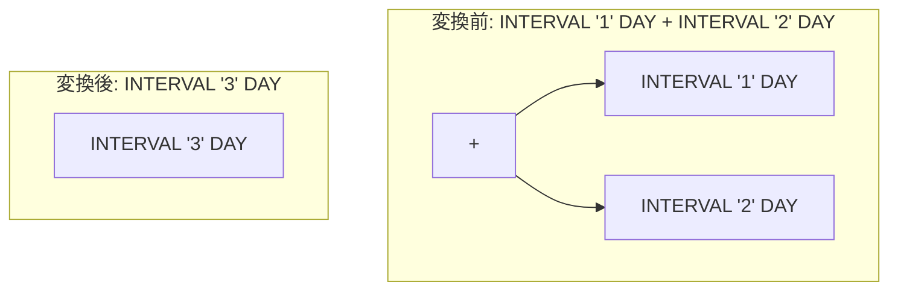

# interval_normalize

- 状態: draft   /   執筆基準リビジョン: `3880673` (2026-09-12)
- 定義位置: `expression/rewrite.cpp` の `ExpressionRuleSet::Default()` 内
  `built.Add(ExpressionRule("interval_normalize", ...))`

## 概要

`interval_normalize` は、`INTERVAL` 型リテラルに対する定数演算をコンパイル時に評価する Rule です。対象は、リテラル同士の加減算、整数定数との乗算、`JUSTIFY_HOURS` / `JUSTIFY_DAYS` / `JUSTIFY_INTERVAL` の適用です。ただし単項マイナスは対象外で、式をそのまま残します（後述）。たとえば `INTERVAL '1' DAY + INTERVAL '2' DAY` を `INTERVAL '3' DAY` へ畳み込みます。

算術オーバーフローや不正な区間が生じる場合には、実行時エンジンが送出すべき例外を消去しないよう、畳み込みを即座に中止して元の構文木のまま保持します。生の高速路では `__builtin_*_overflow` と `IntervalValue::TryTotalNanos()`、一般路では `TryPlus` / `TryMinus` / `TryMultiply` / `TryJustify*` の `StatusOr` で判定します。

## 変換前後の関係



## 適用条件

パターンは `Any()` であり、ノード種別に応じて以下の 3 経路で判定します。

1. **二項加減算経路**: 左右両オペランドがともに `INTERVAL` リテラルの場合。
   同一単位かつ複合量テキストを持たない場合は、コンパイラ組み込み関数で 64 ビット整数のオーバーフローを検出します。

   ```cpp
   // Fast paths must respect the same overflow contract as the
   // runtime IntervalValue arithmetic (throw); a silent int64
   // wrap would make the rewrite change the observable result.
   int64_t folded = 0;
   if (l_iv.RawAmount().empty() && r_iv.RawAmount().empty() &&
       l_iv.Unit() == r_iv.Unit()) {
     bool overflowed = false;
     if (binary.Op() == BinaryOperation::kAdd) {
       overflowed = __builtin_add_overflow(l_iv.Amount(),
                                           r_iv.Amount(), &folded);
     } else if (binary.Op() == BinaryOperation::kSubtract) {
       overflowed = __builtin_sub_overflow(l_iv.Amount(),
                                           r_iv.Amount(), &folded);
     }
   ```

   オーバーフローが検出された場合は変換を行わず `Expression{}` を返します。単位が異なる複合計算の場合は `IntervalValue` の一般加減算ルーチンへ委譲します。

2. **整数倍乗算経路**: `INTERVAL * 整数定数` および `整数定数 * INTERVAL` の場合。
   `__builtin_mul_overflow` により乗算オーバーフローを検査し、オーバーフロー時は畳み込みを拒絶します。

3. **正規化関数経路**: 1 引数の `justify_hours` / `justify_days` / `justify_interval` が `INTERVAL` リテラルを受け取った場合。正規化後の `INTERVAL` リテラルを返します。

   なお現行実装には単項マイナス（`kMinus`）を `INTERVAL` リテラルへ畳み込む経路は存在しません。`expression/rewrite.cpp` の同 Rule は次のコメント付きで式を無変更のまま残します。

   ```cpp
   // `-INTERVAL ...` is rejected by the canonical AST evaluator
   // (UnaryExpression::Evaluate kMinus accepts only numbers). Do not
   // fold it into a value: leaving it unfolded lets the runtime raise
   // the same error the AST ground truth does.
   ```

## 意味論的根拠と三値論理・例外保護

本 Rule における最大の規律は、**実行時エンジンとの例外契約の一致**です。

tinylamb の実行時評価器における `IntervalValue` の算術演算は、int64 の桁あふれが発生した際にエラー（`Status`）を返します。もしオプティマイザの定数畳み込み側で符号付き整数の wrap-around を静かに許容してしまうと、「実行時エラーでクエリがアボートするはずの処理」が「予期せぬ値で完走する不正なクエリ」へと変貌してしまいます。したがって、例外を送出すべきケースでは一切の畳み込みを行わず、実行時のエラーパスに処理を委ねます。

オーバーフロー検査は経路ごとに次のように行います。

- 同一単位の生の加減算・整数倍乗算の高速路では `__builtin_add_overflow` / `__builtin_sub_overflow` / `__builtin_mul_overflow` を用い、さらに `IntervalValue::TryTotalNanos()` で区間領域（約 ±106751 日）を検証します。
- 単位が異なる場合や複合量を含む一般の加減算・乗算は `IntervalValue::TryPlus` / `TryMinus` / `TryMultiply` / `TryParse` の `StatusOr` を経由し、値が不正なら畳み込みを拒絶します。
- `JUSTIFY_*` は `TryJustifyHours` / `TryJustifyDays` / `TryJustifyInterval` を経由します。

いずれも投げるラッパー（`StatusOr` 境界を越える例外）を避け、式を無変更で残すことでランタイムと同じ結果にしています。また単項マイナスは AST 評価器が `INTERVAL` を受け付けないため、畳み込まずに残すことが例外契約の一致につながります。

## 実装の詳細

生成される式は、単位付きの単一量を表す `IntervalExpressionExp(amount, unit)`、または複合量の文字列表現を保持する `IntervalExpressionExp(0, "", str)` の形式で構築されます。

パターンが `Any()` であるため、対象外のノードに対してはラムダ式の先頭で即座に `Expression{}` を返却し、評価オーバーヘッドを極小に抑えています。

## 最適化効果

`INTERVAL` リテラル同士の算術計算がコンパイル時に解消されます。

たとえば `DATE_ADD(col, INTERVAL '1' DAY + INTERVAL '2' DAY)` のようなクエリにおいて、内部の INTERVAL 式が事前に `INTERVAL '3' DAY` へ正規化されることで、後続の日時関数定数畳み込みやスキャン範囲の絞り込み処理が円滑に適用可能になります。

## 関連 Rule との相互作用

- `datetime_and_string_fold_extent`: 日時関数と `INTERVAL` の計算を畳み込みます。本 Rule による事前の INTERVAL 単一化が下流の前提条件となります。
- `fold_binary`: 通常の数値二項演算を畳み込みますが、`INTERVAL` 型をオペランドに含む演算は本 Rule が特化して処理を担当します。

## 検証テスト

`expression/rewrite_test.cpp` の `ExpressionRewriteTest.IntervalNormalize` において以下を検証しています。

- 日時加減算、整数乗算（左右両オペランド）、および `JUSTIFY_*` 関数が単一の `INTERVAL` リテラルに正規化されること。
- オーバーフローする加算および乗算において、静かな桁あふれを起こさず書き換えが安全に拒絶されること（YEAR→月換算のオーバーフローを含む）。
- `- INTERVAL` は単項マイナスのまま書き換えられずに残ること（AST 評価器のエラーを隠さないため）。
