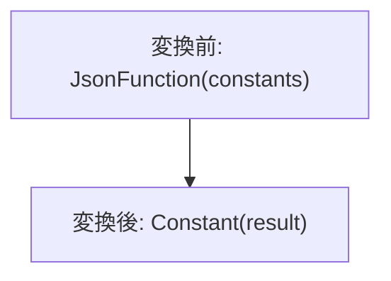

# json_family_constant_fold

- 状態: review / 執筆基準リビジョン: `67ee0c0` + 作業ツリー差分 (2026-11-11)
- 定義位置: [expression/rewrite.cpp](../../../../expression/rewrite.cpp) の `ExpressionRuleSet::Default()`、登録名 `json_family_constant_fold`

## 概要

JSON document family に属する関数を、全引数が定数の場合に共有評価器で一度計算し、成功した値を定数式に置き換えます。

## 変換前後の関係



## 適用条件

パターンは FunctionCallExp です。`json_doc::family::IsJsonFamilyFunction` が関数名を受理し、全引数が存在する ConstantValue で、共有 `Evaluate` が成功した場合だけ変換します。

```cpp
          StatusOr<Value> folded =
              json_doc::family::Evaluate(fn.FuncName(), arguments);
          if (!folded.HasValue()) {
            return Expression{};
          }
          return ConstantValueExp(folded.MoveValue());
```

## 意味論的根拠と境界条件

行評価と同じ JSON family evaluator を使うので、NULL や JSON 値の変換を別実装で推測しません。評価失敗時は元の式を残します。エラーを NULL に置き換えると、短絡や IFERROR の結果が変わるためです。列参照を許すと行ごとに異なる入力を定数化するため拒否します。

## 実装の詳細

定数値を引数順に vector へ集め、`StatusOr<Value>` の成功値を `ConstantValueExp` へ移動します。失敗時の空 Expression は「置換候補なし」を表し、SQL の NULL 定数ではありません。

## 最適化効果

行ごとの JSON 解析と変換を除去します。大きい定数文書は計画に結果を保持するため、入力と結果の大きさには注意が必要です。

## 関連 Rule との相互作用

子の定数畳み込み後に適用できます。既存 `json_path_constant_fold` は別の JSON path 関数群を扱います。

## 検証テスト

`expression/rewrite_test.cpp` の `JsonFamilyConstantFold` と `JsonPathConstantFold` が定数化の結果を検査します。
