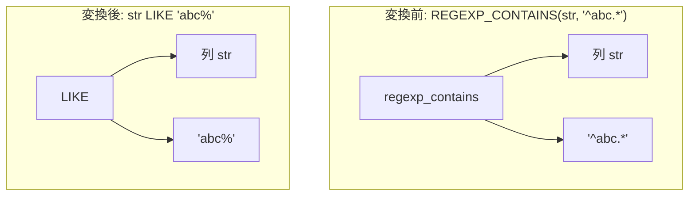

# regexp_prefix_extraction

- 状態: draft   /   執筆基準リビジョン: `fe471c9` (2026-11-21)
- 定義位置: `expression/rewrite.cpp` の `ExpressionRuleSet::Default()` 内
  `built.Add(ExpressionRule("regexp_prefix_extraction", ...))`

## 概要

`regexp_prefix_extraction` は、定数の接頭辞だけを調べる正規表現を、等値比較または `LIKE` へ置き換える Rule です。対象は `REGEXP_CONTAINS`, `REGEXP_LIKE`, `REGEXP_MATCH` です。パターンが `^` とリテラル接頭辞で始まり、その後が終端記号 `$` または任意長ワイルドカード `.*` である場合に適用します。

文字列の先頭一致条件へ単純化し、正規表現エンジンの評価を省きます。変換後の条件は、ストレージ層の LSM インデックスのキー範囲走査に対応付けられます（B+Tree は退役済み）。

## 変換前後の関係



## 適用条件

パターンは `Any()` であり、ラムダ式内部で正規表現関数の構造を検査します。

```cpp
const auto& fn = expression->AsFunctionCallExpression();
const std::string& name = fn.FuncName();
// REGEXP_MATCH is anchored at both ends (std::regex_match), so
// an empty remainder means literal equality, not a prefix.
const bool full_match = name == "regexp_match";
if ((name == "regexp_contains" || name == "regexp_like" ||
     full_match) &&
    fn.Args().size() == 2 && fn.Args()[0] &&
    IsConstant(fn.Args()[1])) {
  const Value pat_val = fn.Args()[1]->AsConstantValue().GetValue();
  const Expression& input = fn.Args()[0];
  // ...(省略: unsafe_input ガードの算出)...
  if (pat_val.type == ValueType::kVarChar && !unsafe_input) {
```

- 対象関数は `regexp_contains` / `regexp_like` / `regexp_match` の 3 種であること。`regexp_match` は両端アンカーの完全一致関数なので `full_match` フラグで区別します。
- 第 1 引数（被検査対象の式）が存在し、第 2 引数（パターン）が非 NULL の VARCHAR 定数リテラルであること。
- 入力式とパターンの双方が「安全」(`unsafe_input == false`)であること。`unsafe_input` は、パターン値または入力式が大小文字非区別コレーションタグ付き、あるいは入力が NULL でない非 VARCHAR 定数であることを静的に証明できる場合に立ちます（`=` と `LIKE` は非区別コレーション下で畳み込まれ、`=` は非 VARCHAR を強制変換し、`LIKE` は非 VARCHAR を拒否するため、REGEXP_* のバイト列比較と意味がずれます）。
- パターン文字列を `ExtractRegexPrefix` により解析し、先頭が `^` で始まり、エスケープされていないメタ文字（`.` `*` `+` `?` `[` `(` `|` `\` 等）が現れるまでの接頭辞 `prefix` と、その後の `remainder` を取得します。
- `remainder` に応じて以下のように分岐します。
  - `remainder == "$"`、または `full_match`（`regexp_match`）で `remainder` が空文字列: 完全一致として等値比較 `=` に置換（ただしタイムスタンプ形状でないこと）。
  - `remainder` が `".*"`, `".*$"`, または `full_match` でない場合の空文字列 `""`: 前方一致として `LIKE 'prefix%'` に置換（ただし接頭辞に LIKE ワイルドカード `%` / `_` を含まないこと）。

## 意味論的根拠と三値論理・例外保護

完全一致 `=` への置き換えにおいては、**タイムスタンプ形状リテラルの除外**が必須の guard となります。

```cpp
if ((remainder == "$" || (full_match && remainder.empty())) &&
    // `=` coerces timestamp-shaped varchars to epoch
    // comparison; REGEXP_* compares bytes.  Refuse the
    // rewrite for timestamp-shaped matches.
    !TimestampShapedConstant(prefix)) {
  return BinaryExpressionExp(
      input, BinaryOperation::kEquals,
      ConstantValueExp(Value(std::string(prefix))));
}
// ...(省略: LIKE 分岐)...
if ((remainder == ".*" || remainder == ".*$" ||
     (!full_match && remainder.empty())) &&
    !HasLikeWildcard(prefix)) {
  return BinaryExpressionExp(
      input, BinaryOperation::kLike,
      ConstantValueExp(Value(std::string(prefix + "%"))));
}
```

tinylamb の `=` 比較演算子は、日時・タイムスタンプ形式の文字列に対して暗黙にエポック秒への型強制変換を実施して比較します。しかし正規表現マッチは厳密なバイト列一致として動作するため、たとえば `'2020-01-01T12:00:00'` と `'2020-01-01 12:00:00'` は `=` では一致しますが正規表現では不一致となります。この乖離を防ぐため、`TimestampShapedConstant` によりタイムスタンプ形状のパターンに対する `=` 変換を拒否します。

同様に、`LIKE` 演算子への変換では文字列のバイト列比較がそのまま行われるため、型強制変換による意味のズレは生じませんが、`%` と `_` が `LIKE` ではワイルドカードとして解釈される点だけは別途 `HasLikeWildcard` で拒否します。

さらに `unsafe_input` ガードは、コレーションタグと定数入力の型という 2 つの静的に判定可能な危険をまとめて弾きます。`=` と `LIKE` はオペランドを大小文字非区別コレーションの下で畳み込みますが、`REGEXP_*` は `AsString()` の生バイト列を比較するため、`COLLATE(..., 'und:ci')` を被せた入力や CI タグ付き定数を変換すると `'ABC'` が `'^abc.*'` に誤って一致してしまいます。また `=` は非 VARCHAR 定数を強制変換し（`regexp_match(1, '^01$')` のような整数→文字列の丸めで真偽が反転する）、`LIKE` は非 VARCHAR オペランドを拒否します。これらは式のみから証明できる場合に限り変換を拒否し、証明できない入力はそのまま残します。

また、無エスケープのメタ文字が存在した時点で接頭辞の切り出しを打ち切るため、正規表現の意味論を損なうような危険な推論は一切行われません。

## 実装の詳細

`ExtractRegexPrefix` は正規表現構文を 1 文字ずつスキャンし、`\` によるエスケープシーケンスはリテラル文字として透過させつつ、純粋なリテラル接頭辞部分のみを正確に抽出します。

パターンが要件を満たさない場合（たとえば `^` で始まらない場合や、メタ文字の後にさらに通常文字が続く場合など）は、変換を行わずに即座に `Expression{}` を返却します。

## 最適化効果

各行で行う正規表現のコンパイルとオートマトン走査を、単純な文字列比較または LIKE 前方一致に置き換えます。

特に `LIKE 'prefix%'` 形式は、後続のプラン生成フェーズで LSM インデックスのキー範囲走査へ直接対応付けられます。そのため、走査対象を接頭辞に一致する範囲へ絞れます。

## 関連 Rule との相互作用

- `like_equality`: ワイルドカード文字を含まない LIKE パターンを等値比較へとさらに簡約します。
- スキャン事前フィルタ（`scan_filter.cpp` の `TryCompileSimpleCompare`）: 変換後の `=` および `LIKE` 述語をインデックス走査およびストレージレベルの早期フィルタに適用します。

## 検証テスト

`expression/rewrite_test.cpp` の `ExpressionRewriteTest.RegexpPrefixExtraction` において以下を検証しています。

- `REGEXP_CONTAINS(str, '^abc.*')` が `str LIKE 'abc%'` へ変換されること。
- `REGEXP_LIKE(str, '^hello$')` が `str = 'hello'` へ変換されること。
- `REGEXP_MATCH(str, '^test')` が `str = 'test'` へ変換されること（`regex_match` は両端をアンカーするため、空 remainder は前方一致ではなく完全一致）。
- タイムスタンプ形状の完全一致パターンにおいて `=` への変換が抑止されること（`like_equality` の連携テストを含む）。

変換を拒否する側は `ExpressionRewriteTest.RegexpPrefixExtractionRefusesUnsafeRewrites` で検証しています。

- 接頭辞に `%` / `_` を含むパターンは `LIKE` へ変換しないこと（`'='` への変換は許可）。
- `COLLATE(..., 'und:ci')` の入力、CI タグ付き定数、非 VARCHAR 定数入力は変換しないか、定数畳み込みが REGEXP_* 本来のバイト列比較の答えを保つこと。
