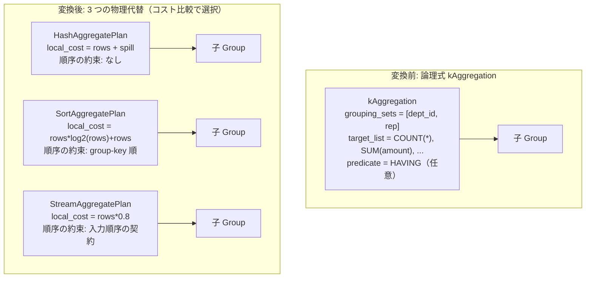

# `aggregation`

- 状態: draft   /   執筆基準リビジョン: `9ce7837` (2026-09-26)
- 定義位置: `plan/implementation_rules.cpp` の `DefaultImplementationRules()` 内の
  登録 `"aggregation"`（パターン: `cascades::dsl::Aggregation()`）

## 概要

論理式 `kAggregation`（集約演算）を、3 種類の物理実行プラン候補 — `HashAggregatePlan`、`SortAggregatePlan`、`StreamAggregatePlan` — の代替候補（`PlanAlternative`）へと変換する Rule です。

3 つの候補は**同じ GROUP BY ペイロード**（`AggregatePayload`: グループキー、集約ターゲットリスト、HAVING、推定グループ数、メモリ契約）を受け取ります。違うのはアルゴリズムと、それが**約束できる出力順序**だけです:

- `HashAggregatePlan` — グループキー上のハッシュ表 1 個。任意の入力順序で動き、順序は**一切約束しない**。
- `SortAggregatePlan` — グループキーのソート run を作り、同一キーの run を 1 パスで畳む。ソートの副作用で**グループキー順（昇順・NULLS FIRST）を約束する**。
- `StreamAggregatePlan` — group を 1 個だけ保持し、ハッシュ表もソートも使わない。**入力が既にグループキー順であること**が正しさの前提なので、その順序を供給する子にだけ提示する。

## 変換前後の関係



生成される 3 つの物理ノードはいずれも `plan/aggregation_plan.hpp` の `AggregationPlan` を基底とし、実行アルゴリズムを `AggregationStrategy`（`kHash`, `kSort`, `kStream`）と plan 型で名分ける。各 plan 型は自前の `EmitExecutor` を持ち、`executor/relational_factory.cpp` がそれぞれ別の実行器（`HashAggregateExecutor` / `SortAggregateExecutor` / `StreamAggregateExecutor`）を組み立てます。

## 適用条件

パターンは `Aggregation()`（単一の子ノード）であり、ラムダ式内部で以下の 3 つの guard 条件を検査します。

1. **行位置要求の不在**:
   ```cpp
   // Aggregated output carries no row positions.
   if (children.size() != 1 || required.require_row_position) {
     return std::vector<PlanAlternative>{};
   }
   ```
   集約演算は複数行を単一の集約値へと不可逆的に集約するため、親ノードから行位置要求が伝播している場合は物理プランを生成しません。

2. **集約または grouping-only DISTINCT**:
   集約なしの場合、全 grouping key と射影列が一致し、HAVING がなければ
   Projection + DISTINCT として実装します。それ以外は辞退します。
   ```cpp
   const bool has_aggregate =
       std::ranges::any_of(logical.target_list, [](const auto& item) {
         return ContainsAggregateExpression(item.expression);
       });
   ```

3. **StreamAgg 用の入力順序契約**（下の「StreamAgg の順序契約」節）:
   ```cpp
   if (grouping_keys.empty() || ChildDeliversGroupKeyOrder(children[0], grouping_keys)) {
     agg_alternatives.push_back(...StreamAggregatePlan...);
   }
   ```

## 意味論的根拠と物理実行の契約

### group キーの取り込み

グループキーは論理式の `grouping_sets`（空なら `partition_by`）から取り込まれ、`AggregatePayload::group_keys` に入ります。キー名にはキー式のカラム名をそのまま使うので、キーを参照する上の射影が「指定した名前」で解決されます。出力行の形は **[group key..., aggregate...]** で、3 つの候補すべてが同じ形を報告します（`AggregationPlan::GenerateSchema`）。

`LogicalProperties` は `kAggregation` の `grouping_sets` を候補キーとして扱い、キーが空のときだけ `max_1_row` を立てます。物理層もそれに従い、`EnforcesDistinct()` は常に true です（1 group につき 1 行で、グループキーは構築上ユニーク）。

### HAVING

ノード自身の `predicate` は group 出力に対する `AggregatePayload::having` として直接評価できます。ただし現行 SQL の HAVING は grouped finish 経路を使い、この Memo payload は生成しません。存在しない生成経路を前提とした変換登録は撤去済みです。

## StreamAgg の順序契約

`StreamAggregate` は「現在開いている group に，属する行が連続して届く」ことを前提にします。この前提が崩れると、正しく畳めるのは最後の group だけで、それ以前の group は複数回出力される（あるいは group 間の順序が崩れる）。したがって **入力が group キーを昇順・NULLS FIRST で到着済みであることが正しさの条件**であり、Rule はそれを 2 段で守ります。

1. **提示条件**: `ChildDeliversGroupKeyOrder(children[0], grouping_keys)` が true（キーが昇順・NULLS FIRST で供給される）のときだけ第三代替を追加する。順序を満たさない子に stream 候補を出さない。
2. **実行時の自己検証**: `StreamAggregateExecutor::Options::require_ordered_input`（factory が設定）が、直前の行のキーとの辞書順比較で順序を検証する。key 位置のいずれかが後退したら `kInvalidArgument`（`"StreamAggregate input is not ordered by the group keys (key N)"`）を返す。null は `SortKeyOrder`（NULLS FIRST）によって「どの値より前」として扱われるので、NULL が後ろに回ってきた場合もここで捕まえる。

キーが 0 個（スカラー集約）のときは group が 1 個で、任意の入力順序が group-key 順そのものなので、stream 候補は常に提示される。`StreamAggregatePlan::RequiresOrderedInput()` がこの区別を報告します。

## 実装の詳細

候補のコストは「そのアルゴリズムが何をするか」を表します:

```cpp
// HashAgg: 1 パス。ただし推定グループ数が group capacity を超えるなら
// key hash で partition へ spill して partition 単位で再集計するので、
// コストにその spill が加わる。
const double hash_cost =
    rows + cascades::EstimateMemorySpillCost(
               cascades::OperatorCostKind::kSort, output_rows,
               AggregateMemoryBudget());

// SortAgg: group キー順の順序を材料とする（ソート + 蓄積パス）。
const double sort_cost = (rows * std::log2(std::max(2.0, rows))) + rows;

// StreamAgg: 1 パス（順序は契約で供給済みなので、ソートもテーブルも不要）。
.local_cost = rows * 0.8
```

`AggregateMemoryBudget()` は optimizer の `MemoryBudget` を plan の `AggregateMemoryPolicy`（`memory_budget_bytes` と `kAggregateEstimatedRowBytes`）の単位に翻訳したものです。

`PlanAlternative::estimated_rows` は常に**推定グループ数**です。キーが空なら 1.0、空でなければ `EstimateDistinctRows(children[0].plan, grouping_keys)`（テーブル統計の distinct 数を使います）。親ノード（結合や LIMIT）はこの group 数に対してコスト,所以됩니다。

## 最適化効果

- 3 つの候補のうち最小コストのものが選ばれる。通常の GROUP BY では hash が最も安い（1 パス・spill なし）だが、group 数が大きければ spill コストが加算され、sort の方が安くなる。
- グループキー順の ORDER BY がある問い合わせでは、stream/sort 候補は `needs_ordering` の sort ペナルティを受けない（`IsOrderedBy` が group キー順を報告するため）。hash 候補は順序を約束しないので、探索がそこへソートを足すことを強制される。この差は順序契約に依存するクエリで実際に効く。
- 出力行数は group 数として伝播するので、集計結果を使う上流の cardinality 推定が input 行数ではなく group 数で評価される。

## 関連 Rule との相互作用

- `distinct_and_group_by_interchange`: 集約関数を持たないグループ化集約を生成しますが、前述の guard によって本 Rule による誤実装が防がれ、`distinct` / `sort_distinct` / `skip_scan_distinct` に委ねられます。
- `push_selection_through_aggregation` / `filter_aggregate_pushdown`: 集約の下位へと述語を押し込み、集約の入力行数を削減します。

- 実行器側の並列化: `HashAggregateExecutor` は `kParallelAggregationMinRows`（8192）を超える入力でワーカー数を引き上げます。ただし位置的に（position 参照だけで）読めないペイロード（式引数、FILTER、HAVING 修飾子、ORDER BY、末尾引数）では `worker_count` を 1 に戻します（推論はせず、逐次 build を保ちます）。ワーカー build は private な group table を union するので group capacity では上限にならず、逐次 build の partition spill とは別の「テーブルが収まらない」回答です（`Spilled()` と `PeakResidentGroups()` で区別できます）。
- 2 つの group 形の**状態**の差は `PeakResidentGroups()` で観測できます: HashAgg は「同時に持つ group table 1 個」（resident build なら distinct key 数、partition spill 後は最大 1 partition の group 数）、SortAgg は常に 1（畳み 중인 run だけ）。この peak は答えには影響せず、メモリ契約の議論の受け口にされているだけです。
- factory（`executor/relational_factory.cpp`）は strategy ごとに設定を引き分けます: worker 数は HashAgg のみ、run threshold（`SpillThresholdRows()`）は SortAgg のみ、`require_ordered_input` は StreamAgg のみ。

## 検証テスト

- `plan/aggregate_shape_test.cpp`: `EveryShapeCarriesTheSamePayloadAndOutputShape`（3 候補が同じ payload と出力行の形を持つ）、`TheLegacyScalarPayloadKeepsItsHistoricalShape`（キーなし render/schema/1 行の互換）、`OnlyTheOrderedShapesPromiseAnOrder`（hash は順序を約束しない／sort・stream は group-key 順）、`TheStreamShapesOrderIsACollatedOne`（`COLLATE` 付きキーの順序は case-insensitive）、`ThePolicyDefinesTheGroupCapacityOfEachShape`（予算→group capacity、実行器側の既定値との一致）、`ExplainNamesTheShapeItsKeysAndItsMemoryContract`、`ExplainInfoCarriesTheRuleAndTheDeliveredOrdering`、`TheRuleOffersBothGroupedShapesAndTheKeylessStream`、`TheStreamShapeNeedsAnOrderedInput`、`AGroupedNodeWithAHavingCarriesTheFilter`、`TheGroupedEstimateIsTheDistinctKeyCount`、`EveryAlternativeIsExactlyOneStrategy`（各候補はちょうど 1 つの final plan 型で、動的型・`Strategy()`・EXPLAIN 名が一致する）、`TheStrategyChoiceFollowsTheGroupTableMemoryContract`（group 数が capacity 内なら hash が安い／超えると spill 込みで sort が安い）、`EachShapeEmitsItsOwnOperator`（factory が形ごとに別実行器を出す）、`EachShapeEmitsItsOwnStrategySettings`（worker 数・run threshold・順序検証がそれぞれ正しい実行器にだけ渡る）、`AKeylessShapeKeepsTheHistoricalScalarOperators`（キーなしは既存のスカラー実行器へ）。
- `executor/grouped_aggregate_test.cpp`: 3 形の等価性、NULL/空/重複/複合キー、FILTER・DISTINCT・AVG、HAVING、子エラー、spill と file error、並列、SQL との差分（`GroupedAggregateSqlTest`）。2 つの group 形の分離そのものは `TheHashShapeKeepsAGroupTableTheSortShapeKeepsOneGroup`（状態）、`TheHashShapeDoesNotReorderItsInputTheSortShapeDoes`（順序）、`InterleavedKeysFoldIntoTheSameGroupsAsAdjacentOnes`（隣接しない同キー行を畳む）、`EachGroupedShapeSpillsOnItsOwnContractOnly` / `APartitionedHashBuildHoldsOnePartitionsGroups`（spill）、`OnlyTheHashShapeFoldsItsInputInParallel`（並列）、`TheEmptyInputReachesNeitherGroupedSpillPath`（空）、`TheSpillPathsKeepTheNullAndDuplicateContract` / `TheSortShapeFoldsNanAndSignedZeroKeysAcrossItsRuns`（NULL・重複・ties が spill を越えても同じ group になる）、`AFailingChildIsTheSameErrorOnBothGroupedAlgorithms`（子エラー）に固定。
- `plan/optimizer_test.cpp` の `OptimizerTest.AggregateSelectBuildsAggregationPlan` / `ParallelAggregationEmittedForLargeChild`、`plan/plan_test.cpp` の `PlanTest.AggregatePhysicalStrategiesHaveDistinctPlanContracts`。

2026-10-02: 単一表の単純 GROUP BY も走査と同じ Memo に入り、通常要求と
キー順要求の両方の子を比較します。stream の局所コストは rows * 0.8、
HashAggregate の spill 推定には共通の EstimateDistinctRows を使います。
`CascadesRulesCoverageTest.GroupedSqlSelectsHashAndStreamAlternatives` は
SQL からの最終選択と実結果を検証します。
