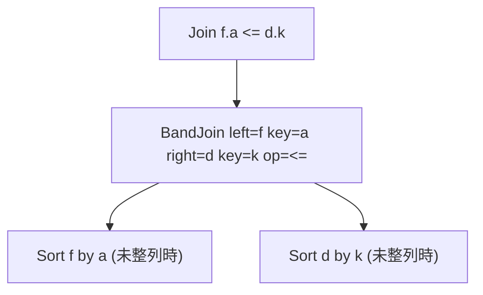

# band_join

- 状態: draft / 更新基準: `9ce7837` 上の作業ツリー (2026-10-06)
- 定義位置: `plan/implementation_rules.cpp` の `DefaultImplementationRules()`
  (`BandJoinAlternative`)
- 実行器: `executor/band_join.cpp` (`BandJoinPlan::EmitExecutor`)

## 概要

単一の帯比較 (`<` / `<=` / `>` / `>=`) だけで結合する2入力を、
両側を結合キー順に整列させた上で、右側の候補範囲を二分探索で切り出す
merge-band 結合として実装します。Nested Loop の全組比較を回避します。

## 変換前後の関係

## 適用条件

- 条件が帯比較1個の単一 conjunct で、両辺がそれぞれの子に属する列
  (子の順序が逆なら `MirrorRangeOperation` で比較演算を反転して
  `left_column <op> right_column` 形に正規化)。
- 両キーの型が同一で `kInt64` / `kDate`、かつ両列とも非 unsigned。

## 意味論的根拠

キー順に整列した右側に対し `a <op> k` を満たす `k` は連続区間をなすため、
`upper_bound` 等の二分探索で候補範囲 `["lower", "upper")` を求められる。
実行器は各区間の行を列挙した後、元の条件を残差で再検証する
(キーの一致で行を追加しない)。

## 実装の詳細

`TryBandJoinSpec` が正規化済み (left column, right column, 演算) を抽出し、
`BandJoinAlternative` が未整列側へ `MakeSortPlan` を差し込みます。
コストは入力行数和 + 必要な sort の n log n + 出力行数、
両側が既に整列していれば 0.8 倍の割引です。出力行数は
`left × right × 0.5` の帯近似で推定します。

## 最適化効果

帯条件のセレクティビティが高い (隣接キーが広い範囲で重なる) 場合は
Nested Loop と同等に近く、探索器が他の候補を選びます。キーが密な
等価近傍 (日付幅の狭い期間比較など) で hash join 不可能な形状の唯一の
高速経路になります。

## 関連 Rule との相互作用

`zigzag_join` は帯比較を等価含む拡張でインデックス順を要求する双子です。
`join_commutativity` が子を入れ替えた後も `MirrorRangeOperation` により
範囲と残差検証が一致することが不変条件です (実装は
`TryBandJoinSpec` のコメント参照)。

## 検証テスト

`executor/band_join_test.cpp` (実行器)、`plan/cascades_rules_coverage_test.cpp`
(ルール到達)。
