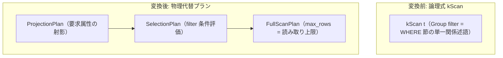

# full_scan

- 状態: draft   /   執筆基準リビジョン: `3880673` (2026-09-12)
- 定義位置: `plan/implementation_rules.cpp` の `DefaultImplementationRules()` 内の登録 `"full_scan"`（パターンは `cascades::dsl::Scan()`、実装は共有ヘルパー `ScanAlternatives` に委譲）

## 概要

論理テーブルスキャン演算子 `kScan` に対し、テーブルの全ページを順次走査する `FullScanPlan`（必要に応じて上層に `SelectionPlan` および `ProjectionPlan` を付加）を生成する物理実装 Rule です。

索引が存在しない場合や述語の選択率が低く全表走査が有利な場合の確実な実行経路であり、フィルタ選択性や LIMIT による最大読み取り行数制限をコストモデルへ正確に反映した上で、`index_scan` が生成する索引スキャン候補とコスト競争を行います。

## 変換前後の関係



残余フィルタが存在する場合は `SelectionPlan` がスキャン直上に配置され、要求列とテーブル格納列が異なる場合は `ProjectionPlan` が最上位に配置されます。自己結合等の別名が存在する場合は `RelationRenamePlan` によりスキーマが調整されます。

## 適用条件

パターンは葉ノード `Scan()` です。実装処理は `ScanAlternatives(..., /*include_indexes=*/false, /*include_full_scan=*/true)` に委譲されます。

カタログ内にテーブル情報および統計情報が存在しない場合（マテリアライズド CTE の一時 Group 等）、本 Rule は空リストを返して処理を中断します。

```cpp
  const auto table_it = context.tables.find(logical.table);
  const auto statistics_it = context.statistics.find(logical.table);
  if (table_it == context.tables.end() ||
      statistics_it == context.statistics.end()) {
    return {};
  }
```

## 意味論的根拠と安全性制約

### 1. グループフィルタの完全評価
論理最適化の述語プッシュダウンフェーズにより、単一関係に閉じた WHERE 述語はすべて Group の `filter` 属性へ集約されます。

```cpp
  // The group filter carries the single-relation conjuncts of the WHERE
  // clause (Phase 2 pushdown); it must be applied in full because the root
  // SelectionPlan wrap no longer exists. Conjuncts speak relation identities
  // while scan machinery speaks physical table names, so translate down.
  Expression filter = QualifyDown(memo.Get(group).filter, relation, physical);
```

ルートノードの `SelectionPlan` はプッシュダウン完了後に消去されます。そのため、物理スキャン演算子側でこの `filter` を必ず適用しなければ、不正なタプルが結果に混入します。`QualifyDown` は、クエリ上の論理名（別名）を物理テーブルスキーマの列オフセットへ対応付けます。

### 2. LIMIT 条件の安全な押し込み判定
順序保証を伴わない単純な LIMIT は、スキャンの反復上限（`scan_limit`）として下位へ沈めることが可能です。ただし、以下のケースではスキャン上限を設定すると誤った結果を生じるため、`CanPushLimitIntoFullScan` により厳格に排除されます。
- 述語（`filter`）が存在する場合（フィルタ通過前の行数で打ち切る誤りを防止）。
- `DISTINCT`、`ORDER BY`、または集約関数を含む場合（全タプルを走査しなければ最終結果が確定しないため）。

```cpp
  if (filter || context.query == nullptr || context.query->limit_count_ == 0 ||
      context.query->distinct_ || !context.query->order_expressions_.empty() ||
      required.limit_hint == std::numeric_limits<size_t>::max() ||
      required.limit_hint == 0) {
    return false;
  }
  return !std::ranges::any_of(context.query->select_, [](const auto& output) {
    return ContainsAggregateExpression(output.expression);
  });
```

## 実装の詳細

### 1. IntegerPeekCompare による生バイト早期除外
整数型の単純比較条件（例: `id = 100` や `status < 3`）が存在する場合、`TryCompileSimpleCompare` を用いて `IntegerPeekCompare` 構造体へコンパイルします。スキャンイテレータはタプル全体のデシリアライズを行う前に、スロット内の生バイト列を直接比較して不一致行を高速に破棄します。

### 2. コストと推定行数
```cpp
    auto local_cost = static_cast<double>(full_scan->AccessRowCount());
    if (required.access_method == cascades::AccessMethod::kPreferIndex &&
        table.IndexCount() > 0) {
      local_cost *= 2.0;
    }
    auto estimated_rows = static_cast<double>(full_scan->EmitRowCount());
    ApplyLimitHint(full_scan, required, context, filter_selectivity,
                   &local_cost, &estimated_rows);
```

- **ローカルコスト**: テーブル全ページを走査するアクセス行数（`AccessRowCount()`）。索引優先ヒント（`kPreferIndex`）が指定されている場合はペナルティ係数 $2.0$ を乗算します。
- **Top-K ヒントの適用**: 要求順序をスキャンが偶然満たしているか無順序でよい場合、`ApplyLimitHint` によりコストと行数が `limit_hint` を上限として圧縮されます。

### 3. 保存順（clustered index order）の報告
本 Rule が作る `FullScanPlan` は、**ヒープの保存順が「SQL の昇順キー」であることを証明できる場合だけ**その順序を報告します。報告が成り立つにはカタログ・測定・鮮度の3条件がすべて揃う必要があり、どれか1つでも欠ければ無順序へ fallback します（`plan/full_scan_plan.hpp` の `ClusteredOrderColumn()`）。

- **カタログ**: その列が UNIQUE 索引のキー全体であること（`CREATE TABLE` は PRIMARY KEY / UNIQUE 列ごとに索引を作る）、かつ列制約が NOT NULL であること。NOT NULL なら NULL が挟まらないので、報告する順序は NULLS FIRST でも NULLS LAST でも同じ列になります。
- **測定**: ANALYZE がその列の相関を $1.0$ として記録していること（走査順で隣接する非 NULL 対がすべて非減少）。
- **鮮度**: 統計が `TableStatistics::LayoutGeneration()` を持ち、それが表の `Table::LayoutGeneration()` と一致すること。行変異（INSERT/UPDATE/DELETE）はチェーンを動かし、UPDATE/DELETE はさらに「1プロセス内で in-place 書き換えが起きた」latch を立てる（古い snapshot は pre-image を解決しうるため、現在の画像の測定はその代理にならない）。ANALYZE は自分の走査の前後で世代が動いていれば証拠を捨てるので、走査中に commit された行は「測定済み」に数えられない。

`IsOrderedBy` の応答は保守的です: 昇順・先頭キー1個・素の列参照にだけ一致します（降順には逆順チェーン走査がありません。2個目以降は prefix 扱いなので `IncrementalSort` 側の判定に委ねます）。一致したときだけ `ORDER BY` 用の `SortPlan` が生成されず、`EXPLAIN` には `FullScan: t (clustered order: id ASC)` が出ます。`FullScanPlan::EmitExecutor` は報告するプランでは `ParallelScan` を使わず、チェーン順を保つ single-threaded `FullScan` に固定します（モーセル並列は worker 完了順にチャンクを出すので保存順ではありません）。

順序は**測定**であって保証ではないため、コスト計算とは切り離します。`PlanBase::OrderIsMeasured()` がその区別を表し、構造的な順序（索引・スート）と違い、全チェーンを読んだ代償が残ります。したがって direct path の「順序付き候補を優先」段も `ApplyLimitHint` の LIMIT 早期打ち切り割引も、測定された順序には適用しません。適用せずにいると `ORDER BY pk LIMIT 1` が全表読みを「1行読み」として評価し、索引アクセスを追い越してしまいます。

さらに、この順序は次の行変異で失効しうるため、`sql_engine.cpp` はこの文脈で解決済みテーブルに順序主張がある間、その文の plan をコンパイル済み plan キャッシュへ入れません。キャッシュされた plan には「ソート助教 = 上限の折畳み / クラスタ prefix の IncrementalSort」のように順序依存の構造が焼き込まれており、別の snapshot で再生すると壊れるためです。

## 最適化効果

- **シーケンシャル I/O の最大化**: ディスクまたはバッファプールからの連続ブロック先読み（Sequential Prefetching）を活用し、ランダムアクセス主体の索引探索よりも高速に大量データを処理します。
- **並列スキャンの適用**: テーブル規模が閾値を超える場合、実行エンジン側で自動的に morsel-driven 型のマルチスレッド並列スキャンへ昇格されます。

## 関連 Rule との相互作用

- `index_scan`: 同一グループの論理 `kScan` に対し索引アクセス案を提示する競合 Rule です。コストエンジンが両者の見積もりを比較して最適な方を採択します。
- `push_selection_into_scan`: WHERE 節の述語をスキャンノードの直上へ集約し、本 Rule が受け取る `filter` を供給します。
- `eliminate_false_selection`: 恒偽述語を検知して空関係（`kEmpty`）に置き換えることで、無駄な全表スキャンの生成を未然に防ぎます。

## 検証テスト

`plan/optimizer_test.cpp` における以下のテストケースで検証されています。

- `OptimizerTest.UnorderedLimitPushesRowCapIntoFullScan`:
  順序なし LIMIT がスキャンの最大読み取り上限（`scan_limit`）へ正しく反映されることを確認します。
- `OptimizerTest.AggregateLimitDoesNotCapInputScan`:
  集約を含むクエリにおいて LIMIT がスキャンへ誤って押し込まれないことを確認します。
- `OptimizerTest.PhysicalRulesCanBeRemovedIndependently`:
  `full_scan` および `index_scan` を個別にルールセットから着脱してもオプティマイザが正常動作することを確認します。
- 保存順の報告ゲートは `plan/full_scan_plan_test.cpp` の
  `FullScanClusteredOrderTest`（未 ANALYZE / 相関 1.0 の主キー / 逆順データ /
  unique 無し / nullable unique / 挿入後の失効 / UPDATE・DELETE の latch /
  並列閾値 / DML source scan / 空表）と、`query/sql_clustered_order_test.cpp`
  の `SqlClusteredOrderTest`（EXPLAIN の `clustered order: id ASC` と Sort 不在、
  順序付き結果、LIMIT・OFFSET・DISTINCT・NULL 順序・空表・失敗文、変異後の
  Sort 復帰と順序維持）で検証しています。
