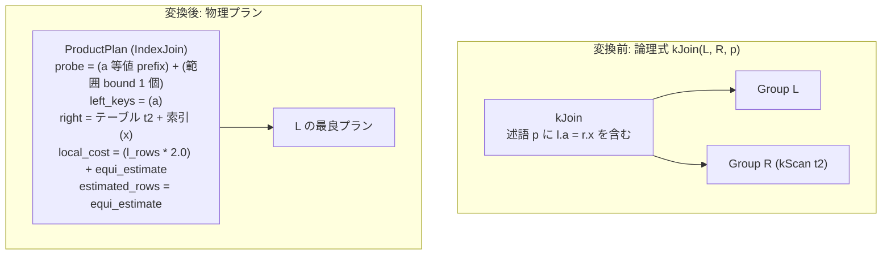

# index_join

- 状態: done   /   執筆基準リビジョン: `3880673` (2026-09-12)
- 定義位置: `plan/implementation_rules.cpp` の `DefaultImplementationRules()` 内の登録 `"index_join"`（パターン: `cascades::dsl::Join()`、実装ラムダ: 共有ヘルパー `JoinAlternatives(..., hash=false, index=true, cross=false)` に委譲）
- 注意: 本文の「実装の詳細」節は index 結合を `LookupJoin`（索引入れ子ループ結合）として記述する。実行器のファイルは `executor/lookup_join.cpp`、probe の論理情報は `plan/product_plan.hpp` の `LookupSeek`。

## 概要

論理等値内部結合 `kJoin` を、内側（右側）リレーションの B+Tree 索引を外側（左側）行ごとに直接シーク・プローブする `ProductPlan`（索引結合形態）へ実装する規則です。右側の全表走査およびハッシュテーブル構築を回避し、左側入力から取得した結合キー値を用いて右側テーブルの索引を直接ポイントルックアップします。

この probe は複合キーの等値 prefix と、prefix の次の索引キー列に対する範囲 bound 1 個までを表せます。probe 自身では決定できない述語（2 個目以降の範囲、索引キー列ではない列の等値、範囲 whitelist 外の型の範囲）は、結合 node の上に残差 `Selection` として残り、probe の過剰フェッチを述語が絞り込みます。

## 変換前後の関係



右子プランは実行時には起動されず、物理実行器がテーブルストレージおよび B+Tree 索引ハンドルを直接参照してタプルを生成します（出力スキーマはリネーム解決済みの `declared_output` を使用します）。

## 適用条件

パターンは 2 つの子を持つ `kJoin` です。結合規則共通のガード条件に加え、`JoinAlternatives` 内のインデックス結合特有のガード条件が存在します。

```cpp
if (children.size() != 2 || required.require_row_position) {
  return std::vector<PlanAlternative>{};
}
```

インデックス結合固有の 4 つの必須条件（Gate）は以下の通りです。

1. **右子が単一物理テーブルスキャンであること**:
   ```cpp
   if (index) {
     const Table* right_table = right.plan->ScanSource();
     if (right_table != nullptr) {
   ```
2. **右側 Group に未処理の scan filter が存在しないこと**:
   ```cpp
   // The index join executor bypasses the right child plan entirely and
   // probes the raw table through its index. A filter merged into the
   // right scan group is implemented by that child plan, so offering an
   // index join here would silently drop it; hash/NL joins consume the
   // child executor and stay safe.
   if (!memo.Get(right_group).filter) {
   ```
3. **等値結合キーの右側属性が、右側テーブルのいずれかの索引の**先頭キー列**と一致すること**:
   ```cpp
   std::optional<LookupSeek> probe = DeriveLookupSeek(
       index_handle, physical_schema, right_physical, left_columns);
   if (!probe) {
     continue;
   }
   ```
   結合キーの並び順ではなく索引の `key_` 順でprefixを求める（`plan/product_plan.cpp` の `DeriveLookupSeek`）。先頭キー列が一つも結合キーでなければ `nullopt` になり、その索引は候補から外れる。工場側（`relational_factory.cpp`）も probe 不成立時はハッシュ結合へ降格させるので、全表走査だけの plan が二重に生成されることはない。
4. **NULL 安全な等値（`IS NOT DISTINCT FROM`）を含まないこと**。NULL キーを行として照合する経路が索引 seek には無いため、`key_null_safe_` に真が立つのと実行器はハッシュ結合へ落とす。

さらに、右側リレーションの統計情報（`context.statistics`）が存在しない場合はインデックス結合代替案は生成されません。

## 意味論的根拠と例外保護・述語脱落防止

本規則において最も重大な意味論的制約は、第 2 のガード条件である「右側スキャングループのフィルタ不在性」です。

`ProductPlan` のインデックス結合実行器は、右子プラン（イテレータ）を実行せず、生のテーブルストレージに対して B+Tree 索引シークを行います。もし論理規則 `push_selection_into_scan` によって右側のスキャングループにフィルタ述語（Selection）がマージされていた場合、そのフィルタは右子プランの走査時に評価される前提となっています。右子プランをバイパスするインデックス結合を適用してしまうと、本来評価されるべきフィルタが完全に脱落し、不正な行が出力される「述語消失（Predicate Erasure）」が発生します。したがって、右側にフィルタが存在する局面では本規則は厳格に発火を抑止されます。

probe が等値 prefix として固定できるのは、索引キー順で連続して並んだ先頭キー列だけです。gap の後ろのキー列は probe が値を固定していないので順序付けに寄与せず、範囲 bound を置いても seek は狭まらない。索引キー順の連続性で prefix を決めることで、結合キーの並び順が索引の並び順と違っても探索キーが格納キー画像の prefix になり、範囲外のバイト列を走査することがない。

範囲 bound は prefix の直後の索引キー列に 1 個だけ置く。探索は半開区間 `[prefix, prefix + bound)`（`>` 系は `[prefix + bound, prefix の上限)`）として境界行を候補に含め、候補行の再検査（`LookupJoin::Matches`）で包含・非包含を必ず決める。したがって探索の精度は述語の意味に依存しない。`SetLookupRange` が bound を採用する条件は「bound の指定先がその位置の索引キー列である」「左右の型が同じ」「その型が `SupportsLookupRangeType`（`INT64` / `DATE`）」。1 つでも欠ければ bound を採用せず、その conjunct を残差側に戻す。残差は「全 conjunct のうち probe が強制するもの（prefix の等値と採用された bound）を除いたもの」で組み立てるので、述語が落ちることはない。

## 実装の詳細

`plan/implementation_rules.cpp` 内の `JoinAlternatives` は、自己結合における別名（エイリアス）解決、プラン構築、コスト計算を以下のように処理します。

```cpp
// Locate the relation key owning this physical table: aliased
// self-joins rename scan schemas, and statistics are keyed by the
// relation identity.
std::string right_relation;
for (const auto& [relation, table] : context.tables) {
  if (table.get() == right_table) {
    right_relation = relation;
    break;
  }
}
```

```cpp
Plan join = std::make_shared<ProductPlan>(
    left_child, left_columns, *right_table, index_handle,
    right_physical, *stats_it->second, declared_output, index_rows);
const bool range_adopted =
    range.has_value() &&
    static_cast<ProductPlan&>(*join).SetLookupRange(
        probe->right_columns.size(), range->left_column,
        range->right_physical, range->operation);
```

- **probe 導出**: `DeriveLookupSeek`（`plan/product_plan.cpp`）が索引キー順で等値 prefix を作る。この情報は `ProductPlan` の ctor の中でも導出され、`relational_factory.cpp` がそれを `slot_t` に解決して `LookupJoin` を組み立てる。規則側が `SetLookupRange` を呼ぶのはこの導出結果に範囲位置を 1 つ足すためで、`range_key_offset` が prefix 長と一致しない場合は `false` を返す。
- **`local_cost = (l_rows * 2.0) + equi_estimate`**: 左入力の行ごとに「B+Tree プローブ走査 + レコード組み立て」のコストとして 2 行分を計上し、さらに索引から実際にヒットして返る推定行数（`equi_estimate`、残余述語の選択度も込み）を加算します。範囲 bound を採用した場合は、点プローブが範囲走査に変わるので、範囲スライス索引スキャンと同じクラスタリング罰（`RangeClusteringPenalty`）を掛ける。
- **`estimated_rows`**: `equi_estimate` を基盤とし、`equi_conjuncts` の上限を `unique` 索引かつ点プローブのときだけ `l_rows` で打ち切る（1 左行に複数右行が一致しうるので、範囲 bound がある／prefix がキー全体でない場合はこの cap を掛けない）。
- **残差**: 全 conjunct から probe が強制する等値と採用済み bound を除いた集合を `SelectionPlan` として結合の上に置く。
- **スキーマの整合性**: `declared_output` により、右側テーブルの物理スキーマを論理エイリアスを含む形式へリネームし、上流演算子の参照列位置を正しく整合させます。

## 最適化効果

右リレーションの全表走査とハッシュテーブル構築を、外側入力の行数に比例する B+Tree の探索へ置き換えます。右側テーブルが大きく、索引の選択度が高い（1 キーあたりのヒット件数が少ない）場合は、全走査を要する `hash_join` より低コストです。一方、左側入力が大きいとシーク回数も増えるため、ハッシュ結合が有利になる場合があります。Cascades 探索エンジンは、両者の推定コストを比較して物理実装を選びます。

## 関連 Rule との相互作用

- `hash_join`, `merge_join`, `nested_loop_join`: 同一の `kJoin` 論理式に対して生成される代替物理結合規則群です。
- `push_selection_into_scan`: 右側スキャングループに述語をマージする論理規則です。本規則はフィルタ存在時に抑止されるため、プッシュダウンの有無がインデックス結合の採否を直接左右します。
- `index_scan`: 右側子プランそのものを索引スキャンとする実装経路です。こちらは右子の実行器を正常に駆動するため、フィルタが存在する場合でも安全に索引を利用できます。

## 検証テスト

- `plan/optimizer_test.cpp`:
  - `OptimizerTest.IndexScanJoin`: 内部結合がインデックス結合として計画され、正常に実行されることを検証します。
  - `OptimizerTest.AliasedSelfJoinCanUseIndexNestedLoop`: 同一テーブルに対する別名自己結合において、関係キーの逆引きと `declared_output` のリネームが機能し、インデックス結合が成立することを検証します。
  - `OptimizerTest.IndexJoinRulePushesOneRangeBoundIntoTheProbe`: 等値 prefix の次の索引キー列に範囲 bound 1 個が probe に入り（`probe:{..., ProbeLeft.y > ProbeRight.b}`）、実行結果が鏡像と一致することを検証します。メモ経路ではなく規則を直接適用するのは、`l.x = r.a` に式書き換えの NULL 安全推論（`x = y → x = y AND x IS NOT NULL AND y IS NOT NULL`）が付き、その inferred conjunct が走査グループに push されて本規則が抑止されるためです。
  - `OptimizerTest.IndexJoinRuleKeepsUnprobedPredicatesResidual`: whitelist 外の型（FLOAT64）の範囲と索引非キー列の等値が probe に入らず残差 `Selection` になることと、行が鏡像と一致することを検証します。
- `plan/plan_test.cpp`: `PlanTest.LookupProbeDerivesPrefixInIndexKeyOrder` / `PlanTest.LookupRangeAcceptsOnlyInt64AndDate` / `PlanTest.LookupRangeRejectsNonWhitelistedKeyColumnType` / `PlanTest.LookupSeekIsAbsentWithoutALeadingKeyJoinColumn`（probe 導出と `SetLookupRange` の受入・拒否条件）。
- `executor/executor_test.cpp`: `ExecutorTest.LookupJoin*`（等値 prefix＋範囲、重複キー、NULL/NaN bound、unique 短絡、空入力、非キー列等値、whitelist 拒否）。
- `query/query_test.cpp`: `QueryTest.CompositeIndexLookupJoinRangeAndResidualSemantics`（SQL 経路の回帰。鏡像 C++ と突き合わせる）。
