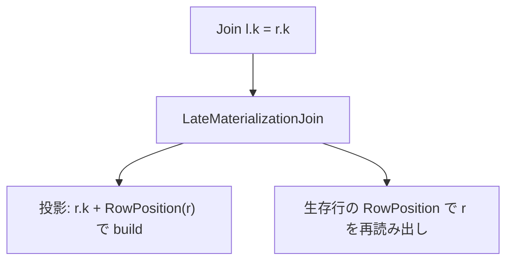

# late_materialization_join

- 状態: draft / 更新基準: `9ce7837` 上の作業ツリー (2026-10-06)
- 定義位置: `plan/implementation_rules.cpp` の `DefaultImplementationRules()`
  (`LateMaterializationAlternative`)
- 実行器: `executor/late_materialization_join.cpp`
  (`LateMaterializationJoinPlan::EmitExecutor`)

## 概要

寬い (列数の多い) 右側表を、結合キー + RowPosition だけの狭い投影で
ハッシュ結合し、生存した行だけを `RowPosition` で元表へ再シークして
残りの列を遅延物質化します。ワイド行の hash build コストを
 Narrow キー表 + 生存行分のランダムアクセスに置き換えます。

## 変換前後の関係

## 適用条件

- 右子が `ScanSource()` で実表を持ち、条件に等価 conjunct が少なくとも1個
  (両辺同一物理型)。
- `kIsNotDistinctFrom` を含まない、サブクエリを含まない、
  決定的 (`DeterministicForPushdown`) な条件のみ。
- 全スキーマ (左・右・物理) に `kArray` 列がない。
- `required.require_row_position` が要求されておらず、右 group に
  scan filter がないこと。

## 意味論的根拠

等価結合で生存する行の RowPosition が分かれば、残り列は元表から
後から読んでも同じ値です。`RowPosition` は MVCC の下では commit 済み
イメージへの由緒ある handle であり、再シークは同一トランザクションの
可視性規則を通ります。

## 実装の詳細

キー型は `SupportsLateMaterializationKeyType` (非 unsigned の固定幅と
文字列) に制限されます。build 側は key + RowPosition のみを保持し、
probe で生き残った位置だけをヒープへ再アクセスするため、
ワイド表 × 高選択率の結合で I/O とメモリが大幅に減ります。

## 最適化効果

SELECT を狭く結合する分析形状 (star schema の fact×dimension) で
hash join の build 材料が列数に比例するのを、キー列のみに抑えます。

## 関連 Rule との相互作用

`hash_join` と同じ形状で競合し、推定コストで比較されます。
動的フィルタ (`dynamic_filter_pushdown_join`) との併用は
scan filter が右 group にあると不発火 (上記の適用条件)。

## 検証テスト

`late_materialization_join_test` (実行器)、
`late_materialization_join_plan_test` (プラン選択)。
