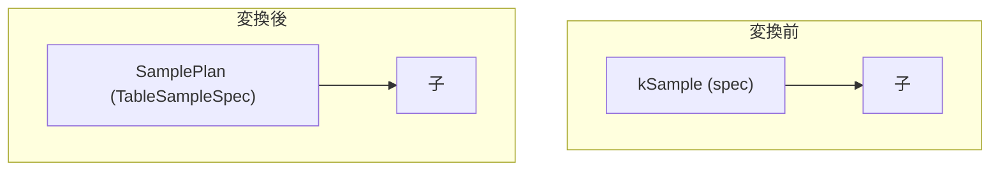

# sample

- 状態: done   /   執筆基準リビジョン: ワーキングツリー (2026-10-09)
- 定義位置: `plan/implementation_rules.cpp` の `DefaultImplementationRules()` 内の登録 `"sample"`（パターン: `cascades::dsl::Sample()`）

## 概要

論理演算子 `kSample`（`TABLESAMPLE` 句）を物理プラン `SamplePlan` へ実装する規則です。子プランの上に `TableSampleSpec`（方式・単位・サイズ・`REPEATABLE` シード・`PARTITION BY`・重み列の有無）を載せたサンプリングノードを被せ、推定出力行数を `SamplePlan::EmitRowCount()` から取得してコストモデルへ渡します。

## 変換前後の関係



## 適用条件

パターンは子を 1 つ持つ `kSample` です。子ノード数が 1 でない、または `logical.sample_size` が空（サンプルサイズが確定していない）場合は発火しません。

```cpp
if (children.size() != 1 || !logical.sample_size) {
  return std::vector<PlanAlternative>{};
}
```

## 意味論的根拠と物理実行の契約

`TableSampleSpec`（`expression/table_sample_spec.hpp`）の全フィールドを論理式からコピーし、`SamplePlan`（`plan/sample_plan.hpp`）を構築します。

- **方法**: `BERNOULLI` / `RESERVOIR` / `SYSTEM`（`TableSampleMethod`）。
- **単位**: `PERCENT` / `ROWS`（`TableSampleUnit`）。
- **順序契約**: `IsOrderedBy` は `RESERVOIR` と `SYSTEM` のとき無条件に `false`（母集合からの非決定的抽出のため順序保証を放棄）。`BERNOULLI` は行ごとの包含判定なので子の順序を透過します。
- **重複契約**: `EnforcesDistinct` は子を透過（サンプリングは重複を生まないため）。
- **統計**: `GetStats()` / `ScanSource()` は子を透過し、`EmitRowCount()` のみがサンプル後の行数を返します。

- `local_cost`: 子の `estimated_rows`（サンプルは全行を走査してから間引くため、アクセスコストは母集合サイズに比例）。
- `estimated_rows`: `sample->EmitRowCount()`（spec の単位・サイズから決まる値）。

## 実装の詳細

```cpp
TableSampleSpec spec;
spec.method = logical.sample_method;
spec.unit = logical.sample_unit;
spec.size = logical.sample_size;
spec.repeatable_seed = logical.sample_seed;
spec.partition_by = logical.partition_by;
spec.with_weight = logical.sample_with_weight;
spec.weight_alias = logical.sample_weight_alias;
Plan sample = std::make_shared<SamplePlan>(children[0].plan, std::move(spec));
const auto rows = static_cast<double>(sample->EmitRowCount());
```

実行時は `TableSampleExecutor`（`executor/table_sample.hpp`）が母集合の走査と抽出行の選択を行います。`REPEATABLE` シードが指定された場合は擬似乱数列が固定され、同一スナップショット上では同一のサンプルが得られます。

## 最適化効果

サンプリングをスキャンの直上で閉じることで、上位の結合・集約が扱う行数を `estimated_rows` で正しく縮小でき、サンプル結果に対する計画品質を維持します。サンプルバリア（`Memo::sample_barrier`）により、サンプルをまたいだ述語の押し下げなど意味を壊す書き換えは抑制されます。

## 関連 Rule との相互作用

- `selection`: サンプル直上のフィルタは `sample_barrier` により子側へ押し込まれません（`BERNOULLI` でも統計の意味が変わるため）。
- `full_scan`: 典型的には子として `SamplePlan` の下に付く物理ノードです。

## 検証テスト

- `query/table_sample_test.cpp`: `SYSTEM TABLESAMPLE` の文法・再現性・行数上限。
- `query/analytical_features_test.cpp`: `TABLESAMPLE` × `GROUP BY` 等の分析機能との組合せ。
- `query/query_test.cpp`: `TABLESAMPLE` を含む end-to-end 結果検証。
