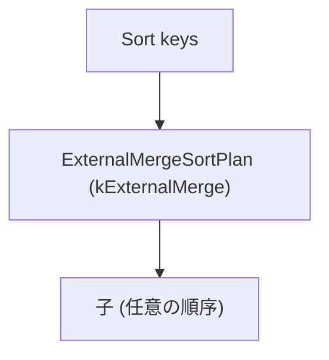

# sort_external_merge

- 状態: draft / 更新基準: `9ce7837` 上の作業ツリー (2026-10-06)
- 定義位置: `plan/implementation_rules.cpp` の `DefaultImplementationRules()`
  (`ImplementExternalMergeSort`)
- 実行器: `executor/relational_factory.cpp` 経由
  (`ExternalMergeSortPlan::EmitExecutor`、`executor/sort.cpp`)

## 概要

論理 ORDER BY の2つの物理形 (`plan/sort_plan.hpp` 参照) のうち、
推定行数が `SortRowCapacity(SortMemoryPolicy)` を超える場合の
外部マージソート半分です。`spill_threshold_rows` 到達ごとに整列済みランを
spill file へ書き出し (末尾ランも含む)、`merge_window_rows` 行のウィンドウで
k-way マージします。

## 変換前後の関係

## 適用条件

- `cascades::dsl::Sort()` に対応する1子ノード。
- 推定行数が容量选择の境界 (`MakeSortPlan` 内 `SortStrategy::kExternalMerge`)
  を超えること。境界以下は `sort` (バッファ) 側が担当します。

## 意味論的根拠

整列はランへの分割と k-way マージで構成でき、各ランは整列済みなので
メモリに1ウィンドウ分だけ乗れば全体を整列出力できます。
順序契約 (`IsOrderedBy` / `OrderCollation` / NULL placement / collation) は
基底クラス `SortPlan` が保持し、誤推定でも最後の resort として内部
spill 選択が残るため、形の選択は答えを変えません。

## 実装の詳細

`SortExecutor::Options{spill_mode = kExternalMerge, memory_budget_bytes,
merge_window_rows, spill_threshold_rows}` が物理形です。キー構築と
collation 認識の省略判定は `PrepareSortShape` を `sort` と共有します
(整列済み子の省略はバッファ側ルールのみが行い、同じ plan が2つの
rule 名の下に現れないことが Memo の不変条件)。

## 最適化効果

メモリに収まらない大規模 ORDER BY を一定メモリで完走させます。
`docs/opt/part2-rules/implementation/sort.md` (バッファ半分) と
`sort_incremental.md` (prefix 再利用) が他の2形です。

## 関連 Rule との相互作用

`limit_push_through_sort` / `topn` が上流で LIMIT を畳める場合、
外部マージより TopN が選ばれることが探索コストで決まります。

## 検証テスト

`sort_shape_test` (プラン形の選択)、`executor/sort.cpp` の spill 経路は
`spill_file_test` と `sort_shape_executor_test` が守ります。
