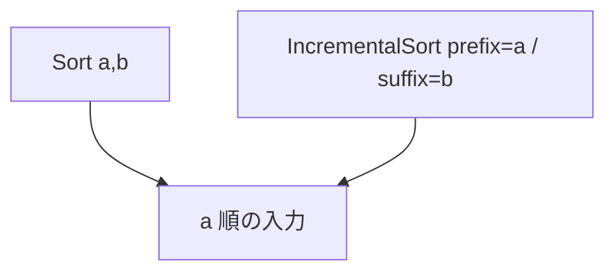

# sort_incremental

- 状態: draft / 更新基準: `9ce7837` 上の作業ツリー (2026-10-02)
- 定義位置: `plan/implementation_rules.cpp` の `DefaultImplementationRules()`

## 概要

ORDER BY の先頭キーが既に整列している入力に対し、同じ prefix 値の範囲だけで
残りのキーを整列します。単一表の特殊経路にあった方式を通常の Memo へ接続しました。

## 変換前後の関係



## 適用条件

一つの子、sort key と方向ベクトルの整合、二つ以上のキーを要求します。
全キーが既に整列していれば通常 sort の省略に任せます。
最長の真の prefix から順に、方向・NULL placement・collation を含む順序契約を確認します。

## 意味論的根拠

prefix が同値の行は入力上で連続します。その範囲内で suffix を整列すれば
全体が要求された辞書式順序になります。prefix が未整列ならこの分割は成立しません。

## 実装の詳細

`PrepareSortShape` で他の sort 方式と同じキーを構築し、prefix と suffix を
`IncrementalSortPlan` に渡します。グループ数は `EstimateDistinctRows` で推定します。
次は登録本体のコスト式の抜粋です。

```cpp
                .local_cost = prepared->rows *
                              std::log2(std::max(2.0, prepared->rows / groups)),
                .estimated_rows = prepared->rows
```

## 最適化効果

入力 n 行を一括整列する n log n に対して、おおむね n log(n / groups) の比較です。
推定はコストにのみ使います。実際の範囲は値比較で検出します。

## 関連 Rule との相互作用

`sort` / `sort_external_merge` は全体整列の候補です。探索器は順序付きの子候補も
比較します。未生成 sort の選択罰則を親へ累積しないため、同じ整列を二重計上しません。

## 検証テスト

`SqlClusteredOrderTest.ClusteredPrefixFeedsAnIncrementalSort` と
`optimizer_aggregation_ordering_high_expectations.test` が SQL からの選択を確認します。
