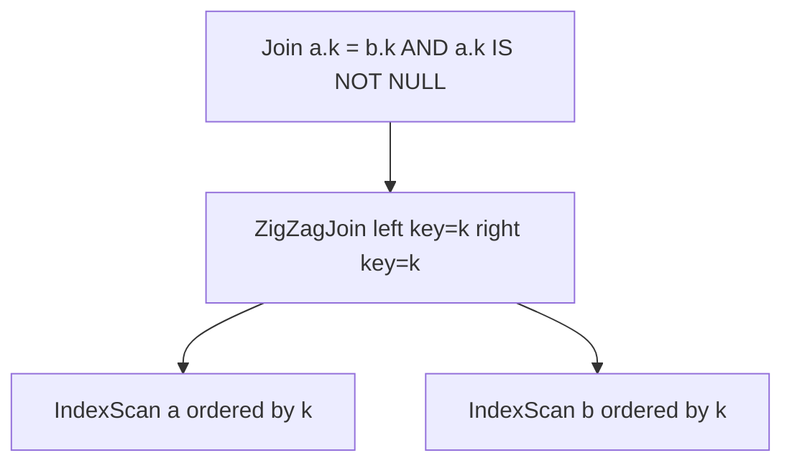

# zigzag_join

- 状態: draft / 更新基準: `9ce7837` 上の作業ツリー (2026-10-06)
- 定義位置: `plan/implementation_rules.cpp` の `DefaultImplementationRules()`
  (`ZigZagJoinAlternative`)
- 実行器: `executor/zigzag_join.cpp` (`ZigZagJoinPlan::EmitExecutor`)

## 概要

両側が結合キーの昇順インデックスアクセス (`IndexScanPlan` /
`IndexOnlyScanPlan` / `IndexSkipScanPlan` で `IsOrderedBy` が証明できる形)
である等価または帯比較の2入力結合を、互いのキー範囲を交互に (zigzag に)
前進させて照合します。中間物質化なしで2つのインデックスをマージします。

## 変換前後の関係

## 適用条件

- 条件は等価または帯比較ちょうど1個 + 任意の `IS NOT NULL` (キー列のどちらか
  に一致するものに限る)。その他の残差があると不採用。
- 両キーは同一の非 unsigned `kInt64` 列。
- 両子が `IsOrderedIndexPlan` (インデックス系 scan + キー昇順の順序証明) を
  満たすこと。

## 意味論的根拠

両側が同一キー順に整列しているため、マージのように互いの現在位置を
比較しながら進めることで、等価 (または帯) を満たす組だけを列挙できる。
`IS NOT NULL` の要求は、インデックス順に NULL が混在する場合の
範囲始点の不定性を排除するための下限保証です。

## 実装の詳細

`TryZigZagJoinSpec` が (left key, right key, 演算, 元の条件) を抽出し、
子の順序が逆なら `MirrorRangeOperation` で正規化します。等価なら
`JoinCardinality` で、帯なら `left × right × 0.5` で行数を推定します。
コストは `0.8 × (left + right の行数和)` で、インデックス順が既にある
ため sort を足しません。

## 最適化効果

両側に既存インデックスがある狭い等価/帯結合で、hash build の材料表を
作らずに済みます。インデックスがない、または順序証明できない場合は
常に不発火です。

## 関連 Rule との相互作用

`band_join` は帯のみ・sort を差し込める一般形、`zigzag_join` は
等価+帯をインデックス順に限定した特殊形です。両方の候補が同じ形状で
立ち上がることがあり、コストで優劣が決まります。

## 検証テスト

`executor/zigzag_join_test.cpp` (実行器)、`plan/cascades_rules_coverage_test.cpp`
(ルール到達)。
