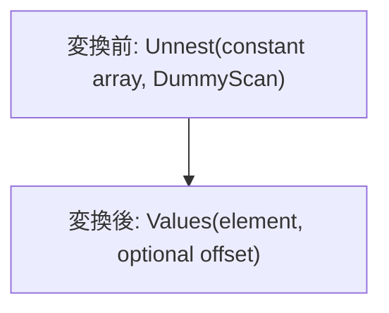

# constant_unnest_to_values

- 状態: review / 執筆基準リビジョン: `67ee0c0` + 作業ツリー差分 (2026-11-11)
- 定義位置: [plan/cascades.cpp](../../../../plan/cascades.cpp) の `RuleSet::Default()`、登録名 `constant_unnest_to_values`

## 概要

定数配列を一行の dummy 入力から展開する UNNEST を、要素と任意の OFFSET 列を持つ Values へ変換します。Memo は同値候補を追加する構造であり、元の実行経路も残します。

## 変換前後の関係



## 適用条件

パターンは `Unnest(Any("input"), "unnest")` です。述語がリテラル、全子が定数の ARRAY、または定数として評価できる GENERATE_SERIES である必要があります。評価成功かつ ARRAY、要素数が `kConstantUnnestValuesThreshold` 以下、入れ子配列なし、出力幅が要素と任意 OFFSET の 1〜2 列、列の関係名が別名と一致、入力 Group の全式が子なし DummyScan であることを検査します。空の出力スキーマは要素型から導出します。

```cpp
          const StatusOr<Value> evaluated =
              predicate->TryEvaluate(Row(), Schema());
          if (!evaluated.HasValue() || !evaluated.Value().IsArray()) {
            return;
          }
          const std::vector<Value> elements = evaluated.Value().ArrayElements();
          if (elements.size() > kConstantUnnestValuesThreshold) {
            return;
          }
          for (const Value& element : elements) {
            if (element.IsArray()) {
              return;
            }
          }
```

## 意味論的根拠と境界条件

要素順と重複と NULL を保持し、OFFSET はゼロ始まりです。実表を駆動入力に許すと各入力行ごとの配列展開回数が失われるため、DummyScan に限定します。STRUCT/PROTO の列展開や入れ子配列をこの scalar 行配置に代入すると列数が変わるため拒否します。時刻などの非決定的関数を許すと計画キャッシュに値を凍結するため、関数名を限定します。

## 実装の詳細

`TryEvaluate` が失敗した場合は変換を返さず、元の実行時評価を保持します。各要素を一行へコピーし、必要なら要素番号を付けた `constant_rows` を `kValues` 候補へ設定します。閾値は Memo に巨大なリテラル表を抱え込ませないための上限です。

## 最適化効果

実行時の配列評価と展開を除き、Values に適用可能な最適化を使えます。計画側には要素数に比例したメモリが必要です。

## 関連 Rule との相互作用

式の定数畳み込みが配列を定数ノードにしてから適用できます。`unnest_filter_pushdown` は非定数入力でも使う別の変換です。

## 検証テスト

`plan/cascades_test.cpp` の `ConstantUnnestArrayFoldsToValues` と `ConstantUnnestKeepsRuntimeWhenNotFoldable` が、要素配置と拒否条件を検査します。
