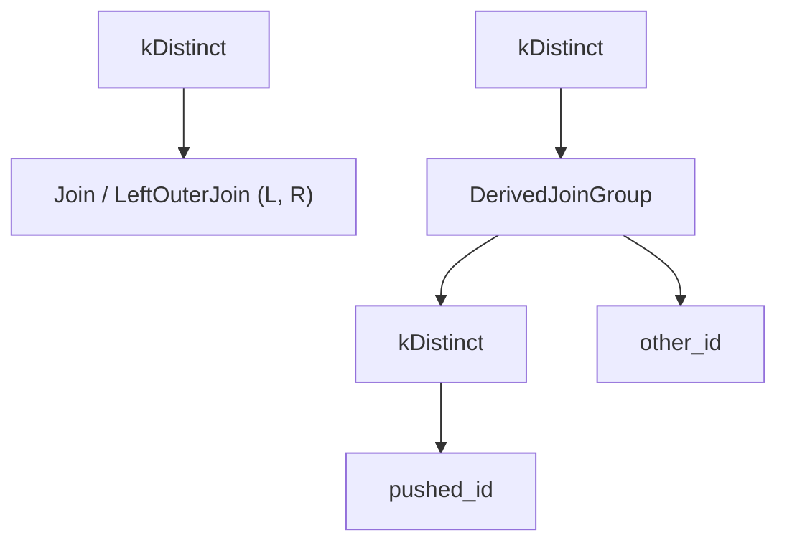

# distinct_eager_over_join

- 状態: draft / 更新: 2026-11-17
- 定義位置: `plan/cascades.cpp` の `RuleSet::Default()`（登録名 `"distinct_eager_over_join"`、パターン: `Distinct(Any("input"))`、target: `LogicalOperator::kDistinct`）

## 概要

内部結合または LEFT OUTER JOIN の直上にある行全体の `kDistinct` に対して、対向側の結合キーが一意（各押し込み側行が高々 1 行と結合する）と証明できるとき、押し込み側を結合前に重複排除する `Distinct(Join(Distinct(pushed), other))` 代替を追加する論理規則です（Eager Distinct Pushdown）。

## 変換前後の関係

## 適用条件

次のすべてを満たす場合に発火します（`plan/cascades.cpp`）。

1. 親が子 1 つの `LogicalOperator::kDistinct`。
2. `input` グループ内の候補式が `kJoin`（内部結合）または `join_type == 0` の `kOuterJoin`（LEFT OUTER JOIN）で、2 子（左右それぞれ 1 リレーション）と非空の `predicate` を持つこと。
3. 押し込み方向の制限: 内部結合では左右両側（`side = 0, 1`）を試すが、**LEFT OUTER JOIN では保存側（左側 `side = 0`）のみ**を対象とし、NULL 供給側（右側）への押し込みは禁止。
4. 結合述語の等値連言から得た対向側のキー列集合 `other_join_cols` について、`memo.Get(other_id).logical_properties.IsUniqueOn(other_join_cols)` が真であること。

## 意味論的根拠（D5）

対向側の結合キーが一意であるため、押し込み側の各行は結合において**高々 1 回**しか一致しません（fan-out 倍増が起きない）。そのため、押し込み側を結合前に重複排除しても、同じキーで複数回一致する行が別々に出現する可能性が消え、したがって事前重複排除しても結果の集合は変わらず、さらに未一致行についても内部結合では双方で除外され、LEFT JOIN の左側では同じ NULL 埋め行が 1 回だけ出るため結果の集合が一致します。逆に LEFT JOIN の右側（NULL 供給側）に押し込んだ場合や対向側が一意でない場合は fan-out 重複度が変わるため禁止されます。

派生結合グループには述語と子 Group ID を含むタグ `"distinct_eager_join:<rel>:<predicate>:<child-groups>"` を付与し、異なる入力グループや結合述語の alternative が混線しないよう分離しています（D1）。親側の `kDistinct` は対向側の重複行も排除するためそのまま残ります。

## 検証テスト

- `plan/cascades_test_part3.cpp`:
  - `CascadesTest.DistinctEagerOverJoinPushesDistinctBelowJoin`
  - `CascadesTest.DistinctEagerOverJoinSkipsNonUniqueSide`
