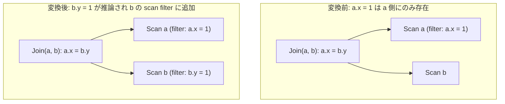

# infer_join_predicates

- 状態: draft / 執筆基準リビジョン: `3880673` (2026-09-12)
- 定義位置: `plan/cascades.cpp` の `RuleSet::Default()`（登録式。変換はヘルパー `InferJoinConstants` と、その内部で呼ぶ `EqualityConstantExpr` に委譲。`PropagateEqualityConstants` は `plan/optimizer.cpp` の別経路のヘルパーで、本 Rule の委譲先ではない）

## 概要

`infer_join_predicates` は、等値結合の一方にある定数条件を、他方へ伝える述語推論 Rule です。たとえば、結合条件 `a.x = b.y` と表 `a` の scan filter `a.x = 1` から `b.y = 1` を導き、表 `b` の scan filter へ追加します。この推論は推移閉包（transitive closure）に基づきます。

結合のプローブ側表に対して事前スキャンフィルタを早期に適用させることで、ハッシュ結合のビルド表・プローブ表の双方で行数を削減し、結合処理全体の実行コストを低減させます。

## 変換前後の関係

論理プランの結合木構造そのものは書き換えません。推論された等式述語を対象関係の単一表グループが保持する `scan filter`（`Group.filter`）へ合流させます。



元の結合述語 `a.x = b.y` はそのまま保持されます。追加された述語はスキャンのインデックス探索引数（SARG）として消費されるか、冗長な残差フィルタとして安全に二重評価されます。

## 適用条件

パターン照合は `Join()` であり、対象演算子は `LogicalOperator::kJoin` に限定されます。

```cpp
        [](const Bindings&, Memo& memo, GroupId group,
           const LogicalExpression& expression) {
          if (SelectionMayStrengthenSharedScans(memo, group) &&
              expression.predicate) {
            InferJoinConstants(memo, *expression.predicate);
          }
        },
        LogicalOperator::kJoin));
```

まず `SelectionMayStrengthenSharedScans(memo, group)` が真でなければ推論しません。これは `or_to_union` / `push_filter_past_setop` が作った branch_local な Selection 下の Join で scan filter を強化すると、別分岐の行まで消してしまう（D5）ためのガードレールです（`inferred_inequality_pushdown.md` と同じ条件）。

ヘルパー関数 `InferJoinConstants` 内で、以下の条件を満たす連言が処理対象となります。

1. **内側結合の限定**: 対象演算子が `kJoin` であり、外部結合（`kOuterJoin`）にはマッチしません。
2. **対象連言の形式**: 連言が修飾名を持つ「列 = 列」の等号二項式（`kEquals`）であること。定数等式や不等号は対象外です。
3. **完全修飾名の要求**: 結合述語の左右の列双方が空でない修飾名（`schema`）を持つこと。
4. **関係集合の存在確認**: メモが参照先リレーションを保持していること（`memo.ContainsRelation({from.schema, to.schema})` が真）。
5. **異型列ペアの除外**: `ColumnsProvenDifferentType(memo, left, right)` が真なら、その等式からは推論しません。異なる型の列へ述語を移して比較意味を変えることを避けます。

## 意味論的根拠と三値論理・代数的一致

本変換の健全性は、等式の代入律と関係代数における選択演算の可換性に基づきます。

内側結合の出力行において、結合条件 `a.x = b.y` は必ず真（TRUE）でなければなりません。三値論理において、どちらかが NULL の場合、比較結果は UNKNOWN となり内側結合の出力から除去されます。同時に `a.x = 1` が真である行のみが `a` 側のフィルタを通過するため、出力行において `b.y` が 1 以外の値または NULL を取ることはあり得ません。したがって、`b.y = 1` を `b` のスキャンフィルタに追加しても、元々結合結果に残るはずだった行は一切除外されず、行集合の同値性が厳密に保たれます。

本 Rule が内側結合に厳密に制限される理由は以下の通りです。外部結合（例: `a LEFT JOIN b ON a.x = b.y`）では、`b` 側にマッチする行が存在しない場合、`b.y` は NULL で補完されて出力されます。このとき誤って `b.y = 1` を `b` のスキャンへプッシュダウンすると、本来 NULL 補完として残るべき行の結合候補自体が変質し、正しい外部結合結果が得られなくなります。専用の null-rejection 解析と外部結合の限定的な内部結合化 Rule は実装済みですが、本 Rule では scan filter に追加した述語がこの意味論を保つか証明しないため、パターンレベルで `kJoin` に限定するガードレールを採用しています。

また、`memo.ContainsRelation({from.schema, to.schema})` によるガードは、相関サブクエリ（`Apply` 演算子配下の式）などにおいて外部参照列が混入した際に、未定義な表グループを生成して `RelationMask` の表明違反（CHECK）を引き起こすことを防ぐ契約上の制約です。

## 実装の詳細

推論の主処理は `plan/cascades.cpp` の `InferJoinConstants` に実装されています。これは join_predicate の連言を走査し、各「列 = 列」等式について下記の内部ヘルパー `push` を左右双方向へ呼び出します。`ColumnsProvenDifferentType(memo, left, right)` が真の列ペアは除外し、その後 `push` を左右双方向へ呼び出します。`push` はその中で定数抽出ヘルパー `EqualityConstantExpr` を呼ぶ補助関数であり、主処理そのものではありません。

```cpp
    if (ColumnsProvenDifferentType(memo, left, right)) {
      continue;
    }
```

```cpp
    const auto push = [&](const ColumnName& from, const ColumnName& to) {
      if (from.schema.empty() || to.schema.empty()) {
        return;
      }
      if (!memo.ContainsRelation({from.schema, to.schema})) {
        return;
      }
      const Expression constant = EqualityConstantExpr(
          memo.Get(memo.EnsureGroup({from.schema})).filter, from);
      if (!constant) {
        return;
      }
      // Share the original constant node. A ParameterSlot copied via
      // GetValue() would freeze the fill-time literal on the other side.
      memo.MergeScanFilter(
          memo.EnsureGroup({to.schema}),
          BinaryExpressionExp(ColumnValueExp(to), BinaryOperation::kEquals,
                              constant));
    };
    push(left, right);
    push(right, left);
```

1. **定数の抽出**: `EqualityConstantExpr` は `from` 側の単一表グループの `filter` を走査し、`from = 定数` または `定数 = from` の形式を持つ連言から定数式（`Expression`）を取り出します。
2. **述語の合成と合流**: 取り出した定数ノードをそのまま共有して `to = 定数` の二項式を構築し、`memo.MergeScanFilter` を呼び出して `to` 側グループのフィルタへ合併します。新しい `ConstantValueExp` を作らず元のノードを共有するのは、`ParameterSlot` を `GetValue()` でコピーすると埋め込み時点のリテラルがもう一方の側に固定されてしまうためです（コードコメント "A ParameterSlot copied via GetValue() would freeze the fill-time literal on the other side"）。
3. **冪等性の保証**: `MergeScanFilter` 内部で `CanonicalizeConjuncts` を経由するため、連言のソートと重複排除が行われ、複数回の同一推論によってフィルタ式が無制限に肥大化することはありません。

## 最適化効果

本 Rule の適用により、結合の両辺に定数等式述語が伝播します。これにより以下の最適化機会が生じます。

- **インデックススキャンの誘発**: 従来フルスキャンを要していたプローブ側表に対して、インデックス等値探索（IndexScan / Point Lookup）が選択可能になります。
- **結合中間行数の削減**: 結合演算子に入力される前段階で不要な行が刈り取られ、ハッシュ結合のメモリ消費量および比較回数が大幅に減少します。

結合述語自体の削除は行わずスキャンフィルタへの追加のみを行うため、探索空間における代数構造を損なうことなく物理アクセスの質を向上させます。

## 関連 Rule との相互作用

- `inferred_inequality_pushdown`: 不等号条件を対象とする対照的な推論 Rule です。同一のガードレールとフィルタ経路を共有します。
- `join_predicate_transitivity`: 結合条件内の「列 = 列」同士から新しい「列 = 列」を推論する Rule であり、列対列の推移閉包を扱います。
- `push_selection_into_scan` / `split_selection_over_join`: 上位の選択演算から定数等式をスキャンフィルタへ運ぶ上流 Rule です。本 Rule の前提条件を整えます。
- `redundant_join_predicate_elimination`: 推論や推移閉包によって冗長化した等式連言を事後的に整理する逆方向の Rule です。

## 検証テスト

- `plan/cascades_test_part1.cpp`:
  - `CascadesTest.InferJoinPredicatesCopiesConstantsAcrossEquals`: `a.x = 1` および `a.x = b.y` から、`b` グループの filter に `b.y = 1` が導出・登録されることを検証。
  - `CascadesTest.DefaultRulesIncludePredicateAndProjectionTransforms`: 既定の RuleSet 内に `infer_join_predicates` が正しく登録されていることを検証。
