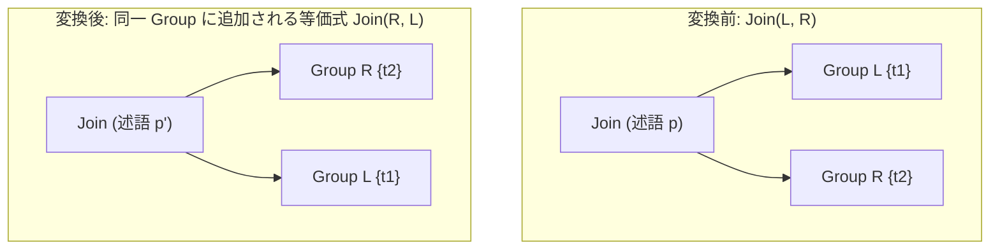

# join_commutativity

- 状態: draft / 執筆基準リビジョン: `3880673` (2026-09-12)
- 定義位置: `plan/cascades.cpp` の `RuleSet::Default()`(登録名 `"join_commutativity"`)

## 概要

`Join(L, R)` に対し、左右の入力を交換した等価式 `Join(R, L)` を同一 Group に追記する規則です。内側結合における左右の役割が入れ替わることで、後段の物理実装規則（`nested_loop_join` や `hash_join` など）において、どちらの入力を build 側（ハッシュ表構築側）とし、どちらを probe 側（探索側）とするかの選択肢が提供されます。

## 変換前後の関係



Memo は追記型のデータ構造であるため、元の `Join(L, R)` は保持されます。同一の Group 内に `Join(R, L)` が等価な選択肢として追加され、その後のコスト評価において両者の推定コストが比較されます。

## 適用条件

パターンは `Join(Any("left"), Any("right"))` であり、子ノードを 2 つ持つ任意の `kJoin` 式に一致します。結合列挙器が担当するグループを除外し、左右の交換時に元の結合述語を引き継ぎます。

```cpp
    built.Add(Rule(
        "join_commutativity", Join(Any("left"), Any("right")),
        [](const Bindings&, Memo& memo, GroupId group,
           const LogicalExpression& expression) {
          if (memo.JoinEnumerationClaimed(group)) {
            return;
          }
          memo.AddExpression(
              group,
              memo.NewJoin(
                  expression.children[1], expression.children[0],
                  expression.predicate ? *expression.predicate : Expression{}));
        },
        LogicalOperator::kJoin));
```

## 意味論的根拠と述語の導出

内側結合では、同じ述語を使って左右を交換しても行の多重度は変わりません。`Memo::NewJoin` は渡された述語を正規化し、述語が省略された場合に限り `JoinConditionFor` で関係集合から再導出します。

なお、本 Rule は `kOuterJoin`（外部結合）には適用されません。外部結合は一般に交換律が成立しないため（$L \text{ LOJ } R \neq R \text{ LOJ } L$）、左右交換には別途 `right_to_left_outer_join` による結合型の変換が必要です。

## 実装の詳細

1. **探索エンジンとの連携**: 探索エンジンのワークリストから Group 内の各代替式に対して順次 Rule が評価されます。`expression.children` に格納された左右の子 GroupId を反転させて `NewJoin` に渡します。
2. **重複排除の動作**: `Memo::AddExpression` は、まず演算子・テーブル・子 GroupId の前方一致で比較し、そこで弾かれなかった場合に限って指紋（`std::optional<std::string>`）を遅延計算して比較します。グループ内に既に同一指紋が存在する場合は登録を破棄します。大半の結合代替は前方一致の段階で異なると分かるため、指紋のシリアライズを回避しています。

```cpp
  std::optional<std::string> fingerprint;
  const bool duplicate =
      std::ranges::any_of(target.expressions, [&](const auto& existing) {
        if (existing.operation != expression.operation ||
            existing.table != expression.table ||
            existing.children != expression.children) {
          return false;
        }
        if (!fingerprint) {
          fingerprint = expression.Fingerprint();
        }
        return existing.Fingerprint() == *fingerprint;
      });
```

自己結合のように交換後も構造が変わらない式はここで即座に破棄されます。この重複破棄は探索の失敗ではなく正当な重複排除であるため、縮退フラグ（`degraded_`）を誘発しないよう設計されています。

## 最適化効果

本 Rule の適用により、対象 Group には元の順序と交換後の順序の双方が物理化候補として登録されます。

- **ハッシュ結合におけるメモリ消費の抑制**: ハッシュ結合は一般に build 側の行数・データサイズに比例してメモリを消費します。左右の順序を選択可能にすることで、より行数の少ない関係を build 側に配置する物理計画を選択できます。
- **インデックス結合の適用可能性拡大**: インデックス走査を内側とする `LookupJoin` では、内側となる関係が probe できる先頭キー列を持つインデックスを保持している必要があります。交換によってインデックスを持つ関係を内側へ配置できます。なお probe の接頭辞は索引キー順で決まるため、交換でキーの並び順が変わっても探索キーは格納キー画像の接頭辞のままです。

## 関連 Rule との相互作用

- `join_enumeration`: 関係集合のすべての 2 分割を列挙する規則です。列挙系が有効である場合、`join_commutativity` が生成する左右交換形は列挙結果と指紋重複し、重複排除されます。
- `join_associativity_left` / `join_associativity_right`: 結合木の結合律に基づく回転規則です。これらの回転規則と `join_commutativity` を組み合わせることで、列挙規則を用いずに任意の結合順序を Memo 内で網羅できます。
- `join_to_cross_if_no_predicate`: 述語を持たない `kJoin` を `kCrossJoin` へ置き換える規則です。交換によって生成された式にもこの規則が伝播します。
- `right_to_left_outer_join`: 外部結合における左右交換を、演算子種別の変換を伴って安全に実現します。

## 検証テスト

- `plan/cascades_test_part*.cpp` の `DefaultRulesEnumerateEquivalentJoinTreesInMemo`
  — 3 表の Group を探索し、式数と Group 数の下限を検査します。各式の子 Group
  順序までは比較しないため、元の順と交換した順の両方が揃うことは直接検証しません。
- `plan/cascades_test_part*.cpp` の `AppliedRuleNamesTrackFiredRules` —
  `search.AppliedRuleNames().contains("join_commutativity")` で実際に
  発火したことを記録ベースで検査します。
- `plan/optimizer_test_part*.cpp` の `JoinChainMatchesGoldenResultUnderRuleSubsets`
  — `join_commutativity` を含む 4 つの順序系 Rule を組み合わせで
  無効化しても結果行(golden)が変わらないことを検査します。
