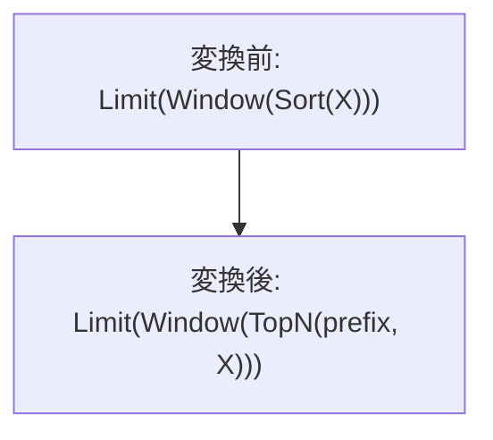

# limit_prefix_ordered_window

- 状態: review / 執筆基準リビジョン: `67ee0c0` + 作業ツリー差分 (2026-11-11)
- 定義位置: [plan/cascades.cpp](../../../../plan/cascades.cpp) の `RuleSet::Default()`、登録名 `limit_prefix_ordered_window`

## 概要

Window の順序を正確に満たす子 Sort を TopN に変え、値が prefix に対して安定する Window の入力を縮めます。

## 変換前後の関係



## 適用条件

LIMIT が非ゼロ、WITH TIES なし、Window が一子で全 target がウィンドウ関数、全呼び出しの partition/order 仕様が一致している必要があります。`WindowPrefixGate` が各値の接尾切断に対する安定性を調べます。順位関数 ROW_NUMBER/RANK/DENSE_RANK は prefix を数え、NTILE/PERCENT_RANK/CUME_DIST/LAG/LEAD/PERCENTILE_CONT/PERCENTILE_DISC はフレーム指定があっても拒否します。その他の呼び出しは明示 ROWS フレームの両端が CURRENT ROW 以前であることを検査します。子孫に別の Window がある場合、既に prefix 変換された Group、循環参照になる Group は拒否します。 この版は order term が非ゼロで、子 Group に一子 Sort があり、`SortMatchesWindowOrder` が partition キーを含む並び、方向、NULL 順序を一致と判定する必要があります。

```cpp
            const auto gate = WindowPrefixGate(window);
            if (!gate.has_value() || !gate->stable || gate->order_terms == 0 ||
                ReachableChildHasWindow(memo, sort_group_id)) {
              continue;
            }
            const WindowFunctionCallExpression* reference = nullptr;
            for (const NamedExpression& target : window.target_list) {
              if (target.expression) {
                reference =
                    &target.expression->AsWindowFunctionCallExpression();
                break;
              }
            }
            if (reference == nullptr) {
              continue;
            }
            const LogicalExpression* sort_node = nullptr;
            for (const LogicalExpression& sort :
                 memo.Get(sort_group_id).expressions) {
              if (sort.operation == LogicalOperator::kSort &&
                  sort.children.size() == 1 && sort.children[0] != group &&
                  SortDeliversWindowSpec(sort, *reference)) {
                sort_node = &sort;
                break;
              }
            }
            if (sort_node == nullptr) {
              continue;
            }
```

## 意味論的根拠と境界条件

Window は計算値を入力行位置へ戻すため、出力の先頭部分と入力の先頭部分が対応します。ただし通常のウィンドウ値は消された行に依存します。例えば全 partition の SUM や CUME_DIST を入力切断後に計算すると結果が変わるので、単なる行数保存だけではこの変換を正当化できません。OFFSET は内側で先頭行を捨てず、必要な prefix を確保し、外側の Limit が適用します。フレームを参照しない関数についてはフレーム指定だけで安定性を推論できないため、ゲートと回帰テストを合わせて確認する必要があります。 Sort がウィンドウ仕様と異なると、入力 prefix の外に先行する partition 行が残り得るため拒否します。

## 実装の詳細

一致する Sort の入力・キー・方向・NULL 指定を `kTopN` へコピーします。count/offset を渡して必要 prefix を保持し、その上に Window と外側 Limit を置く派生候補を追加します。

## 最適化効果

全整列候補に加えて小さい TopN と Window の候補を探索できます。TopN のメモリは要求 prefix に依存します。

## 関連 Rule との相互作用

`limit_push_through_sort` と同じ TopN 演算子を使いますが、Window を越える追加証明が必要です。無順序版と order term 条件で分離します。

## 検証テスト

`plan/cascades_test.cpp` の `LimitPrefixThroughOrderedWindowFusesTopN`、`OrderedWindowRejectsMismatchedSortKeys` と、無順序版の拒否テスト群を参照します。
