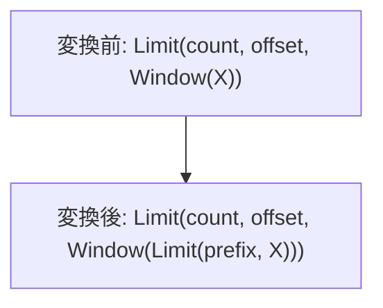

# limit_prefix_unordered_window

- 状態: review / 執筆基準リビジョン: `67ee0c0` + 作業ツリー差分 (2026-11-11)
- 定義位置: [plan/cascades.cpp](../../../../plan/cascades.cpp) の `RuleSet::Default()`、登録名 `limit_prefix_unordered_window`

## 概要

順序キーを持たず、残す行の値が後続入力に依存しない Window の下へ、必要な入力 prefix の制限を追加します。

## 変換前後の関係



## 適用条件

LIMIT が非ゼロ、WITH TIES なし、Window が一子で全 target がウィンドウ関数、全呼び出しの partition/order 仕様が一致している必要があります。`WindowPrefixGate` が各値の接尾切断に対する安定性を調べます。順位関数 ROW_NUMBER/RANK/DENSE_RANK は prefix を数え、NTILE/PERCENT_RANK/CUME_DIST/LAG/LEAD/PERCENTILE_CONT/PERCENTILE_DISC はフレーム指定があっても拒否します。その他の呼び出しは明示 ROWS フレームの両端が CURRENT ROW 以前であることを検査します。子孫に別の Window がある場合、既に prefix 変換された Group、循環参照になる Group は拒否します。 この版は order term 数がゼロであることを追加で要求します。

```cpp
            if (!gate.has_value() || !gate->stable || gate->order_terms != 0 ||
                memo.Get(input_id).tag.starts_with("window-prefix-limit:") ||
                ReachableChildHasWindow(memo, input_id)) {
              continue;
            }
```

## 意味論的根拠と境界条件

Window は計算値を入力行位置へ戻すため、出力の先頭部分と入力の先頭部分が対応します。ただし通常のウィンドウ値は消された行に依存します。例えば全 partition の SUM や CUME_DIST を入力切断後に計算すると結果が変わるので、単なる行数保存だけではこの変換を正当化できません。OFFSET は内側で先頭行を捨てず、必要な prefix を確保し、外側の Limit が適用します。フレームを参照しない関数についてはフレーム指定だけで安定性を推論できないため、ゲートと回帰テストを合わせて確認する必要があります。 ORDER BY がない場合、各 partition 内の順序は入力順なので、全入力 prefix の切断は partition の接尾のみを切断します。

## 実装の詳細

`window-prefix-limit:` と `window-prefix-window:` の派生 Group を作ります。署名には入力 Group、仕様、count、offset を含めます。内側 LIMIT は必要 prefix を保持し、Window と元の LIMIT を再構成した候補を元 Group に追加します。

## 最適化効果

Window が計算する行数と partition 状態を縮小できます。入力の読み取りを止められるかは選択される物理経路に依存します。

## 関連 Rule との相互作用

順序付き版は別登録です。一般の LIMIT-through-Window は安全ではなく、本登録の条件を満たす場合にのみ候補を増やします。

## 検証テスト

`plan/cascades_test.cpp` の `LimitPrefixThroughUnorderedWindowFires`、`DefaultFrameWindowKeepsLimitAbove`、`CumeDistWindowKeepsLimitAbove`、`NestedWindowLayerRefusesLimitPrefix`、`UnorderedRuleRefusesOrderedWindow` を参照します。
