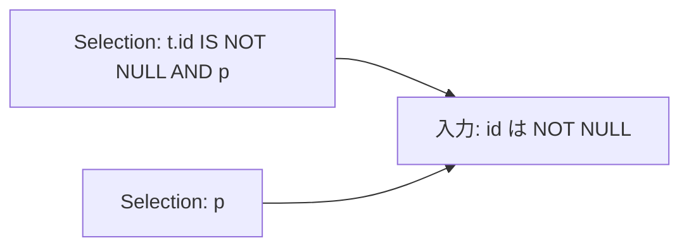

# not_null_is_not_null_elimination

- 状態: draft / 更新: 2026-10-02 (`9ce7837` 上の作業ツリー)
- 定義: `plan/cascades.cpp` の `RuleSet::Default()`

## 変換と条件

Selection の各 AND 項から、入力の `LogicalProperties::IsNotNull` で証明できる
`column IS NOT NULL` を除きます。残りがなければ TRUE、あれば残りの AND を持つ
Selection を同じ Group へ追加します。元の候補も残ります。



catalog の NOT NULL / PRIMARY KEY と、入力 Group の安全な導出が証明源です。
nullable UNIQUE、列名が id であること、統計上 NULL が観測されなかったことは
証明に使いません。未知の列・未証明の列は元の述語を保持します。

SQL の通常 Scan は output_schema を持たず、schema は Memo::SetTableSchemas で
別途渡されます。旧実装は空の output_schema だけを読んでいたため、人工 Memo
では発火しても SQL では発火しませんでした。論理プロパティを読むことで
実際のカタログ経路へ接続しています。

## 実装の中心

`not_null_is_not_null_elimination` 内の実コード抜粋です。

```cpp
if (input_group.logical_properties.IsNotNull(col_name.ToString())) {
  changed = true;
  continue;
}
```

## 関連と検証

TRUE だけになった Selection は `eliminate_true_selection` で除去できます。
`CascadesTest.NotNullIsNotNullElimination` は SQL と同じく Scan の output_schema を
設定せず、SetTableSchemas だけを使い、この登録が実際に適用されたことを確認します。
