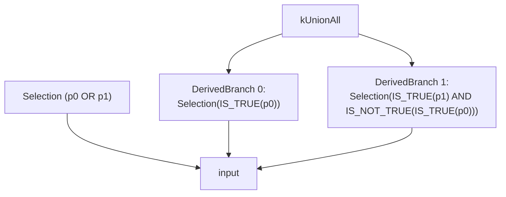

# or_to_union

- 状態: draft / 更新: 2026-11-17
- 定義位置: `plan/cascades.cpp` の `RuleSet::Default()`（登録名 `"or_to_union"`、パターン: `Selection(Any("input"))`、target: `LogicalOperator::kSelection`）

## 概要

`Selection` 述語が `p_0 OR p_1 OR ... OR p_{k-1}` の選言（disjunction）であるとき、排他ガード付きの条件に分解した複数の `Selection` 枝グループとそれらを束ねる `kUnionAll` 代替を生成する論理規則です。各枝は互いに素になるよう設計されているため、元の多重集合（bag multiplicity）を保ったまま各枝で個別にインデックス走査等の高速アクセスパスを選択できます。

## 変換前後の関係

## 適用条件

`plan/cascades.cpp` により以下をすべて満たす場合に発火します。

1. `expression.operation == LogicalOperator::kSelection`、`children.size() == 1`、`predicate` が非空であること。
2. `SplitDisjuncts(predicate)` が `2`〜`8` 本の非空な選言枝に分かれること。
3. すべての枝が `stable_branch`（`ExpressionCannotThrowForPlanner` が真、サブクエリ・集約・ウィンドウを含まず、`FunctionCall` はすべて `Volatility::kImmutable`、修飾列は `input_relations` に属し、未修飾列は入力スキーマからちょうど 1 列に解決できる）を満たすこと。スキーマを設定しないテスト用ケースは一意性検査を省略します。
4. すべての枝が「同一列に対する定数等式比較 `col = const`」のみではないこと（その形は `or_of_ranges_to_in` / `in_list_to_semi_join` がより効率的に扱うため対象外）。

## 意味論的根拠（D5）

単純に `Selection(p0) UNION ALL Selection(p1)` とすると両方を通る行が 2 倍に増え、`UNION DISTINCT` にすると元入力に存在した重複行まで消えてしまいます。本規則では各枝 $i$ の述語を次のように排他化します。

$$\text{IS\_TRUE}(p_i) \land \bigwedge_{j < i} \text{IS\_NOT\_TRUE}(\text{IS\_TRUE}(p_j))$$

`IS_TRUE` と `IS_NOT_TRUE` を介すことで、`p_j` が `FALSE` でも `NULL`（`UNKNOWN`）でも後続枝 $i$ が正しく判定され、三値論理の下で各行がちょうど 1 つの枝にのみ振り分けられます（bag 多重度保存）。各枝のグループには `branch_local = true` と内容アドレス型のタグ `or_union_branch:<input>:<idx>:<predicate>` が付けられ（D1）、別の分岐や走査グループへ条件が誤って統合されるのを防ぎます。

## 検証テスト

- `plan/cascades_test_part3.cpp`:
  - `CascadesTest.OrToUnionSplitsTwoBranchDisjunction`
  - `CascadesTest.OrToUnionSkipsSameColumnEqualities`
  - `CascadesTest.OrToUnionSplitsThreeBranchDisjunction`
  - `CascadesTest.OrToUnionSplitsMultiRelationDisjunction`
- `query/query_test_part3.cpp`:
  - `QueryTest.OrToUnionPreservesBagMultiplicity`
