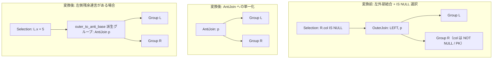

# outer_to_anti_join

- 状態: draft   /   執筆基準リビジョン: `0629612` + 作業ツリー差分 (2026-11-18)
- 定義位置: `plan/cascades.cpp` の `RuleSet::Default()`（登録名 `"outer_to_anti_join"`）

## 概要

左外部結合とその直上の NULL 検査フィルタ $\sigma_{R.\text{key IS NULL}}(\text{LeftOuterJoin}(L, R, p))$ を、専用の反結合演算子 $\text{AntiJoin}(L, R, p)$ へ置換する論理 Rule です。

SQL において頻出する「外部結合と IS NULL 述語による除外パターン」を単一の論理演算子へ畳み込むことで、NULL パディングされた中間タプルの生成および後段でのフィルタ評価を完全に回避します。

## 変換前後の関係



## 適用条件

パターンは `Selection(Any("input"))` であり、ルートが `kSelection` ノードであることを検査します（`plan/cascades.cpp`）。

```cpp
    // outer_to_anti_join: Convert LeftOuterJoin(L, R, p) followed by
    // Selection(R.key IS NULL [AND left_residual]) into AntiJoin(L, R, p)
    // (wrapped in Selection(left_residual) when left-only conjuncts remain).
    // Sound when R.key is declared NOT NULL OR when ON predicate p rejects
    // NULLs on R.key.
    // Lean proof: lean/TinylambOpt/Discovery.lean
    //   (outer_to_anti_join_aggressive, outer_to_anti_join_equi_nullable_sound,
    //    bug_when_testing_non_join_nullable_col,
    //    bug_when_join_allows_null_match)
```

適用判定（guard）は以下のすべての条件を要求します。

1. **左外部結合の特定**: 入力グループ内の式が `kOuterJoin` かつ `join_type == 0`（LEFT OUTER JOIN）であること（RIGHT および FULL は対象外。RIGHT は `right_to_left_outer_join` で正規化されます）。
2. **NULL 検査と左側残余連言への分離**: 選択述語を `SplitConjuncts` で分解した各連言が、(a) 右側リレーション $R$ の列に対する `kIsNull`（少なくとも 1 つ以上）であるか、または (b) サブクエリ・集約・ウィンドウを含まず `SafeToReduceEvaluationCount` を満たす左側リレーション $L$ のみの純粋な残余連言であること。
3. **一致行における非 NULL 保証（Lean 証明済み拡張）**: NULL 検査対象の列 $R.\text{col}$ が、カタログスキーマで NOT NULL / Primary Key と宣言されている（`ColumnIsDeclaredNonNull`）**または** 結合述語 $p$ が $R.\text{col}$ に対して NULL 拒否（`ExpressionRejectsNullsWhere`）であること（例: `ON t1.id = t2.id` では nullable な `t2.id` でも一致行では決して NULL になりません。Lean 証明: `lean/TinylambOpt/Discovery.lean`）。
4. **残余連言の保持**: 左側残余連言が存在する場合は裸の `kAntiJoin` を Selection グループに直接登録せず、派生グループ `outer_to_anti_base:...` に AntiJoin を置いた上で `Selection(left_residuals, AntiJoin(L, R, p))` を構築します（`InheritBranchLocal` で branch-local 性を継承。派生グループが元グループと一致する場合はスキップ）。

## 意味論的根拠と安全性制約

### 1. 除外イディオムの代数同値性
左外部結合 $L = \Join_p R$ は、結合条件 $p$ に一致したタプルと、一致しなかった $L$ のタプルに $R$ 側の属性を NULL 補完したタプルの和集合を生成します。

もし $R.\text{col}$ が本来 NULL を取り得ない属性（NOT NULL または主キー）であれば、$R.\text{col IS NULL}$ を満たす行は「結合条件 $p$ に一致しなかった左側のタプル」と完全に一致します。したがって、以下の代数同値性が成立します。

$$\sigma_{R.\text{key IS NULL}}(L =\Join_p R) \equiv L \triangleright_p R \quad (\text{AntiJoin})$$

### 2. 残余連言の保持
変換後の $\text{AntiJoin}$ ノードは結合述語 $p$ のみを保持しますが、左側のみを参照する純粋な残余連言（例: $L.x = 5$）は AntiJoin の上に $\text{Selection}(\text{left\_residuals}, \cdot)$ として積み直され、フィルタ条件が保持されます（`SafeToReduceEvaluationCount` を満たす場合に限る）。

```cpp
              // Non-null-test conjunct: allowed as a preserved left-side
              // residual when pure, query/aggregate/window-free, and strictly
              // referencing left_rels.
              if (ContainsAggregate(conjunct) ||
                  TreeContainsWindowCall(conjunct) ||
                  !SafeToReduceEvaluationCount(conjunct)) {
                convertible = false;
                break;
              }
              const auto touched = conjunct->TouchedColumns();
              if (touched.empty() ||
                  !std::ranges::all_of(touched, [&](const ColumnName& c) {
                    return !c.schema.empty() && left_rels.contains(c.schema);
                  })) {
                convertible = false;
                break;
              }
              left_residuals.push_back(conjunct);
```

もし残余連言を単に捨ててしまえば $L.x = 5$ のフィルタ条件が脱落して出力行が増加します。現行 rule は左側残余を許容しつつ Selection で保持するため、この誤りは起きません。右側列への `IS NULL` 検査が 1 つも無い場合（`null_checks == 0`）は AntiJoin 化の根拠自体が成立しないため conversion しません。

### 3. NULL 可能列による誤判定の抑止
もし $R.\text{col}$ が NULL 許容列である場合、結合条件 $p$ に一致した正当なタプルであっても元データとして $R.\text{col}$ が NULL であった行が $\sigma_{R.\text{col IS NULL}}$ を通過してしまいます。AntiJoin は一致タプルを無条件に破棄するため、出力から正当な行が脱落します。

```cpp
                  if (!col.schema.empty() && right_rels.contains(col.schema)) {
                    const bool not_null_in_match =
                        ColumnIsDeclaredNonNull(memo, col.schema, col) ||
                        (join_expr.predicate && *join_expr.predicate &&
                         ExpressionRejectsNullsWhere(
                             *join_expr.predicate,
                             [&](const ColumnName& c) {
                               return c.schema == col.schema &&
                                      c.name == col.name;
                             },
                             /*bare_column_rejects_null=*/false));
                    if (not_null_in_match) {
                      ++null_checks;
                      continue;
                    }
                  }
```

上記の `ColumnIsDeclaredNonNull` はカタログの NOT NULL / Primary Key 宣言を、`ExpressionRejectsNullsWhere` は結合述語 $p$ の NULL 拒否性を検査します。どちらも成り立たない NULL 許容列は `null_checks` に数えられず、AntiJoin 化の根拠が失われるため conversion しません。

## 実装の詳細

変換処理は左側残余連言の有無で 2 通りに分岐します。残余が無い場合は Selection グループそのものに裸の `kAntiJoin` を登録します。

```cpp
            const std::vector<NamedExpression>& anti_targets =
                sel_targets.empty() ? join_expr.target_list : sel_targets;
            if (left_residuals.empty()) {
              memo.AddExpression(
                  group,
                  LogicalExpression{.operation = LogicalOperator::kAntiJoin,
                                    .children = {left_id, right_id},
                                    .predicate = join_expr.predicate,
                                    .target_list = anti_targets,
                                    .output_schema = sel_schema});
            } else {
              // 左側残余連言が残る場合は AntiJoin を派生グループに置き、
              // その上に残余連言だけを適用する Selection を積む。
              const GroupId anti_group = memo.EnsureDerivedGroup(
                  input_relations,
                  "outer_to_anti_base:" + GroupIdsTag({left_id, right_id}) +
                      PredicateTag(join_expr.predicate));
              InheritBranchLocal(memo, anti_group, group);
              if (anti_group == group || anti_group == input_id) {
                continue;
              }
              memo.AddExpression(
                  anti_group,
                  LogicalExpression{.operation = LogicalOperator::kAntiJoin,
                                    .children = {left_id, right_id},
                                    .predicate = join_expr.predicate,
                                    .target_list = join_expr.target_list});
              memo.AddExpression(
                  group,
                  LogicalExpression{.operation = LogicalOperator::kSelection,
                                    .children = {anti_group},
                                    .predicate = CanonicalizeConjuncts(
                                        CombineConjuncts(left_residuals)),
                                    .target_list = sel_targets,
                                    .output_schema = sel_schema});
            }
```

したがって、右側列に対する `IS NULL` 連言は AntiJoin の意味論（一致行を破棄する）に吸収されて消えますが、左側のみを参照する残余連言は `Selection(left_residuals, AntiJoin(L, R, p))` として保存されます。どちらの分岐でも AntiJoin の `predicate` は元の結合述語 `join_expr.predicate` のみを保持し、`target_list` は元 Selection の `target_list`（空のときは結合側の `target_list`）を踏襲します。

## 最適化効果

- **中間タプル生成の排除**: 不一致行を表現するための NULL パディング行の構築・メモリ割り当て処理が完全に消滅します。
- **専用アルゴリズムの適用**: 物理最適化において、右側のマッチ有無のみをビットマップやハッシュ表で追跡する `anti_hash_join` や `anti_merge_join` が選択可能となり、メモリ消費量と実行時間が大幅に削減されます。

## 関連 Rule との相互作用

- `outer_to_inner_join_on_null_rejecting_filter`: NULL 拒否述語が存在する場合に内部結合へ変換する相補的 Rule です。本 Rule は「NULL 許容行のみを残す」という逆方向の条件を扱います。

- `join_empty_simplification`: 反結合の右側が空関係である場合の恒等単純化（$L \triangleright \emptyset \equiv L$）を後段で実行します。

## 検証テスト

`plan/cascades_test_part*.cpp` における以下のテストケースで検証されています。

- `CascadesTest.OuterToAntiJoinRewrite`:
  主キーに対する `t2.id IS NULL` フィルタを伴う LEFT JOIN が正しく AntiJoin へ変換されることを確認します。
- `CascadesTest.OuterToAntiJoinFiresOnNullableJoinKeyRejectedByOn`:
  `t2.id` が NULL 許容でも `ON t1.id = t2.id` が NULL を拒否するため、一致行で NULL になりません。変換が成立することを確認します（Lean 証明 `outer_to_anti_join_equi_nullable_sound` に対応）。
- `CascadesTest.OuterToAntiJoinRefusesNullableNonJoinColumn`:
  結合キーではない NULL 許容列（`t2.note`）に対する `IS NULL` 検査では変換が抑止されることを確認します。
- `CascadesTest.OuterToAntiJoinRefusesNullSafeOnForNullableColumn`:
  NULL 安全な `IS NOT DISTINCT FROM` は NULL = NULL を一致させるため、NOT NULL 宣言なしでは変換が抑止されることを確認します。
- `CascadesTest.OuterToAntiJoinPreservesLeftResidualConjunct`:
  `WHERE t2.id IS NULL AND t1.x = 5` のように左側属性への残余述語が含まれる場合に、
  Selection グループへの裸の AntiJoin 登録は行われず（残余述語が落ちるため）、
  代わりに `Selection(t1.x = 5, AntiJoin(...))` が生成され残余述語が保持されることを確認します。
- `CascadesTest.OuterToAntiJoinRequiresNullCheckOnAllRightColumns`:
  右側属性に対する `IS NULL` 以外の述語（例: `b.name = 'foo'`）が混在する場合に変換が抑止されることを確認します。
