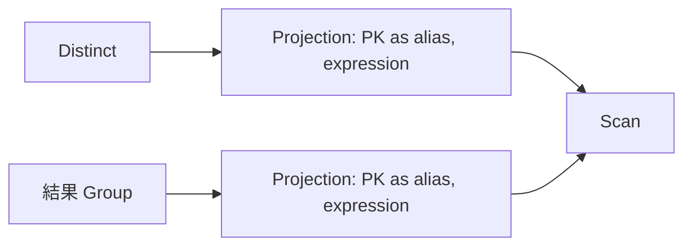

# pk_unique_distinct_elimination

- 状態: draft / 更新: 2026-10-02 (`9ce7837` 上の作業ツリー)
- 定義: `plan/cascades.cpp` の `RuleSet::Default()`

## 変換と条件

`Distinct(X)` の出力が既に一意であると証明できれば、X の式を結果 Group に
追加します。余分な Projection を足さないので、実行時の重複排除も射影 pass も不要です。



SQL の Distinct は target_list が空です。子が Projection なら、その素の列参照を
入力側のキーへ戻して、Projection の入力 Group の `IsUniqueOn` を調べます。
それ以外は子の output_schema（Scan は catalog schema も利用）で出力列を求めます。
別名でもキーを失いません。計算式はそれ自体を一意性の証拠にしません。

例えば `SELECT DISTINCT id AS k, a*2 FROM t` は id が PK なら除去できます。
`SELECT DISTINCT a FROM t` は id を落としているので除去できません。
nullable UNIQUE も複数 NULL を許すため証拠にしません。統計上 NDV=行数という
観測も、一意制約の代わりにはしません。

Scan をコピーする場合は元 Group の filter も移します。コピー先で WHERE を
失うと行数・値が変わるため、この条件は必須です。循環する自分自身は対象外です。

## 実装抜粋

```cpp
          // SQL's Distinct carries no target list. Prove uniqueness of the
          // actual child's output, mapping a projection back to its source
          // keys, and reuse that equivalent expression without another pass.
          // Copy candidates because AddExpression may invalidate storage.
          const auto candidates = input_group.expressions;
          for (const auto& child : candidates) {
            const LogicalProperties* properties =
                &input_group.logical_properties;
            std::unordered_set<std::string> columns;
            if (child.operation == LogicalOperator::kProjection &&
                child.children.size() == 1 && child.children[0] != group) {
              properties = &memo.Get(child.children[0]).logical_properties;
              for (const auto& target : child.target_list) {
                if (target.expression &&
                    target.expression->Type() == TypeTag::kColumnValue) {
                  columns.insert(target.expression->AsColumnValue()
                                     .GetColumnName()
                                     .ToString());
                }
              }
            } else {
              const Schema* schema = &child.output_schema;
              if (child.operation == LogicalOperator::kScan &&
                  schema->ColumnCount() == 0) {
                const auto found = memo.GetTableSchemas().find(child.table);
                if (found != memo.GetTableSchemas().end())
                  schema = &found->second;
              }
              for (size_t i = 0; i < schema->ColumnCount(); ++i)
                columns.insert(schema->GetColumn(i).Name().ToString());
            }
            if (!columns.empty() && properties->IsUniqueOn(columns)) {
              if (child.operation == LogicalOperator::kScan &&
                  input_group.filter)
                memo.MergeScanFilter(group, input_group.filter);
              memo.AddExpression(group, child);
            }
          }
```

## 検証

`CascadesTest.PkUniqueDistinctElimination` と
`CascadesRulesCoverageTest.DistinctUsesProjectedKeysAndStatistics` で構造・SQL・結果を確認します。
compliance の optimizer_null_uniqueness / optimizer_cse_projection も、nullable UNIQUE
を除去しないことと、キー保持射影の DISTINCT を除去することを検証します。
