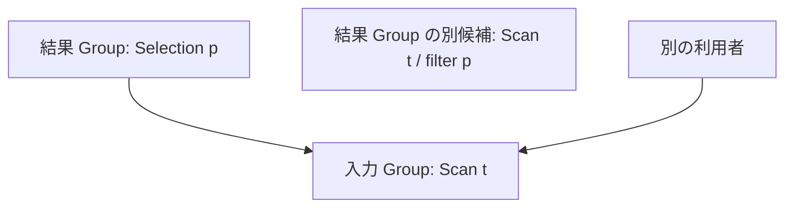

# push_selection_into_scan

- 状態: draft / 更新基準: `9ce7837` 上の作業ツリー (2026-10-02)
- 定義位置: `plan/cascades.cpp` の `RuleSet::Default()`

## 概要

Selection の述語を物理 scan の access-path 選択へ渡します。重要なのは、
共有される入力 Group を変更せず、Selection の結果 Group に filtered scan を
追加する点です。これにより外部結合や UNION の別枝を狭めません。

## 変換前後の関係



## 適用条件

`SelectionWithin(0, Scan("scan"))` が述語の存在と参照関係の閉包を確認します。
入力または結果 Group に `sample_barrier` がある場合は辞退します。
サンプリングより前へ WHERE を移すと標本自体が変わるためです。

## 意味論的根拠

結果 Group は既に「入力のうち p を満たす行」という意味です。その Group に
p を評価する scan を追加するのは同値です。入力 Group の意味は変更しません。
以前のように共有入力を狭めると、FULL JOIN 分解の別枝などから行が失われます。

## 実装の詳細

`RuleSet::Default()` からの抜粋です。

```cpp
          if (memo.Get(input).filter)
            memo.MergeScanFilter(group, memo.Get(input).filter);
          memo.MergeScanFilter(group, *expression.predicate);
          for (const auto& scan : memo.Get(input).expressions) {
            if (scan.operation == LogicalOperator::kScan)
              memo.AddExpression(group, scan);
          }
```

`MergeScanFilter` は連言を正規化し、変更を touched 通知します。
探索器は依存する親を再評価するので、新しい scan 候補と filter が物理選択へ届きます。

## 最適化効果

単一表の通常 SELECT も Memo に入り、この変換から index/full scan を比較できます。
元の Selection も候補として残るので、可用な方式を減らしません。

## 関連 Rule との相互作用

`merge_selections` が隣接 filter を一段にまとめます。
`push_filter_past_setop` の枝は child ID を含むタグで区別します。
範囲抽出は実際の scan filter を読みます。zone map は実行器で適用されます。

## 検証テスト

`cascades_test` の scan-filter 契約と親再訪、`phase0_contract_test` の
schema/order/estimate 契約、`optimizer_test` の FULL JOIN 分解を確認します。
