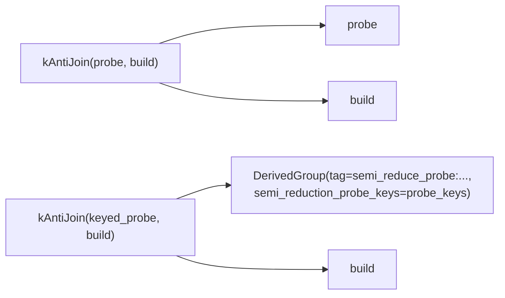

# semi_reduction_pushdown_anti_join

- 状態: draft / 更新: 2026-11-17
- 定義位置: `plan/cascades.cpp` の `RuleSet::Default()`（登録名 `"semi_reduction_pushdown_anti_join"`、パターン: `AntiJoin(Any("probe"), Any("build"))`、target: `LogicalOperator::kAntiJoin`）

## 概要

`kAntiJoin(probe, build)` の等値結合キーを検出し、probe 側グループに結合キー列の注釈（`Group::semi_reduction_probe_keys`）を付けた派生グループを生成する論理規則です。対となる `semi_reduction_pushdown_semi_join` と同じ `semi_reduction_annotate` ラムダを共有します。

## 変換前後の関係

## 適用条件

`plan/cascades.cpp` の `semi_reduction_annotate` により次を確認します。

1. `expression.operation == LogicalOperator::kAntiJoin` であり、`expression.predicate` が存在すること。
2. `memo.Get(group).relations.size() == 2` かつ親タグに `"semi_reduce"` が含まれないこと。
3. probe 子グループ `probe_id != group` かつ `memo.Get(probe_id).tag` が `"semi_reduce_probe:"` で始まらないこと。
4. 結合述語の連言から、左右の子をまたぐ `col_a = col_b` 等値キーのうち probe 側の列 `probe_keys` を 1 つ以上抽出できること。
5. probe グループが単一リレーションで、`sample_barrier` がなく、そのリレーションに対応する `kScan` 論理式が存在すること。

## 意味論的根拠（D5）

反結合も出力するのは probe 側の行のみであり、build 側は「probe のキー値に対して一致する行が存在しないか」の判定にのみ使われます。そのため probe キー domain による build 側縮約の候補を論理的に注釈しても結果は不変です。派生グループ `keyed_probe` は元の `probe` グループの `filter` を引き継ぎ、フィルタ欠落を許しません。

## 検証テスト

- `plan/cascades_test_part2.cpp`:
  - `CascadesTest.SemiReductionPushdownAnnotatesTheProbeKeys`
  - `CascadesTest.SemiReductionPushdownSkipsNonEqualityJoins`
  - `CascadesTest.SemiReductionPushdownAnnotatesEveryCompositeKey`
