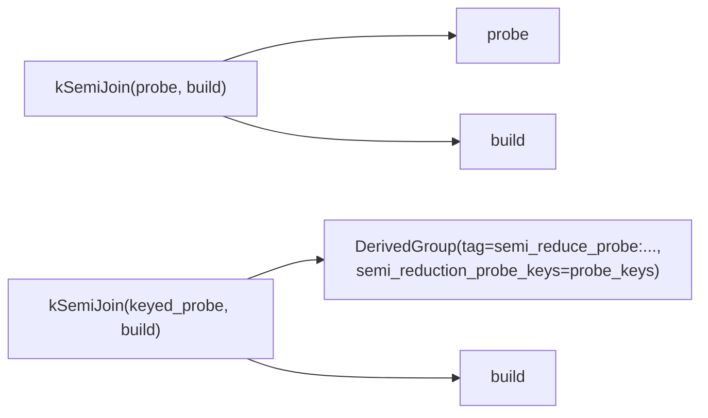

# semi_reduction_pushdown_semi_join

- 状態: draft / 更新: 2026-11-17
- 定義位置: `plan/cascades.cpp` の `RuleSet::Default()`（登録名 `"semi_reduction_pushdown_semi_join"`、パターン: `SemiJoin(Any("probe"), Any("build"))`、target: `LogicalOperator::kSemiJoin`）

## 概要

`kSemiJoin(probe, build)` の等値結合キーを検出し、probe 側グループに結合キー列の注釈（`Group::semi_reduction_probe_keys`）を付けた派生グループを生成する論理規則です（Phase 2 "Hash Semi Reduction"）。`semi_hash_join` 等の実装規則がこの注釈を受け取り、ビルド側の重複削減や probe キー domain による事前絞り込み（`ProductPlan::PreferSemiReduction`）を選択できるようにします。

## 変換前後の関係

規則自体は縮小手順（フィルタ種別やコスト判断）を持たず、「probe 側のどの列が結合キードメインを決めるか」という純粋な論理情報だけを記録します。

## 適用条件

`plan/cascades.cpp` の共有ラムダ `semi_reduction_annotate` が次の条件をすべて満たす場合のみ発火します。

1. `expression.operation == LogicalOperator::kSemiJoin`（兄弟規則 `semi_reduction_pushdown_anti_join` は `kAntiJoin`）で、`expression.predicate` が存在すること。
2. 親グループ `group` の `relations.size() == 2` であり、親タグに `"semi_reduce"` を含まないこと（二重適用防止）。
3. probe 子グループ `probe_id` が親自身ではなく、タグが `"semi_reduce_probe:"` で始まらないこと（不動点ガード）。
4. probe 側に対応する関係が 1 つで、`sample_barrier` がなく、その関係の `kScan` 式が probe Group にあること。
5. 結合述語の連言に左右別の子リレーションにまたがる等値比較 `col_a = col_b` が少なくとも 1 つあり、probe 側に属するキー列集合 `probe_keys` が空でないこと（自己結合や定数比較のみでは抽出されない）。

## 意味論的根拠（D5）

準結合は probe 側の行のみを出力し、build 側の列は返しません。したがって build 側は「probe キー集合に対して少なくとも 1 行一致するか」という存在判定だけに寄与するため、build 側を異なるキーごとの 1 行に縮約したり probe のキー域外の行を除外しても多重集合は不変です。

派生グループ `keyed_probe` には元の `probe_id` の `filter` をそのままコピーし、残余述語の消失を防ぎます。単一リレーションの `probe` であれば `kScan` 式も補います。

## 検証テスト

- `plan/cascades_test_part2.cpp`:
  - `CascadesTest.SemiReductionPushdownAnnotatesTheProbeKeys`
  - `CascadesTest.SemiReductionPushdownSkipsNonEqualityJoins`
  - `CascadesTest.SemiReductionPushdownAnnotatesEveryCompositeKey`
