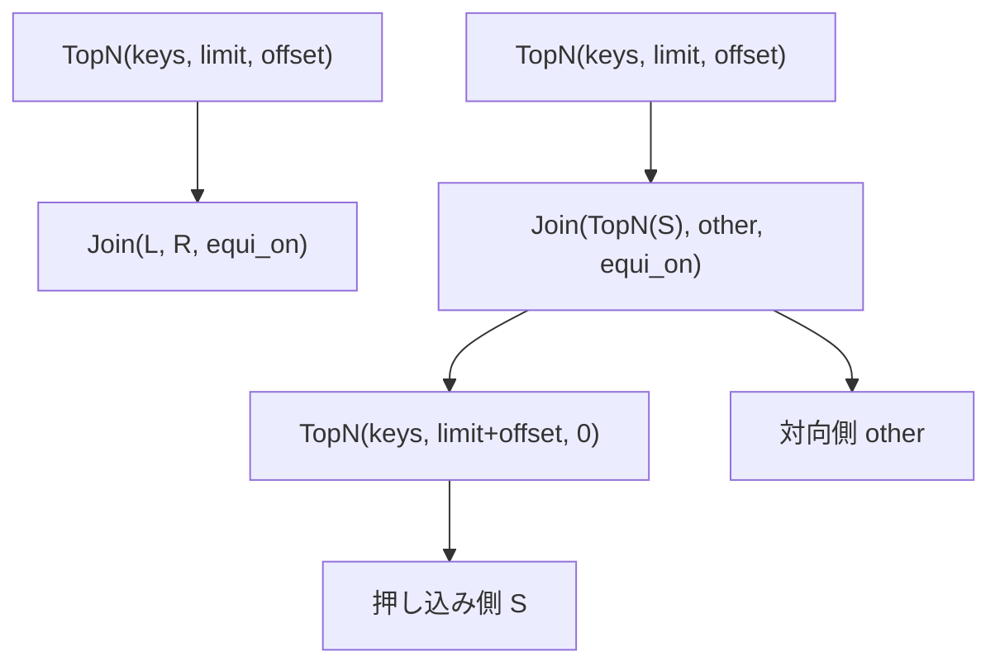

# topn_push_through_proven_one_to_one_join

- 状態: draft / 更新: 2026-11-17
- 定義位置: `plan/cascades.cpp` の `RuleSet::Default()`（登録名 `"topn_push_through_proven_one_to_one_join"`、パターン: `TopN(Any("input"))`）

## 概要

内部結合 `Join(L, R)` の上にある `TopN(keys, limit, offset)`（`WITH TIES` なし）について、押し込み側の各行が対向側の**ちょうど 1 行**と結合する（1:1 結合である）ことが証明でき、かつ Top-N キーが押し込み側の列のみで評価できるとき、押し込み側へ `TopN(keys, limit + offset, 0)` を押し込んだ `TopN(Join(TopN(S), other))` 代替を生成します。

## 変換前後の関係

## 適用条件

次のすべてを満たす場合のみ発火します（`plan/cascades.cpp`）。

1. **有限・タイなし Top-N**: `expression.operation == kTopN`、`children.size() == 1`、`!with_ties`、`limit_count + limit_offset` がオーバーフローせず `> 0`、`!target_list.empty()` かつ `target_list.size() == sort_ascending.size()`。
2. **二表等値内部結合**: `input` グループ内の `kJoin` 式で、左右の子がそれぞれ 1 リレーション（`left_relations.size() == 1 && right_relations.size() == 1`）であり、全結合連言が `col_l = col_r` の等値比較であること。
3. **Top-N キーの局所性**: `topn_keys` が参照するすべての列が修飾済みかつ押し込み側リレーション `pushed_rel` のみに属すること。
4. **対向側の一意・NOT NULL 性（高々 1 件の証明）**: `other_id` の `LogicalProperties::IsUniqueOn(other_join_cols)` と全結合キーの `IsNotNull` が成り立つこと（NULL 同士は一致せず、nullable UNIQUE は複数行になり得るため一意性だけでは不足）。
5. **少なくとも 1 件一致の証明**: `memo.IsProvenOneToOne(pushed_rel, other_rel)` が真であるか、または `pushed_id` 側の結合キー列が `other_rel` の同キーを参照する `Constraint::kForeign` を持ち、かつ押し込み側キー列も `IsNotNull` であること（NULL キーは外部キー参照先があっても一致せず 0 行になるため NOT NULL が必須）。
6. **対向側グループに scan filter がないこと**（FK フォールバックのみ）: `memo.Get(other_id).filter` が空であること。カタログの `Constraint::kForeign` 宣言は「参照先の行が存在する」ことだけを保証し、参照整合検査自体は未実装（`type/constraint.hpp` の `kForeign` は "Won't implemented"）であるため、オプティマイザはデータを見ずにこの証明を信用します。一方 `WHERE b.v > 5` のような単一リレーション述語は `push_selection_through_join` が対向側グループの scan filter にmergeしてしまうため、FK が保証する「ちょうど 1 行」をフィルタが落とし得ます。その場合、上位 `limit + offset` に入った押し込み側の行は素の結合では脱落する行を出力してしまいます。スナップショット証明（`MarkProvenOneToOneJoins`）は探索より前にスキャンを行いデータで包含を検証する代替経路であり、そちらの述語ゲート（後述）が同じ落とし穴を防ぎます。

## 意味論的根拠（D5）

旧 `push_down_limit_through_join` / `topn_push_through_inner_join` は右キーの一意性（各左行が高々 1 行と一致）しか検査していなかったため、一致しない左行が上位 `limit + offset` に入った場合に後段の結合で消え、元計画より少ない行を返す誤りが起き得ました（無効化済み）。本規則は「高々 1 行（UNIQUE + NOT NULL）」に加えて「少なくとも 1 行（FK + 押し込み側 NOT NULL またはオプティマイザの包含証明 `IsProvenOneToOne`）」を要求することで、結合と 1:1 対応する上限集合のみに適用を限定します。

各派生グループタグは `limit + offset`、押し込み/対向リレーション名、結合述語、およびソートキー/方向/NULL 順の署名を含むため、異なる条件同士でグループを共有しません（D1）。

## 検証テスト

- `plan/cascades_test.cpp`:
  - `CascadesTest.TopNPushThroughProvenOneToOneJoinWithForeignKey`
  - `CascadesTest.TopNPushThroughProvenOneToOneJoinRejectsNullableForeignKey`
  - `CascadesTest.TopNPushThroughProvenOneToOneJoinRejectsFilteredOtherSide`
  - `CascadesTest.TopNPushThroughProvenOneToOneJoinRejectsWrongForeignKeyColumn`
  - `CascadesTest.TopNPushThroughProvenOneToOneJoinRejectsResidual`
  - `CascadesTest.TopNPushThroughProvenOneToOneJoinWithSnapshotProof`
  - `CascadesTest.TopNPushThroughProvenOneToOneJoinSkipsWithoutProof`
  - `CascadesTest.TopNPushThroughProvenOneToOneJoinSkipsNonLocalKeys`
