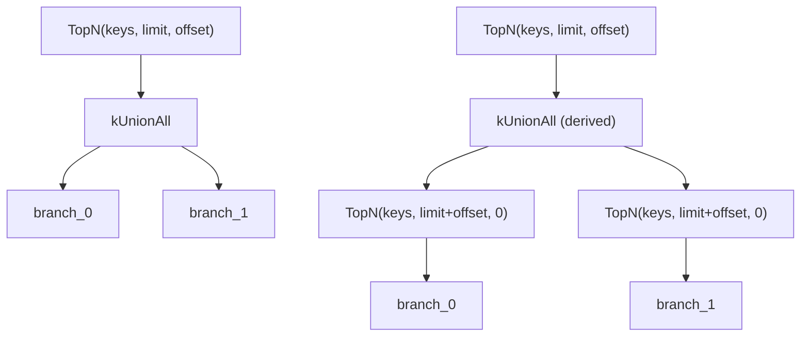

# topn_push_through_union_all

- 状態: draft / 更新: 2026-11-17
- 定義位置: `plan/cascades.cpp` の `RuleSet::Default()`（登録名 `"topn_push_through_union_all"`、パターン: `TopN(Any("input"))`、target: `LogicalOperator::kTopN`）

## 概要

`kUnionAll` の上にある `TopN(keys, limit, offset)`（`WITH TIES` なし）に対して、各子枝ごとに同じ順序キーで上位 `limit + offset` 件に制限する `TopN(keys, limit + offset, 0)` を押し込み、全体の最上位 `TopN(keys, limit, offset)` で最終順序と `OFFSET` を確定させる代替 `TopN(UnionAll(TopN(branch)...))` を生成する論理規則です。

## 変換前後の関係

## 適用条件

次のすべてを満たす場合に発火します（`plan/cascades.cpp`）。

1. 親が `LogicalOperator::kTopN`、子数 1、`!expression.with_ties`（タイ行が `limit + offset` を超えて残る可能性がある `WITH TIES` は対象外）。
2. `limit_count + limit_offset` が `size_t` オーバーフローせず `> 0` であり、`!target_list.empty()` かつ `target_list.size() == sort_ascending.size()`。
3. 入力グループ `input_id` に `children.size() >= 2` の `LogicalOperator::kUnionAll` 式があること。
4. いずれの枝にも同じソートキー・方向・NULL 配置かつ `limit_offset == 0 && limit_count <= limit_count + limit_offset` な `kTopN` がまだ載っていないこと（冪等・停止条件）。

## 意味論的根拠（D5 / D6）

各枝から全体の最終順位（`offset` 件飛ばした後の先頭 `limit` 件、すなわち通算上位 `total_limit = limit + offset` 件）に入り得る候補はその枝自身の上位 `total_limit` 件だけであるため、各枝を `total_limit` 件で打ち切ってもグローバル Top-N の結果は変わりません。押し込み先枝の `OFFSET` は `0` にリセットし、最上位の元 `TopN(limit, offset)` を残すことで全体の整列順序とオフセット（D6）を保ちます。枝側の派生タグには `child_id`、`total_limit`、およびキー・昇降順・NULLS 順の署名（`topn_key_signature`）を埋め込み、異なるソート仕様の混線を防ぎます（D1）。

## 検証テスト

- `plan/cascades_test_part3.cpp`:
  - `CascadesTest.TopNPushThroughUnionAllCapsBranches`
  - `CascadesTest.TopNPushThroughUnionAllSkipsWithTies`
