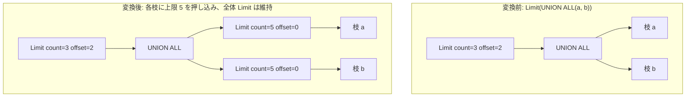

# union_all_push_limit

- 状態: draft / 執筆基準リビジョン: `3880673` (2026-09-12)
- 定義位置: `plan/cascades.cpp` の `RuleSet::Default()`（登録名 `"union_all_push_limit"`）

## 概要

`union_all_push_limit` は、`Limit(count, offset)` が `UNION ALL` の直上に配置されている場合に、各入力分岐に対して独立に `(offset + count)` 行の上限（capping）を押し込みつつ、全体の Limit 演算子を親ノードとして維持する Rule です。

各分岐から必要な最大行数のみを取り出し、不要なタプルの生成・走査を早期に打ち切ることで、UNION ALL の中間結果サイズを大幅に抑制します。

## 変換前後の関係

`LIMIT 3 OFFSET 2` の例:



## 適用条件

パターンは `Limit(Any("input"))` であり、対象演算子は `LogicalOperator::kLimit` です。変換ラムダ内で以下の条件を検証します。

```cpp
          if (expression.limit_count == 0 ||
              expression.limit_offset >
                  std::numeric_limits<size_t>::max() - expression.limit_count) {
            return;
          }
          if (memo.Get(bindings.at("input"))
                  .tag.starts_with("union-limit-setop:")) {
            return;
          }
```

発火条件および非発火条件は以下の通りです。

1. `limit_count > 0` であること（0 は tinylamb において無制限を意味するため押し込み不能）。
2. `limit_offset + limit_count` の計算が `size_t` の範囲内でオーバーフローしないこと。
3. 入力グループのタグが `"union-limit-setop:"` で始まらないこと（自己適用のループ防止）。
4. 入力グループ内に子ノード数 2 以上の `LogicalOperator::kUnionAll` 式が存在すること。
5. 枝ごとの派生グループ（`union-limit:<cap>`）が枝自身やルートグループと一致しないこと。

UNION DISTINCT に対しては、重複排除が分岐をまたいで行われるため本 Rule は発火しません。

## 意味論的根拠と多重度保存

多重集合における UNION ALL の結合順序と、Limit 演算子のタプル取得順序の一致が意味保存の論拠となります。

- **各枝の必要行数の上界**: UNION ALL は各分岐のタプルを多重集合として連結します。全体の先頭 $(offset + count)$ 行を決めるために、1 つの分岐から必要になるのは最大でも $(offset + count)$ 行です。他の分岐がすべて 0 行の場合でも、この上限は変わりません。したがって、各枝を `cap = offset + count` で打ち切っても必要な行は欠落しません。
- **全体 Limit の保持（親ノードの存続）**: 各枝に Limit を押し込むだけでは、全体の出力は最大で「枝数 $\times cap$」行となり、全体のオフセットも適用されません。元の `count` と `offset` を持つ親 Limit を残すことで、最終的な行数とオフセットを保ちます。
- **オーバーフロー保護**: `offset + count` の加算における算術オーバーフローを事前に検出し、未定義動作を防止します。

## 実装の詳細

`plan/cascades.cpp` における変換処理は、枝ごとの派生グループ生成と、キャップ済み UNION ALL の登録で構成されます。

```cpp
            std::vector<GroupId> limited_children;
            limited_children.reserve(setop.children.size());
            bool cycle = false;
            for (const GroupId child : setop.children) {
              const GroupId limited =
                  memo.EnsureDerivedGroup(memo.Get(child).relations,
                                          "union-limit:" + std::to_string(cap));
              if (limited == child || limited == group) {
                cycle = true;
                break;
              }
              memo.AddExpression(
                  limited,
                  LogicalExpression{.operation = LogicalOperator::kLimit,
                                    .children = {child},
                                    .limit_count = cap,
                                    .limit_offset = 0});
              limited_children.push_back(limited);
            }
```

1. 全枝に対して `limit_count = cap`, `limit_offset = 0` の `kLimit` 式を配置した派生グループを生成します。
2. 派生グループ `union-limit-setop:<cap>` に新しい子リストを持つ `kUnionAll` 式を配置します。
3. ルートグループにその派生グループを子とする元の `kLimit` 式を配置します。

## 最適化効果

各分岐の実行が最大 `cap` 件で早期停止（Early Termination）します。

スキャンノードへ Limit ヒント（`limit_hint`）が伝播することにより、ストレージ層での不要なブロック読み込みが抑制され、パイプライン全体のレイテンシが大幅に低減します。

## 関連 Rule との相互作用

- `push_limit_through_union_all`: 同種の Limit 押し込みを行う兄弟 Rule であり、枝側に既存の Limit がある場合の処理など一部のガードが異なります。
- `merge_limits`: 押し込まれた Limit と枝内に既存の Limit が合成されます。
- `union_all_merge`: UNION ALL を平坦化し、本 Rule がすべての枝を一括してキャップできるように下地を整える。

## 検証テスト

- `plan/cascades_test.cpp` の `CascadesTest.UnionAllLimitCapsEveryChildAndKeepsGlobalLimit`: `Limit(3, offset=2)` の下の各枝に `count=5, offset=0` の Limit が配置され、全体として元の Limit(3, 2) が維持されることを検証します。
