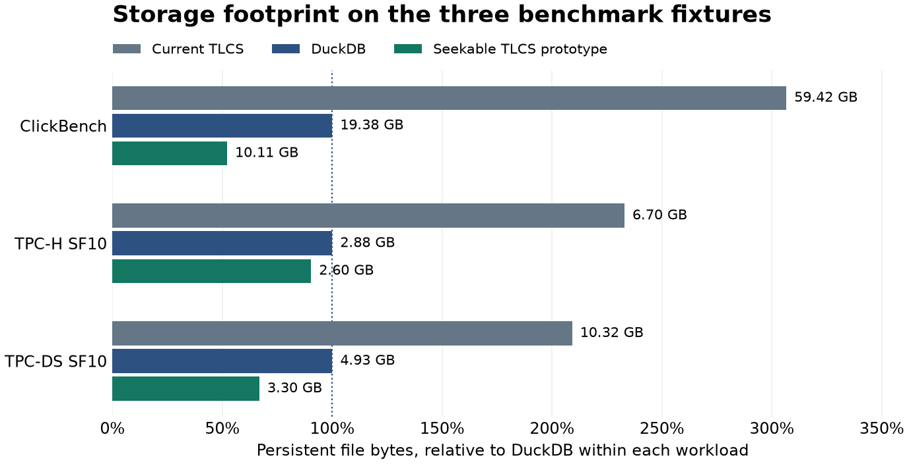

# 可逆圧縮の研究課題 228 件と DuckDB との保存サイズ比較

2026-11-24 に既存のベンチマーク用 DB を調べた。tinylamb の列ファイル（TLCS）を独立に復号可能な 1 MiB のフレームにすると、ClickBench・TPC-H SF10・TPC-DS SF10 の **3 データセットすべてで、試作形式の保存サイズが DuckDB を下回った**。実際に一時ファイルに書き、ディレクトリを読み直し、全フレームを復号して入力とバイト単位で照合した。これを出発点に、原値の復元、ヘッダ込みの採用条件、部分読取りを Lean の提出型にした。

## 全ファイルでの比較

| ワークロード | テーブル数 | 合計行数 | 現行 tinylamb (B) | DuckDB (B) | 試作 tinylamb (B) | 試作の対 DuckDB 削減率 |
|---|---:|---:|---:|---:|---:|---:|
| ClickBench | 1 | 99,997,497 | 59,421,543,500 | 19,384,250,368 | 10,114,664,031 | 47.82% |
| TPC-H SF10 | 8 | 86,586,082 | 6,697,242,348 | 2,875,469,824 | 2,598,364,046 | 9.64% |
| TPC-DS SF10 | 24 | 191,496,658 | 10,319,679,752 | 4,934,610,944 | 3,298,867,451 | 33.15% |



- tinylamb は同じ fixture の全 `*.db.tlcs.*`、`*.db`、`*.db.blocks.*` のファイル長を合算した。試作では各 TLCS のみをコンテナに置き換えた。後二者の合計は順に 170,182 B、16,828,643 B、553,322 B。DuckDB は比較ハーネスの対応する `reference.duckdb` のファイル長。両者とも WAL は集計外。tinylamb 側の WAL とそのメタデータは順に 10,749,338 B、13,257,293 B、4,572,454 B。ファイルシステムの割り当てブロック数は使っていない。
- Zstandard 1.5.7、レベル 6 で各フレームを独立に圧縮し、縮まなければ元バイトを保存する。32 B のファイルヘッダ、各フレーム 17 B の索引（物理位置、長さ、元データの CRC32、形式タグ）を含む。ClickBench の 1 MiB 版は 56,669 フレーム、索引とヘッダで 963,405 B。64 KiB 版でも、全バイトを復元でき、DB 全体で **11,912,994,395 B** だった。最大展開量を 1 MiB から 64 KiB に下げる代価は、この fixture で 1,798,330,364 B。
- これはオフラインで書いた試作形式の大きさ。現行 SQL エンジンが圧縮フレームを直接開く経路、点参照やスキャンの所要時間、更新時の書込み量は未検証。既存パスの論理オフセットや mmap による直接参照を、新形式の物理オフセットへ接続する必要がある。Lean では Zstandard を「対象フレームを可逆に変換する外部関数」として扱う。圧縮ライブラリの実装や全データに対する勝率は仮定していない。

## ClickBench のどこに余地があるか

105 列・3,052 ブロックのメタデータを全件集計した。TLCS 本体 59,421,373,318 B のうち、可変長文字列のデータと終点表が **44,625,476,335 B**、整数の frame of reference が 8,920,108,185 B、1 バイト辞書コードなどが 5,832,228,159 B。現行 writer は可変長列に行ごとの 32-bit 終点を書き、辞書コードは定数ブロックでも 1 B/行を使う。[TLCS の列形式](../../../table/tlcs_file.hpp#L50)・[書込み経路](../../../table/tlcs_file.cpp#L1092)

**タイトル・URL・参照元。** `Title`、`URL`、`Referer` の文字列本体だけでそれぞれ 9.49 GB、9.04 GB、6.66 GB。各列に約 0.40 GB の終点表が付く。比較 DB を DuckDB 2.0.0 で読み、`pragma_storage_info('hits')` の validity 以外を調べたところ、この 3 列の圧縮方式名はすべて `DICT_FSST`（順に 7,009、11,622、9,083 セグメント）。フレーズ辞書の課題では 1 バイト記号とエスケープに対する最短パース、辞書の採用費用、1 行だけの復号を扱う。[DuckDB のストレージ形式](https://duckdb.org/docs/stable/internals/storage)・[FSST 著者による実装と論文](https://github.com/cwida/fsst)

各 128 ブロックグループの先頭を取り、計 24 ブロック・各列 786,432 行を抽出。行順、重複、空文字を含むバイト列を照合した。下表はサンプルだけの合計で、全体の比率への外挿はしていない。

| 列 | 現行（本体＋終点、B） | ソート辞書の共通接頭辞＋bit-packed ID (B) | 可変長の語長＋DEFLATE 6 (B) | ブロックごとに 3 候補の最小 (B) |
|---|---:|---:|---:|---:|
| Title | 86,779,927 | 22,003,268 | 12,893,528 | 12,488,279 |
| URL | 76,678,606 | 28,455,780 | 15,135,173 | 14,779,657 |
| Referer | 58,497,879 | 20,811,564 | 12,936,067 | 12,936,067 |

新しい候補には 9 B のフレーム（タグ 1 B、行数と本体長が各 4 B）を課金した。現行候補には元の列ディレクトリを使う。DEFLATE はこの列別サンプル、Zstandard は上の全ファイル比較に使用した。

**時刻 3 列。** `EventTime`、`ClientEventTime`、`LocalEventTime` は参照 DuckDB では TIMESTAMP、tinylamb fixture では文字列で保存されている。各列の 99,997,497 行すべてで、各終点が 22 B 間隔、値が ASCII の `YYYY-MM-DD HH:MM:SS+00` に一致した。数字 14 桁を 47 bit に格納すると、先頭ゼロも元の綴りも戻せる。各列の先頭サンプル 786,432 行で実際にパックして各行のバイトを復元した。

1 列の本体＋終点は現行 2,599,934,922 B。全ブロックの行数から、候補は各列 587,512,763 B（ブロックごとに 9 B のヘッダと最終バイトの丸め込み）。3 列だけで **6,037,266,477 B** の削減余地がある。これは既存 TLCS に対する列形式単独の計算値で、全ファイルの Zstandard 実測と加算できない。書式が混在する場合の例外表、同じ日付を持つ列間での日付共有、文字列としての範囲検索も独立した課題にした。

## Lean の提出型

全 228 件を `def …Goal : Prop` として公開した。証明・反証は次の研究課題。小さな `#guard` は具体的な入力での実行例で、一般命題が成立するかどうかはそれぞれの前提による。

| モジュール | 件数 | 何を証明・反証するか |
|---|---:|---|
| [Container](../../TinylambOpt/ResearchGoals/Compression/Container.lean) | 17 | 混合フレームの完全復号、任意バイト範囲の読取り、実バイト節約と DuckDB の目標サイズとの関係、再配置、変更フレームだけの再圧縮 |
| [TemporalText](../../TinylambOpt/ResearchGoals/Compression/TemporalText.lean) | 12 | 時刻の元の綴り・順序の復元、47-bit 点参照、共有日付の 20-bit 時分秒、例外表の採算 |
| [Text](../../TinylambOpt/ResearchGoals/Compression/Text.lean) | 22 | バイナリ語、辞書の前方差分、ID の丸め、接尾辞、再始動費用、9 B フレームの復元と切断検出 |
| [PhraseTables](../../TinylambOpt/ResearchGoals/Compression/PhraseTables.lean) | 15 | URL 部分語の最短パース、辞書語の追加・削除、学習サンプルの偏り、複数ページでの辞書共有 |
| [Directories](../../TinylambOpt/ResearchGoals/Compression/Directories.lean) | 16 | 文字列終点の Elias–Fano 表現、空文字による重複、疎な select アンカー、走査上限、連結 |
| [IntegerFrames](../../TinylambOpt/ResearchGoals/Compression/IntegerFrames.lean) | 16 | 外れ値の上位ビットと位置、局所 FOR 幅、GCD による倍率除去、Rice パラメータの探索停止条件 |
| [Predictors](../../TinylambOpt/ResearchGoals/Compression/Predictors.lean) | 64 | 16 種類の予測器それぞれの復元、サイズ上限、再始動に必要な履歴、予測器固有の第 4 課題。周期・折返し・外れ値・列間時差・剰余を含む |
| [Nullable](../../TinylambOpt/ResearchGoals/Compression/Nullable.lean) | 18 | NULL と空・ゼロを区別して復元、少数側の位置、反転位置、NULL 専用コードで増える幅、列間マスク共有 |
| [BitPatterns](../../TinylambOpt/ResearchGoals/Compression/BitPatterns.lean) | 14 | binary64 の生ビットを保つ XOR 窓、bit plane、byte shuffle、例外つき縮小、負のゼロ |
| [Partition](../../TinylambOpt/ResearchGoals/Compression/Partition.lean) | 16 | 可変ページ境界の最適化、索引を含むコスト、推定誤差の上限、点参照の展開量と保存サイズの両立 |
| [Wire](../../TinylambOpt/ResearchGoals/Compression/Wire.lean) | 18 | ULEB、符号付き残差、ゼロ幅、部分ビット読取り、ヘッダとパディングを含む損益分岐 |

実装に近い入口は `Container.RandomRead` と `BeatTarget`、`TemporalText.PackedSeek` と `FixedWidthCharge`、`Text.FramedInverse`。大きいファイルを読み切れた実測に加え、ページ境界をまたぐ読取りや、採用判定がヘッダ費用で逆転する条件を一般化する。

反例も残してある。たとえば辞書語を `[1,2]`、`[1]`、`[2,3,4]` としたとき、入力 `[1,2,3,4]` は最長一致で 5 B、最適な分割で 2 B。恒等 codec で 2 B の入力を二つのフレームにすると、1 フレームの 51 B が 68 B に増える。終点が一つだけの `[1]` では、平均値から選ぶ下位幅を使うと 2 B、幅ゼロなら 1 B。貪欲パース、細粒度化、平均による幅選択の採用条件を検討できる。

## 追試

リポジトリ直下で実行する。全ファイルのプローブは Python 3.14 以降の標準 `compression.zstd` を使う。一時出力先には最大の圧縮ファイルを置ける空き容量が必要。プローブは入力を読み取り専用で開き、検査が終わると一時ファイルを閉じて削除する。

```bash
suite=build/benchmarks/three-db-sf10-20261122
probe=lean/issues/research/fixtures
for fixture in clickbench-tlcs-v3-fixture tpch-tlcs-v3-fixture tpcds-tlcs-fixture; do
  for file in "$suite/$fixture/"*.db.tlcs.*; do
    python3 "$probe/seekable_space.py" "$file" --scratch build/benchmarks --chunk 1048576 --level 6
  done
done
python3 "$probe/seekable_space.py" "$suite/clickbench-tlcs-v3-fixture/native.db.tlcs.11" \
  --scratch build/benchmarks --chunk 65536 --level 6
python3 "$probe/tlcs_space.py" "$suite/clickbench-tlcs-v3-fixture/native.db.tlcs.11" \
  build/benchmarks/clickbench-full-20261116/dataset/metadata.json --timestamp-census
```

最初のコマンドの `packed` を suite ごとに合計し、上記のカタログ・ブロックを足す。比較した DuckDB のファイルはそれぞれ次のとおり。行数は読み取り専用接続で実テーブルの `count(*)` を合計し、TLCS ヘッダの合計と照合した。

| ワークロード | DuckDB の比較ファイル |
|---|---|
| ClickBench | `build/benchmarks/clickbench-full-20261116/reference.duckdb` |
| TPC-H | `build/quality/tpch-scaling-20261117/sf10/dataset/reference.duckdb` |
| TPC-DS | `build/benchmarks/tpcds-sf-20261117/sf10-dataset/reference.duckdb` |

列の圧縮方式を再確認する SQL は以下のとおり。[DuckDB のストレージ情報](https://duckdb.org/docs/stable/configuration/pragmas)

```sql
SELECT column_name, compression, count(*) AS segments
FROM pragma_storage_info('hits')
WHERE column_name IN ('Title', 'URL', 'Referer') AND segment_type <> 'VALIDITY'
GROUP BY column_name, compression ORDER BY column_name, compression;
```

`cd lean && lake build` でパッケージ、実行例、CheckProofs をまとめて検査できる。
